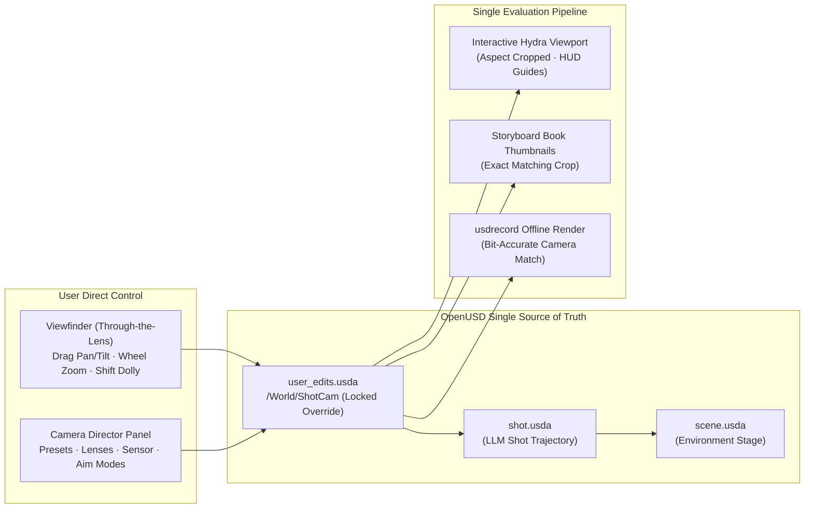

# PainterSpace

PainterSpace is a Qt / OpenUSD + Hydra Storm 3D storyboard studio where the composed USD stage (`user_edits.usda` over `shot.usda` over `scene.usda`) is the single source of truth for interactive editing, LLM shot generation, and rendering.

> [!IMPORTANT]
> ## THE FOUNDATIONAL ARCHITECTURAL LAW OF PAINTERSPACE
> ### General Scene-Graph-Driven Shot Planning — Never Hardcoded Scenario Scripts
>
> **This is the non-negotiable, foundational law of the PainterSpace codebase:**
>
> 1. **`LLMShotPlanner` ([`tools/shot_library/llm_planner.py`](tools/shot_library/llm_planner.py)) MUST ALWAYS be a general, compositional, scene-graph-driven planner — NEVER a hardcoded keyword script.**
>    - **STRICTLY FORBIDDEN**: Writing `if "some_scenario" in prompt:` template branches that emit pre-baked sequences or hardcoded 3D coordinate literals like `pos(0.0, 1.70, -11.37, 180.0)` or `cam_start = [-3.18, 6.2, 16.5]`.
>    - **WHY**: Hardcoded scenario scripts only work for the exact ~10 demo prompts they were written for and collapse on every new creative prompt a user types in the studio. Our goal is a **genuinely general animation engine** capable of rendering realistic, physically grounded animations for **any** prompt in **any** scene.
> 2. **Zero Raw Coordinates in the Planner (`pos(...)` Ban)**:
>    - The planner must **never** guess or hardcode raw `(x, y, z)` world coordinates, Euler rotation angles, or frame numbers.
>    - Every actor placement, target destination, surface interaction, stair traversal, and camera framing must be expressed strictly through **semantic references** resolved dynamically from the live `scene.usda` stage (`scene_data`) and [`manifest.json`](manifest.json):
>      - **Zone & Roadway Markers**: `lane_east.north`, `lane_east.south`, `lane_east.center`, `lane_east.stop_mark`, `lane_west.north`, `sidewalk_west.center`, `plaza.center`
>      - **Asset Anchors, Surfaces & Parts**: `car_1:door_fl_stand`, `car_1:hood_front`, `car_1:roof`, `car_1:hood`, `car_1:door_fl`, `in_vehicle="car_1"`
>      - **Dynamic Stair Portals**: `stairs_main`, `stairs_main_top`, `stairs_main_bottom` (discovered from `manifest.json` stair centerlines and tread geometry)
>      - **Relative Spatial Selectors**: `in_front_of(actor, gap)`, `behind(actor, gap)`, `beside(actor, left|right, gap)`, `left_of(actor, gap)`, `right_of(actor, gap)`, `nearest_to(actor, filter)`
>      - **Causal & Proximity Event Triggers**: `after="car_1.stopped"`, `after="human_1.arrived"`, `when_closer_than={"actor_a": "human_1", "actor_b": "car_1", "gap": "far"}`
>      - **Frustum-Solved Camera Vantages**: `camera_frame(actors=[...], style="wide"|"medium"|"close"|"top_down", vantage="eye_level"|"aerial", move="push_in"|"orbit"|"track_with")`
> 3. **Separation of Intent (LLM Planner) vs. Physics & Math (Deterministic Compiler)**:
>    - **The Planner (`llm_planner.py`)** decomposes any natural-language storyboard prompt into entities, semantic placements, and sequential/simultaneous `FunctionCatalog` calls (**76 fundamental building-block verbs** covering locomotion, expressive gaits, vertical/acrobatic traversal, world/device interactions, vehicle occupancy, social/emotional/performance choreography, combat/weapons/medical aid, and camera framing) — either via live LLM tool-calling (`_plan_with_llm_api` using auto-introspected `export_tool_schemas()`) or compositional clause analysis (`_plan_general_semantic`).
>    - **The Compiler (`compiler.py`, `motion_synthesis.py`, `camera_controller.py`, `bake_animation.py`, `validate_collisions.py`)** deterministically computes 4D space-time trajectories, obstacle-avoiding Catmull-Rom splines, stride-matched animation playback speeds, upper-body gesture layering, procedural gaze IK, 3D perspective camera frustum solving, and 48 Hz skeletal capsule collision verification/repair.
> 4. **Automated Enforcement**:
>    - `test_general_llm_planner_zero_hardcoded_coordinates` in [`tests/test_regression_issues.py`](tests/test_regression_issues.py) statically scans `tools/shot_library/llm_planner.py` and fails the build if a single hardcoded `pos(...)` coordinate literal is ever introduced.
>    - **Full Architecture Guide**: See [`docs/LLM_SHOT_PLANNER.md`](docs/LLM_SHOT_PLANNER.md) for a complete step-by-step walkthrough of how the LLM Shot Planner works.

## Current capabilities

- **Live OpenUSD + Hydra Storm Viewport (`UsdViewportWidget`)**:
  - Directly opens and renders composed USD stages (`shot.usda` sublayering `scene.usda`) using native C++ `UsdImagingGLEngine` (`HdStormRendererPlugin` / Metal) inside Qt.
  - Camera selector switching between `/World/ShotCam` and the Free Orbit Camera, with orbit, pan, zoom, a ground grid overlay, and a rotating compass in the 3D editor. The compass shows north (−Z), east (+X), south (+Z), and west (−X) as the view rotates.
  - Interactive timeline scrubber and play/pause controls for animated stages (including rigged `UsdSkel` characters).
  - Live reload (`QFileSystemWatcher` + post-LLM generation reload) that updates the viewport in-place without restarting the app while keeping your camera and frame position intact.
  - Fast hybrid raycast picking (sub-millisecond CPU BBox/Ray intersection with GPU context fallback), bounding-box selection highlight, and Move (`W`), Rotate (`E`), and Scale (`R`) gizmo overlays.
  - **Non-destructive `user_edits.usda` override layer**: all manual viewport edits (transforms, visibility toggles, reference asset additions, deletions, duplicates, and ground paint strokes) are written exclusively to `user_edits.usda`, never modifying the LLM's `shot.usda`.
  - When a generated shot animates an actor previously placed in its manual layer, the compiler and editor release the stale manual reference and static transform. This prevents a second copy of the actor and lets the generated route keyframes drive it through the final frame. Other manual edits remain in the override layer.
  - Generated routes can lengthen a shot beyond its initial camera-only duration. The editor updates the saved timeline and extends an undrawn camera path to the compiled duration; a deliberately drawn camera path keeps its own timing.
  - Adding a referenced asset expands the standard scene ground to cover its measured horizontal bounds. The ground keeps its height and thickness, and the size change is saved in `user_edits.usda` with the asset placement.
  - Visible **`Your changes`** layer toggle badge with per-prim reset, full layer reset, `Cmd+Z` / `Cmd+Shift+Z` undo/redo, and orphan warnings when a regenerated shot removes a manually edited prim.
  - Ground painting (`UsdGeomBasisCurves` strokes under `/World/Paint` in `user_edits.usda`) with adjustable brush color, size, opacity, and eraser tool.
- **Two-Step Scene & Shot Storyboard Workflow & Scene Versioning (`tools/scene_manager.py`)**:
  - **Step 1 (Describe & Edit Main Scene)**: Configure the shared scene (`scenes/scene_XX/scene.usda`) via an LLM prompt, the 3D editor, or both. Edits to the main scene can be saved independently (`Edit Main Scene` / `Save Main Scene`), automatically versioning snapshots (`scene_v1.usda`, `scene_v2.usda`).
  - **Scene-stage prompts**: The planner reads the shared scene with its `user_edits.usda` layer. Static setup stays in `scene.usda`. When the returned plan contains action beats, queue execution creates the next unused `shot_XXX/shot.usda`, compiles the action there, and opens that shot in the editor. The shot inherits the scene and can use measured stair portals and other scene references. Validated compiler calls reject action beats aimed directly at `scene.usda`.
  - **Non-Destructive Shot Inheritance**: New shots always inherit the latest version/state of the main scene, while older, already-compiled shots preserve their historical scene baseline without being mutated or broken.
  - **Step 2 (Individual Shots)**: Build and refine shots in a 3×3 storyboard book grid (`scenes/scene_XX/shot_XXX/shot.usda` + `user_edits.usda`), with Hydra-rendered thumbnails.
- **Minimalist 3D Editor UI (`src/MainWindow.cpp`, `src/UsdViewportWidget.cpp`)**:
  - Streamlined top toolbar featuring direct navigation (`Back to Shots Grid`), clean scene controls (`Edit Main Scene` / `Save Main Scene`, `Save Shot`), and a compact prompt input and shot generation button.
  - Distraction-free 3D viewport canvas with technical debug overlays removed.
- **Solid-Object Collision Prevention, Detection & Repair (`tools/collision/`)**:
  - [Crowd planning implementation guide](docs/CROWD_IMPLEMENTATION.md): the reproduced crowd issues, placement and joint-routing fixes, contact policy, validation evidence, configuration, performance implications and remaining limits.
  - [Crowd performance follow-up](docs/CROWD_PERFORMANCE_UPDATE.md): indexed reservations, conservative conflict culling, equivalent-order deduplication, corner-heading correction and cached camera projection. The updated club replay passes heading and camera checks as well as collision validation, with unchanged search budgets and sample counts. Component benchmarks and the still-unimplemented extensions are recorded explicitly; zero additional cost for every possible shot is not guaranteed.
  - Non-destructive `.norm.usda` asset normalization (meters, `Y`-up, `-Z` forward, base-center at `y = 0`), height-filtered compound collision boxes ($0.15\text{ m}$–$2.10\text{ m}$ so tree canopies are ignored while trunks and low branches block), live-articulated door colliders, and pre-cleared standing `anchors`.
  - Three-layer collision protection: **Prevent** (8-connected A* + string-pulling path planner [`plan_path.py`](tools/collision/plan_path.py)), **Detect** (48 Hz posed `UsdSkel` bone-capsule vs. OBB/actor signed-distance validator [`validate_collisions.py`](tools/collision/validate_collisions.py)), and **Repair** (up to 3 structured LLM retries, automatic path re-planning `--repair`, and a render gate). Coverage depends on the assets having suitable collision geometry.
  - The collision validator splits long shots into disjoint time ranges across up to four processes by default, retaining the full sample rate and merging violations into one report. Use `--workers 1` for serial diagnosis or `--workers N` to tune CPU and memory use. Short shots stay serial to avoid process startup overhead. This speeds up validation only; it does not change crowd path planning.
  - Before baking a shot, the compiler measures dance, combat, defense, reaction, dialogue and explicitly selected clip reach. It links prompt-created contact pairs before layout, relocates adjustable scene-derived standing placements on their original side, then jointly allocates independent pair arenas across both sides of their scene owner. This includes attack and reaction pairs without an explicit `stage_pair` call. Allocation uses travel cost, measured reach, solids and stationary actors. Repeated pairs reuse an arena; a later action by a pair inherits its earlier explicitly chosen center. Explicit coordinates, vehicle seats, and director-locked tracks keep their authored placements. Standing placement exhaustion returns `CROWD_SPACING`; bounded joint arena assignment can return `INTERACTION_LAYOUT_LIMIT`. Both passes commit their edits only after a full assignment succeeds.
  - With manifest envelopes, prompt-created meetings and adjustable ground `walk_to`/`run_to`/`jog_to`/`sprint_to` movements use safe-interval A* over measured support, continuous swept-disc checks against piecewise-linear actor reservations, and bounded departure-time sampling. Actors hold their final position until they actually move, and incoming destinations are checked through the next departure. Mid-route waits become ordinary movement and `wait` beats; original movement completion-event IDs survive splitting. A preliminary interaction schedule tells movement planning when actors vacate their starts, then approaches are rebuilt against the reserved movements. Ground movements use bounded conflict-directed priority search: independent paths are checked continuously, each conflict branches on either agent yielding, and paths are replanned under the resulting partial order. Unplanned movements reserve their fixed prefix rather than their guessed future route. Depth-first exploration retains alternative orders when a constrained route fails; route caching avoids solving unchanged queries again. This is priority-based coordination, not optimal CBS, PIBT, LaCAM or ORCA, and it has no completeness guarantee. Disjoint pair stages with the same explicit `at`, `after`, or `with` trigger synchronize as a wave; excessive added wave delay returns `INTERACTION_DELAYED`. Original triggers survive recompilation. Callers without envelopes retain the geometric route fallback.
  - If the compact arrival neighborhood around a ground-movement target is blocked, destination allocation searches farther rings up to the measured support extent on that floor. It still checks body and animation clearance, scene solids, other actors' timed reservations, and route support. The provisional timeline moves a driver to the vehicle's resolved door stand after `exit_vehicle`, so a later walk uses the ground-level position instead of the former seat position. The search remains bounded by `max_destination_nodes`; a distant arrival can still fail if no clear route exists.
  - Ordinary walking can cross low raised strips and curbs up to `WALK_OVER_MAX_HEIGHT_M` (0.20 m). The planner treats them as traversable when the floor remains supported, and motion synthesis lifts the root smoothly over their measured collision boxes while keeping the walk clip. Taller or unsupported obstacles remain blocking unless an explicit route uses the existing vault contract. Final posed collision validation still gates publication.
  - `ShotCompiler(..., crowd_config=CrowdSolverConfig(...))` accepts tunables from `tools/shot_library/crowd/config.py`: 0.3 m clearance buffer beyond actor and animation envelopes, 0.4 m planning cells, 0.25 s departure increments, 8 s added route/wave delay, 4,096 route expansions, 4,096 formation candidates, 128 joint priority-search nodes (`max_joint_nodes`), 48 layout beam entries, and 128 arena candidates per group. `schedule_prompt_interactions(..., crowd_config=...)` accepts the same configuration; its existing `max_route_attempts` bounds route queries. Failure details distinguish formation rejection and planner statuses; `CROWD_ROUTE_LIMIT` identifies an ordinary ground movement that exhausted its search. Joint node counts, conflicting agents and the coordination algorithm appear in route failure details. The old `priority_retries` parameter remains accepted for API compatibility; `max_joint_nodes` controls the new search. Grid, candidate, horizon, or priority exhaustion is **not** a proof of physical infeasibility.
  - Landscape planning reads upward-facing mesh floor geometry before deriving standing markers. Coplanar tile areas and support are combined, so a broad triangulated street is not replaced by a narrow collider ledge. The reader retains measured faces across the whole advertised floor level, including areas beyond the limited marker list; routes and fallback placement can use those faces while still checking scenery and level transitions.
  - Initial standing placement measures animation envelopes for the starting visit and first ground departure, using resolved beat times, and assigns the adjustable cast together before routing or synthesis. Performances after that departure reserve their full envelopes at their destinations instead of at the starting position. Callers without a resolved timeline keep the conservative whole-shot envelope; direct callers can supply `timeline_beats` to `space_standing_actors`. It first tries advertised standing markers; if those fail, it samples the measured owning floor with progressively finer grids, preserving the original local left/right side and support level. Full motion support, scenery clearance, fixed actors and any subsequent automatic meeting areas still constrain acceptance. Generated placements are saved as explicit setup coordinates, preserving heading, so saved plans do not depend on invented markers. Explicit coordinates, seated actors and director-locked tracks remain fixed. `standing_search_levels` (default 3 retries) and `standing_samples` (default 4,096 raw floor samples per adjustable actor across all levels) bound fallback sampling; each retry after the first doubles `layout_candidates` and `layout_beam_width` from their base values. Set these through `CrowdSolverConfig`. `CROWD_SPACING` includes measured actor radii, unsupported/solid geometry rejection counts, per-actor candidate filtering, pair conflicts, candidate/beam pruning and retry history. Sparse sampling or a bounded search can still miss a valid layout; failure does not establish that the floor is physically too small. This initial layout check does not replace later route and posed-animation validation.
  - Route searches first try sampled departure delays on a clear direct path, continuously checking the complete source wait, travel and destination hold. Spatial detours then use coarse-to-fine grids: `CrowdSolverConfig.route_grid_levels` defaults to 3 (four times the base cell size, twice the base size, then the base size). All levels share the existing `max_expansions` budget; this does not multiply the allowed expansions or relax actor, scenery or floor clearance. A low-level route failure now reports the actual `blocking_actors`. Joint priority search can branch on these adjustable actors even when the initial attempt failed before producing a complete set of routes. Fixed tracks and scenery remain authoritative, equivalent/cyclic orders are discarded, and `max_joint_nodes` still bounds retries. `CROWD_ROUTE_LIMIT` includes the blocking actors, grid levels and total expansions to distinguish exhausted spatial search from coordination failures. These searches remain bounded and incomplete.
  - Scheduled stationary actions now reserve timed **activity areas** independently of movement priority. An actor's earlier or later move does not release the space occupied by its current performance. Shared-action metadata reserves a conservative enclosing disc around the participants and their measured animation reach, including the gap between them; unrelated actors cannot route or arrive inside that active area. This applies to fights, conversations and other scheduled shared actions without scene-specific rules. Reservations expire with the action, and participants retain their intentional contact contract. Passing actors keep timed movement trajectories rather than reserving the entire crossing area, allowing checked waits. Destination allocation, routing, joint conflict checks and the final continuous root check use the same activity areas. Conservative enclosing discs may reject tight passages that would require more detailed choreography; they do not waive collision or support checks.
  - Validated compiles continuously check the synthesized piecewise-linear root trajectories for all plans, including authored motion without generated routes. Swept-disc checks include waits, final holds and animation-reach transitions, so fast crossings and short gestures cannot slip between frame samples. Intentional shared participants have a scoped interaction window; approaching partners still require body clearance. Only a contact pair can omit the extra clearance buffer while closing or holding its contact pose; unrelated actors retain the full 0.3 m buffer. Measured overlaps feed the existing bounded replanning loop. The final posed-animation validator remains sampled and separate. A missing validator, missing/stale result, missing collider coverage, or failed check cannot certify a shot. `validate=False` remains an explicit development/preview bypass, skips repair and collision certification, and is not used by production queue compilation. Sampled posed-body validation does not prove freedom from skeletal collisions between samples.
  - Formation search deduplicates actor-slot arrangements before spending its candidate budget. Repeated floor-mesh edge directions and already-staged orientations cannot consume the budget by retrying the same geometry; the original coordinates still receive support, clearance and route checks. Formation-budget failures include the most frequent blocking actors, alongside rejection counts and route-planner statuses.
  - The latest [collision audit](docs/CROWD_COLLISION_AUDIT_RESULTS.json) recompiles the saved 20-character shot in isolation, successfully bakes all actors, passes continuous root checks and reports zero disallowed collisions across 2,553 independent posed-animation samples. It uses the existing contact policy and default planning budgets, with no repair retries. The original shot remains unchanged; the combined test and phase suite passes 332 tests.
  - Generated clip actions preserve their floating-point start/end times and playback speeds through JSON serialization. Short route segments and slow final steps reach the animation baker without rounding their duration or speed to zero. A path whose destination is already reached becomes a stationary hold using the normal wait clip; it preserves position, heading and the movement completion event instead of emitting an invalid zero-speed walk or run.
  - Crowd overlaps trigger bounded replanning from the original input, never direct edits to checked roots. `CrowdSolverConfig.max_repair_attempts` (default 3 retries) and `max_repair_clearance_m` (default 1 m extra buffer) bound the work. Each retry increases the planning buffer by the measured clearance deficit or penetration depth, with a minimum of half a planning cell, up to the configured cap. Standing allocation, arrival positions, routes, waits, synthesis and both validation stages rerun; authored paths and fixed action windows retain their contracts. The final collision validator no longer performs an independent root-edit repair. Failures unrelated to spacing, such as missing coverage or unsupported levels, stop immediately. Current limits include conservative shot-wide arena reservations, sequential interaction priorities, no inferred waves for missing triggers, and no localized wave repair loop; a bounded attempt can still fail.
  - Generated character-contact exemptions identify the intended counterpart by instance ID/name and expire at the action's exact end. They do not exempt every copy of the same character asset. Untargeted reactions, guards and collapses no longer generate wildcard contact exemptions. The configured incidental limb-contact policy still applies.
  - Vehicle seating fits an occupant's root height to the vehicle cabin roof using the character's manifest height, appearance scale and the vehicle's cabin or body bounds. This applies when a character starts in a seat, drives, or enters a vehicle. Driving uses the driving clip when available. Entry lowers the character before crossing into the cabin; exit moves the character outside before raising them. The roof protrusion check remains active for body points under the roof throughout those transitions. The linter accepts a below-ground rig root only for keyframes explicitly supported by a vehicle seat or door transition, while it continues to reject underground pedestrians.
  - Validated attempts write to private sibling staging directories. Only a passing candidate is promoted to the shot directory; failed attempts preserve the current shot, animations and editor edits. Promotion detects edits made during compilation and rolls back a failed file replacement; it replaces individual files with the root layer last, rather than atomically swapping the whole directory. Input scene snapshots may still be created beside the shared source scene. Reports include `crowd_repair` attempt history, planning buffers and the terminal failure; failed reports do not advertise discarded artifact paths. Use `ShotCompiler(..., crowd_config=CrowdSolverConfig(max_repair_attempts=5, max_repair_clearance_m=1.5))` to tune repair budgets; zero retries disables repair while keeping validation mandatory for validated compiles.
  - `defend_or_block(actor, threat=...)` also accepts `attacker=...` or `target=...`, using actor IDs or labels. All three forms identify the opponent for shared attack/defense scheduling, preventing an unintended extra reaction followed by an unpaired defense. Conflicting aliases return `DEFENSE_TARGET` without adding a beat; omitting the opponent still permits a standalone guard.
  - Ground moves between different support levels now return `CROWD_LEVEL_TRANSITION` with the actor, beat and endpoint heights instead of silently bypassing crowd routing and using an unreserved spline. Choose an arrival on the same floor or author an explicit stair/vertical route; the XZ crowd solver cannot infer a safe connection between floors. Later prompt meetings are scheduled even when preceding movement uses authored paths. Standing allocation also reserves cumulative dance root travel using resolved beat durations and the same style speeds as synthesis, so a translating dance needs more room than its skeleton alone. Path sampling retains every polyline corner at its traversal time, including eased paths, to prevent interpolation from cutting across checked route edges.
  - Ordinary ground-movement targets are arrival **areas**. Before routing, the compiler scatters arrivals around their requested points, with separation equal to the actors' clearance radii plus the configured buffer. Candidate positions use concentric rings whose pitch and angular spacing derive from those radii; nearby slots on the actor's approach side are preferred. The allocator filters stationary characters, floor edges and measured scenery, then assigns the most constrained arrivals first and backtracks over earlier choices when another actor cannot fit. It reserves each position throughout the arrival hold; visits on different floors or at nonoverlapping times may reuse horizontal space. Following gestures and fights contribute their measured reach. The original requested target and completion event survive regeneration. Authored paths and fixed director windows retain their explicit contracts. `destination_rings` (default 6), `destination_candidates` (default 256 per request), and `max_destination_nodes` (default 4,096 tentative placements) bound the search. Configure them through `ShotCompiler(..., crowd_config=CrowdSolverConfig(...))`. If the bounded search cannot assign everyone, `CROWD_DESTINATION_LIMIT` reports its budgets and returns no partial layout. Arrival slots still pass through reserved movement routing and collision validation; a clear endpoint alone does not certify the route.
  - Adjustable movements immediately before an automatically allocated pair interaction use its meeting area, including runs that lead directly into a fight. Automatic meeting areas are selected on the participants' existing support level, even if the suggested center belongs to a different scene object. This keeps approaches on their floor instead of sending them to lower ground and back. Requested targets remain in `crowd_movement_source` for regeneration; resolved endpoints appear in `arrival_position`.
  - Prompt-linked pair actions reserve one shared contact area while routes are negotiated, including a partner waiting for the action to start. A free-form `approach` immediately before that pair action is routed by the interaction scheduler, which chooses a supported arrival and shared start. Explicitly timed or drawn approaches retain their authored route and timing.
  - If an exact arrival is blocked, an actor already close enough can stay at its clear current position. If routing to the allocated slot fails, the planner tries nearby supported stops, checking other arrival reservations, solid clearance and the full stationary hold. `CrowdSolverConfig.arrival_tolerance_m` (default 2 m) bounds these fallback stops relative to the requested arrival area; `arrival_route_candidates` (default 8) bounds extra route attempts. Setting the tolerance to zero disables approximate fallback. Authored paths, fixed windows and paired contact spacing keep their existing contracts. Arrival holds reserve the protected reach of following actions, including fights, rather than only the smaller walking radius. This prevents another route from occupying the space needed after arrival.
  - The archived 20-character club replay now compiles and passes collision validation with zero penetrations at 3,379 samples under the requested limb-contact policy; the suite now has 230 passing tests. The performance follow-up also resolves its heading and camera warnings. See [`CROWD_PERFORMANCE_RESULTS.json`](docs/CROWD_PERFORMANCE_RESULTS.json) for the updated results, [`CROWD_JOINT_VALIDATION_RESULTS.json`](docs/CROWD_JOINT_VALIDATION_RESULTS.json) for the earlier replay provenance, and [`CROWD_VALIDATION_RESULTS.json`](docs/CROWD_VALIDATION_RESULTS.json) for the collision report.
  - Character-to-character clearance now defaults to **full-body separation**, including arms and legs, for initial placement, meeting areas, arrival positions, movement routes and pre-bake checks. The compiler forwards the same policy to serial and parallel posed-animation validation. Intended interaction contacts retain their scoped exceptions. `CrowdSolverConfig(allow_actor_limb_contacts=True)` explicitly permits incidental limb contacts while still protecting the pelvis, torso, neck and head. Character-to-object checks always retain full limb clearance.
  - Standing placements use bounded joint layout search instead of committing nearest spots one actor at a time. The search can rearrange earlier placements to fit later actors and tries retained alternatives when a layout blocks a later pair meeting. It preserves each actor's floor, scene owner and side, checks the full animation envelope against floor edges and scenery, and commits only a complete layout. `layout_beam_width` and `layout_candidates` control the search; `CROWD_SPACING` includes candidate counts and budgets when it fails. Failure within these budgets does not prove that the cast cannot fit.
  - Dancing stays at the allocated root position by default for every style, including moonwalk. Use `dance(actor, style="moonwalk", travel="travel")` for intentional backward travel; its full duration still contributes to the reserved swept area. `travel="in_place"` is the default. Authored skeletal motion remains part of the measured animation envelope.
  - For standalone validation, `--strict-actor-limbs` selects full-body checking; the standalone validator's default still permits incidental limb contacts. Reports include `actor_contact_policy: "core_body"` or `"full_body"`. Unknown skeleton segment names remain protected. Conservative envelopes can reject tight scenes requiring pose-specific choreography; relaxing limb contact does not guarantee that a route exists.
- **Deterministic Shot Function Library (`tools/shot_library/`)**:
  - **Plan, Logic, Execution**: The LLM plans shots strictly by calling a closed vocabulary of named semantic functions (`walk_to`, `run_to`, `dodge`, `drive_to`, `argue`, `attack`, `jump_on`, `camera_frame`, etc.) without ever authoring raw OpenUSD text, coordinates, headings, frame numbers, or camera angles.
  - **Actor Registry & Identity (Phase 0)**: Permanent unique IDs (`human_1`, `car_1`), human-editable labels, auto-assigned appearance variants for identical assets (clothing tints, height scale, descriptive tags), prim `customData` serialization, floating name tags in the 3D viewport, and actor tree synchronization.
  - **Core Compiler & Timeline Resolver (Phase 1)**: Dependency graph resolution, cycle detection, physics/clip duration calculation, settle holds, and automatic idle fills between beats.
  - **Prompt and Shared Action Timeline**: Generated character actions appear on the timeline; users can add linked actions for selected participants; prompt-created meetings synchronize arrivals using each character's route.
  - **Vehicle Kinematics (Phase 2)**: Speed profiles (acceleration, cruise, braking), path tangent headings, wheel spin ($\Delta s / r_{wheel}$), steering angle ($\arctan(L \cdot \kappa)$), braking pitch, and `stop_short`, `near_miss`, and `collide` modes.
  - **Directional locations and headings:** `place(..., at_reference="east")` and compass movement targets resolve to measured supported boundary regions, with body-sized clearance against scene solids. Cardinal and diagonal directions (including aliases such as `north_east`) use world axes and `entry_region_fraction`; they no longer mean fixed offsets from the actor or origin. Missing support geometry or an obstructed requested side produces an explicit resolution failure. New directional movers participate in bounded starting-layout search for clear, reachable departures, constrained to their requested side. Vehicle placement and synthesis share a bounded route planner, so accepted detours are the paths actually animated; failure within the configured search budget reports `START_ROUTE_LIMIT` or `VEHICLE_ROUTE_LIMIT`. Coordinates, named anchors, existing actors, seats and Director-authored paths/windows retain their placement authority. `facing_reference="west"` remains a heading independent of free-space availability. Final animation collision validation still decides whether a candidate can be published.
  - **Vehicle travel clearance**: Ordinary vehicle moves plan body-sized routes over measured support geometry and around static solids. Vehicle checks include low obstacles (without the pedestrian step-over exemption) and the asset's measured height for overhead clearance. Placement and synthesis share the route planner, and synthesized keys retain each route vertex so interpolation cannot cut corners. Moving-vehicle separation is checked continuously between trajectory keys. Relative vehicle destinations such as `beside(car, right)` reserve both body sizes plus the named free-space gap. `drive_toward(..., mode="stop_short")` may shorten its approach to preserve clearance; ordinary `drive_to`/`reverse_to` cannot silently report arrival after stopping short of a blocked destination (`VEHICLE_DESTINATION_CLEARANCE`). A check before baking covers every vehicle root segment, including authored paths and stationary holds (`VEHICLE_ROUTE_CONFORMANCE`). Existing authored paths are not rewritten. Conservative footprint discs can reject tight but physically feasible maneuvers; bounded route search can also exhaust its budget. Final posed-animation validation remains mandatory before publication.
  - **Vehicle exit and walking clearance**: A character keeps a seated pose while moving out of the cabin, then begins a standing animation only after the root reaches free space. The stand point is outside the host's measured footprint with room for animated limbs and an extra 0.15 m routing buffer. Walking destinations near actors exclude vehicle footprints, and pedestrian routes use a visibility graph around blocking objects so the line segments remain clear. If no clear route exists, compilation reports `ROUTE_CLEARANCE_FAILED` instead of sending the character through the obstacle. These footprint circles are conservative; intentionally touching a vehicle requires an explicit contact action.
  - **Moving character targets**: When one character travels to another character who moves during the shot, synthesis resolves the target's trajectory first. The traveler then aims at the target's position at arrival time instead of the target's initial seat or placement. Circular movement dependencies report `ACTOR_TRAJECTORY_DEPENDENCY`; simultaneous mutual pursuits require a joint trajectory plan.
  - **Interaction-aware LLM planning contract**: The queue and live planner instructions ask the LLM to identify participants, required actor states, and causal events across the whole shot before emitting calls. Later travel to a person uses that actor's ID and an `after` dependency when the narrative requires a prior state change. Tool descriptions for actor travel expose the arrival-time resolution rule. Compilation remains the final authority for geometry and timing; prompt instructions alone cannot certify every narrative interpretation.
  - **Compiler-resolved spatial contracts:** `scene_context.spatial_regions` and `list_spatial_regions()` expose compact scene-owned `floor` and `approach` region IDs, measured heights/bounds, source owners and descriptions. IDs fingerprint geometry; stale or invented references fail explicitly. An approach region describes free floor near measured obstacles owned by a static source object, including compound landscape owners. It does not identify doors, interiors or individual component buildings. Call `stage_region_approach(intent_id, actors, source_region, destination_region, departure_timing="simultaneous", gait="walk", after=[...], asset_id=...)`. It reuses placed actors or identities from `scene_context.existing_actors`, and creates setup actions for new actors. Use `asset_id` to choose a listed character asset for new actor IDs. A wholly new cast may omit it when `manifest.json` configures `defaults.character_asset_id`, or when the manifest has exactly one character asset. Adding new actors alongside existing actors requires an explicit asset choice; unresolved references cannot silently extend an existing cast. New IDs must be valid identifiers and all participants must be distinct (including aliases and case variants). Cast creation and staging commit together only after the declaration validates. The executor stops at the first failed call, so a failed approach cannot continue into dependent performances. It emits one movement per actor and an interaction named by `intent_id`; do not also emit individual walk/run calls. Declare a following shared performance with `timing: "simultaneous"` and `after: [intent_id]`. Supported gaits are `walk`, `run` and `jog`. The compiler selects actor-specific source positions, destination positions, headings and nominal travel durations from measured geometry and body/animation envelopes, then uses the existing reservation-based routing and final animation validation. Explicit starting coordinates and non-standing authored source references are preserved if compatible; ordinary standing markers remain placement preferences. Authored durations are retained. Authored routes, exact windows and Director tracks cannot be overwritten. Only an initial, unseated character approach on the same support level can allocate a starting position; later relocation and cross-floor travel need explicit routes.
  - Spatial allocation commits only complete source-and-arrival layouts. It seeds gathering formations from the measured approach direction and required actor spacing, samples/refines supported floor geometry, and tests continuous proposed departures for conflicts. Arrival scattering and route alternatives remain constrained to the declared destination region and source-side direction. After synthesis, actual departures and arrivals must still satisfy region membership and direction, including the existing low-step/curb walkover allowance. The planner's review can mark a valid region contract as pending geometry; the compiler binds it before the final plan review, routing and synthesis. Plan serialization and successful validation reports retain `spatial_intents` and their binding proposals. Regeneration rebuilds from the region contract rather than trusting an old placement or silently substituting a numbered standing marker.
  - Spatial search reuses `CrowdSolverConfig.standing_samples`, `standing_search_levels`, `layout_candidates`, `layout_beam_width` and `max_joint_time_s`. These bound per-region sampling/refinement, joint endpoint assignment and the binding time allowance. `max_repair_attempts` also bounds checked alternative layouts after spatial or route failures; deterministic grid offsets and alternative gathering centers change the proposal without changing the contract. Each attempt rebuilds original input, and a failed validated compile preserves the accepted shot. `SPATIAL_REGION_REFERENCE`, `SPATIAL_REGION_LEVEL`, `SPATIAL_INTENT_LOCKED`, `SPATIAL_INTENT_LIMIT` and `SPATIAL_INTENT_CONFORMANCE` report unsupported references, levels, overrides, bounded search failure or actual-motion violations. Sequential allocation of different contracts reserves their source and destination areas conservatively; direct-path proposal filtering and finite search are incomplete, so a limit error is not proof of physical impossibility. Prepare a new request to refresh its region inventory and tool schema; existing low-level plans are not silently migrated.
  - **Prompt/plan review before compilation:** JSON, live and fallback planner results now pass a read-only review before routing or animation synthesis. Direct compilation performs the same review, so bypassing the planner does not bypass it. The review rejects explicit equal-start requests implemented as one-by-one, overlap-only or independently timed actions; checks one-by-one requests for completion dependencies; checks ordered group phases for missing arrival barriers; and checks `from the direction/side of <source>` against scene object names and manifest aliases/tags. Source-side checks use resolved placements and arrivals with measured owner obstacle footprints, or an object position when no footprint is available. Compound landscape pivots are not treated as individual building entrances. Unresolved recognized directions or timing cues report missing evidence instead of inventing a location. Explicit Director tracks take precedence and are recorded as overrides. Failures return `PLAN_REVIEW` with requirement evidence, affected action IDs and qualitative revision advice; rejected API plans return to planning before compilation, while queue feedback requests revised calls. Existing accepted shot artifacts remain protected by validated compilation transactions. Successful validation reports include `plan_review`. This is a bounded English grammar using function names, common inflections and a small action synonym vocabulary, not unrestricted natural-language verification: it covers explicit timing cues, ordered phases and from-direction clauses, and does not establish interiors/exits, every possible paraphrase, actor-count fidelity, or collision freedom. The normal route and final animation checks remain required.
  - **General arrival origins and route constraints:** `stage_region_approach` accepts any listed `floor`, boundary `entry`, obstacle-side `approach`, or exterior `corner` region as an origin. Pass `source_regions=[...]` with one region ID per actor (in actor order) for independent origins, or use `origin_layout="opposite"` / `"surrounding"` to allocate two opposing sides / all four world-axis entry bands of the destination floor. With automatic distributions, set `source_region` to the destination floor ID; explicit `source_regions` cannot be combined with an automatic distribution. Opposite requires at least two actors; surrounding requires at least four. These constraints are independent of gait, departure timing and the later activity. Explicit initial positions remain authoritative and must satisfy the selected origin areas. `CrowdSolverConfig.entry_region_fraction` configures the boundary bands from measured floor dimensions.
  - **Route-aware starting positions:** Automatic region arrivals choose corner waypoints before selecting starting positions. Source candidates are ranked by clear, supported travel through the required waypoints to the destination, with bounded static routing used to reject unreachable complete layouts. Source seeds approach the first waypoint rather than lining up with the final gathering point, and generated headings face the first route leg. Simultaneous groups seed followers with body-sized headway adjusted for turn angles, and proposed routes through the waypoints are checked together before committing the layout. Standing-marker choices also favor unobstructed first departures while retaining their owner/side/level constraints. New characters using `walk_to`/`run_to`/`jog_to`/`sprint_to`, and vehicles using `drive_to`/`reverse_to`, with no assigned location receive joint, body-sized, reachable starts on measured same-level floors. These proposals keep a clear provisional start where possible and use configured sampling/layout/search budgets. Existing actor positions, explicit coordinates, semantic origins, seats, authored paths/windows and Director tracks remain authoritative. Unresolved or moving/relative targets stay with the motion scheduler. A bounded placement failure returns `START_ROUTE_LIMIT` without partial placement changes. Static reachability does not certify crowd timing or vehicle steering; normal routing, synthesis and collision validation still run.
  - **Walkable free space:** Crowd routes may use any measured, supported flat space with sufficient body clearance, including gaps between buildings and areas without standing markers. All measured flat mesh faces remain available for route support; placement markers do not define a walkable mask. For objects with measured solid geometry, routing checks those solids instead of also blocking an enclosing whole-object circle. Objects with missing or incomplete collision coverage retain the conservative fallback. Walls, furniture, unsupported gaps, incompatible heights, actor reservations, and explicit origin/waypoint/destination constraints still apply. Search remains bounded; this does not turn a search-limit failure into proof that a route is impossible.
  - **Shared environment colliders:** The compiler reads manifest collision shapes through the final validator's `world_groups()` geometry code. Mixed cube/mesh assets retain all manifest blockers, and articulated parts contribute their composed pose, including parent rotation and scale. Placement, corner selection, and ground routing therefore see these shapes before animation baking. Collider-derived thin support faces use the same transforms. The scene snapshot retains object, shape and part identifiers for diagnosis; regenerate after editing geometry or a part pose. This static snapshot does not predict later environment animation, and the final posed-body collision gate remains required.
    Run `.venv/bin/python -m pytest tests/test_environment_routing.py` for missing-collider, transformed-part and corner-route regressions, including a validated east-to-south walk on the residential intersection asset.
  - **Region IDs in ordinary placement and movement:** The shared semantic resolver accepts current measured `floor`, boundary `entry`, and exterior `corner` IDs directly in `place(at=...)` and movement targets such as `drive_to(target=...)` or `walk_to(target=...)`. It chooses a supported, obstacle-free point inside the selected region using the mover's asset bounds, character collision radius and appearance scale; vehicles use a conservative circumscribed body radius. Entry resolution projects the live mover position onto the boundary band and favors clear approaches, then searches measured samples if needed. Corner points remain local to the measured corner. Sampling, time and clearance use `CrowdSolverConfig`; the region is never replaced by a different area to make a large mover fit. Ordinary crowd destination alternatives retain the region constraint. Static endpoint selection does not certify a complete route or vehicle turn; downstream routing and collision checks remain required. Unknown/stale IDs and regions with no body-sized clear point fail explicitly. Unresolved setup locations now return `UNRESOLVED_REFERENCE` with `role: "starting_location"` instead of silently placing the actor at a default coordinate. Existing anchors, zones, markers and coordinate references retain their meaning. A resolver owns one scene snapshot; create a new resolver after editing scene geometry.
  - **Directional destinations:** `destination_region` accepts a listed `floor` or boundary `entry` ID. Use a floor for an interior gathering, or a boundary entry band to keep arrivals on a requested side (for example, an east origin, ordered corner waypoints, and a south boundary destination). The band remains the arrival constraint during allocation, routing alternatives, final synthesized-motion validation, and saved-plan regeneration; its `support_region` supplies the underlying floor identity for automatic origin distributions. This targets supported space in a boundary band, not an off-stage exit or indefinite walking. Approach and corner areas remain origins/waypoints, not arrival areas.
  - **Routes through required areas:** `via_regions=[...]` declares ordered intermediate areas, independently of the origin and gathering area. For a path around a building corner, select the measured corner areas on the intended support floor, in travel order, and place the origin on the intended incoming side. Different groups can use separate staging calls with different origins and route areas; coordinate their departure interactions and make a shared performance wait for all arrival interactions. The compiler selects clear waypoint positions, then the reservation-based route search visits them in order under shared expansion and delay budgets. Detours and nearby arrival alternatives retain the waypoints; saved-plan regeneration retains the contract. Final synthesized roots must visit the bound waypoints in order within one route grid cell and preserve the declared origin distribution around the actual gathering. Prompt review rejects recognized opposite-side, all-direction and around-corner requests that lack matching contracts. This remains a bounded English review grammar, rather than unrestricted language understanding.
  - **Measured-space limits:** Entry bands and corner quadrants intersect measured support and still require body/animation clearance. Corners describe conservative obstacle-footprint geometry, including compound objects, rather than verified architectural doors or interiors. Unknown regions, incompatible floors, unavailable waypoint space and exhausted search budgets fail explicitly. Vertical transitions and interiors still require their own authored route/support contracts. The system cannot guarantee a route from every imaginable location; it preserves declared requirements instead of substituting a different entrance. Existing shots must be replanned to adopt a different origin or route contract.
  - **Structured interaction declarations**: A `declare_interaction` call in the existing `{"calls": [...]}` response records participants, an intent label, action references, and `sequence`, `overlap`, `parallel`, or `simultaneous` timing. References use `actor_id.function` or a known beat ID. When an actor/function repeats, prefer explicit `#1`, `#2`, and so on in authored beat order. The resolver first reserves exact beat IDs and numbered references, then assigns unnumbered references in declaration order only when they cover every remaining occurrence. Thus `["car.drive_to", "car.drive_to#2"]` resolves to the first and second drives; two bare references also resolve when there are exactly two drives. A lone bare reference among several unselected occurrences remains an actionable ambiguity error. References bind to stable beat IDs before scheduling, so later generated actions cannot change their meaning. Created beats also retain the catalog tool that produced them in optional `source_function` metadata. Interaction references accept either the actual action name or its recorded tool name: `perform(actor="driver", action="jump")` can be referenced as `driver.jump` or `driver.perform`. Repeated tool references follow the same occurrence rules. Queue execution records this provenance for every tool-created beat; saved plans retain it, while older plans without metadata continue to use actual function names and exact beat IDs. The resolver never invents an alias for a beat with no recorded tool origin. `sequence` requires actions to finish one by one, `overlap` requires a shared interval, `parallel` permits independent timing within a phase, including routing delays, and `simultaneous` requires equal action start times. The optional `after` array names other interaction IDs: every action waits for all actions in those preceding phases to finish. Declarations can appear in either order; unknown, self-referencing or shared-action predecessors are rejected, and cyclic timing dependencies fail timeline resolution. For a group traveling and then dancing together, declare the walks as `parallel` when staggered travel is acceptable or `simultaneous` when departures must match; declare the dances as `simultaneous` with `after: ["travel"]`, where `travel` is the first declaration's ID. Include the actual walk and dance calls too. A phase may contain a single action. The compiler binds references to exact beats, carries completion barriers through routed waits and segments, and checks the final timeline. Terminal dance/activity extension cannot override explicit durations or previously scheduled dependencies; unconstrained extensions update their finish events. `INTERACTION_TIMING` details identify conflicting action IDs, actors, start/end times and overlap, or missing scheduled actions. Declarations and phase predecessors are stored in `shot_plan.json`; older declarations without `after` remain supported.
  - **Actor exclusivity in shared phases:** `overlap` and `simultaneous` allow at most one full-body action per actor. The generator instructions and exported `declare_interaction` schema state this contract. The catalog rejects known conflicts before recording the declaration, including symbolic references to actions that have not been emitted yet; complete-plan validation also catches conflicts through labels, actor IDs, originating tool names and exact beat IDs. Use separate interactions linked with `after` for an actor's successive actions, retaining concurrency between different actors within each phase. `INTERACTION_OVERLAP` reports the phase, actor, conflicting references/beat IDs and corrective guidance. Invalid generated calls retain structured feedback for the planning retry loop instead of falling through to a different semantic plan. The system does not silently change explicit overlap into sequence or parallel timing.
  - **Simultaneous group timing:** When the user requests departures or performances at the same time, the LLM should declare those actions with `timing: "simultaneous"`; the exported tool schema lists the allowed modes. Declare departure and performance as separate simultaneous interactions, with the performance declaration's `after` naming the departure interaction. This shares actor readiness and makes the performance wait for the last arrival. `parallel` permits staggering and `overlap` only requires a shared interval, so neither substitutes for equal starts. The compiler checks the first moving segment of every routed action, excluding source waits, rather than comparing only arrival segments. If routing delays one departure, it tries a common later departure by rebuilding and checking all waits, routes and holds. `max_delay_s`, `max_joint_nodes` and the shared `max_joint_time_s` budget bound synchronization. Authored paths and exact windows remain authoritative; conflicting times or exhausted synchronization return `INTERACTION_SIMULTANEOUS` with action times and start spread, rather than certifying a staggered shot. Saved plans are restored to their source movements before phase binding and recompiled normally. These are bounded searches, not guarantees that every feasible choreography will be found; no collision checks are waived. Explicit `sequence` declarations keep their one-by-one meaning, and existing shots need a newly authored plan to change intent.
  - **Proximity Events & Evasive Reactions (Phase 3)**: Swept threat corridor calculation, feasibility check ($v_{req} \le v_{max}$), and evasive dodge trajectories with clear structured error feedback if infeasible.
  - **Social Scenes & Formations (Phase 4)**: Circular/arc formations with personal space spacing, turn-taking schedules, and seeded gesture pools.
  - **Jumping & Contact (Phase 5)**: Top-surface parabolic jump arcs, strike standoff calculations, and dynamic allowed-contacts rule generation for collision validation.
  - **Rooftop jumps:** Scene preparation measures flat, character-sized faces from building meshes and USD cubes, then advertises the highest usable face as an `Object:roof_01` reference with an external ground `landing_reference` when one is available. A shot planner can place a character there and call `jump_down` toward that landing. The drop duration follows the measured height, with `jumping_down` for takeoff and `falling_in_air_idle` during descent. Level validation accepts vertical travel only during the scheduled airborne interval. Buildings with no measured usable roof expose no roof reference.
  - **Measured flat surfaces:** Static scene meshes and USD cubes expose `Object:surface_###` references wherever their combined flat faces support a character and provide standing clearance. These faces also support walking routes across adjacent polygons. Ground-level standing spots remain available separately; elevated references are included in queue scene context. Narrow ledges, obstructed spots, and faces without sufficient measured support are omitted.
  - **Placed asset tops:** Full asset ingestion now measures character-sized top surfaces from an asset's normalized mesh and geometry-derived collision boxes, and stores them as `surface_###` references in the manifest. This applies to props, platforms, furniture, and vehicles without requiring asset-specific surface coordinates. Vehicle-tagged assets also receive a `roof` alias for their highest usable measured top. References resolve relative to the placed asset's position and heading. Run full ingestion with `--write` to generate these references for an asset; `--collision-only` updates collision data but does not regenerate surface metadata. A top must have enough horizontal support and standing clearance to be advertised.
  - **Drawn routes over low surfaces:** For a ground-level character route, compilation samples the authored X/Z trace against measured support polygons from scene geometry and stationary placed vehicles. Reachable tops such as a hood or platform lift the route to their measured height. The compiler inserts jump clips and clearance arcs at the up and down edges, then resumes the requested walk or run gait across the top. Tops above the ordinary vault limit require an explicit climb, stair, or jump action. Explicitly authored 3-D route heights are retained. Moving vehicle tops are excluded because carrying a rider requires time-dependent attachment.
  - **Frustum-Validated Camera (Phase 6)**: Standard cinematic framing styles (`wide`, `medium`, `close`, `over_the_shoulder`, `top_down`) and motion paths (`push_in`, `pull_out`, `track_with`, `crane_up`) with actor visibility checks.
  - **Replay Determinism & Task Queue Integration (Phase 7)**: 100% byte-identical USDA compilation from `shot_plan.json` and CLI integration via `compile_shot.py --process-queue`.
  - **Scalable Vehicle Seating & Articulated Part Egress (Phase 8)**: Multi-vehicle driver/passenger seating, asset-driven seat anchor resolution (`driver_seat`, `passenger_seat`, `seat_rear_left`, `seat_rear_right`), automatic motion coupling (occupants follow host vehicle position, heading, and pitch at every frame without manual parallel beats), and contact exemption generation.
  - **4-Occupant Vehicle Boarding & Articulated 4-Door Egress (Phase 9)**: Scalable batch boarding (`board_vehicle`), dynamic seat allocation, and intelligent seat-to-door disembarking (`disembark_vehicle`) with animated OpenUSD door rotations (`Door_FL`, `Door_FR`, `Door_RL`, `Door_RR`) and roadway stand anchor targeting.
- **Full Manual Camera Director Mode (`src/CameraRig.*`, `src/CameraTools.*`, `tools/shot_library/camera_rig.py`)**:
  - **Single Source of Truth**: The Viewfinder (`Tab` to toggle World / Camera view), panel thumbnails (`thumbnail.jpg`), and final offline render (`usdrecord`) all evaluate through `/World/ShotCam` using identical aperture, sensor, focal length, and aspect ratio crop masks.
  - **Dual-Mode Viewport (3D World ↔ Camera Viewfinder)**: Press `Tab` anytime to switch between the 3D World Editor (for free orbit, stage layout, and 3D camera trajectory inspection) and the Camera Viewfinder (for true through-the-lens cinematic framing with cinema letterbox masks, rule-of-thirds grid, title/action safe guides, and in-canvas HUD readouts).
  - **Through-the-Lens Viewfinder Navigation**: Pan and tilt smoothly by dragging in the viewfinder, roll with `Shift`+drag, optical zoom (12–200 mm) with scroll wheel, and physical camera dolly forward/backward along the optical axis with `Shift`+scroll.
  - **Dedicated Camera Director Panel (`CAMERA DIRECTOR`)**: Anchored at the bottom of the right sidebar with zero scrolling required. Features dynamic active-mode indicators (`🎥 Camera Viewfinder (Active) • Tab` vs `🌐 3D World Editor (Active) • Tab`), shot mode selector (`Director Manual`, `Prompt / LLM`, `Hybrid`), 8 shot size presets, continuous focal length slider + 6 quick prime lens chips (18mm, 24mm, 35mm, 50mm, 85mm, 135mm), aspect ratio presets (16:9, 2.39:1, 9:16, 1:1), sensor presets (Super 35, Full Frame, Standard 16:9 Digital), aim modes (Look-At, Free, Auto-Frame, Path Tangent) with stage target dropdown, and Vertigo dolly zoom.
  - **Streamlined DCC Right Sidebar & Prim Controls**: The upper right sidebar groups `LAYERS / PRIM TREE` and `PRIM TRANSFORM` in a flexible container. Compact numeric fields with standard 3D DCC axis accents ($X$=Red, $Y$=Green, $Z$=Blue, $\text{Scale}$=Amber) and step-button-free numeric inputs completely eliminate horizontal/sideways scrolling. A unified dark theme (`#15191f`) with dark disabled states prevents light macOS background leaks.
  - **Interactive Movable Look-At Arrow**: A sleek green gaze arrow in the 3D World Editor points towards the middle of the shot by default. Users can freely move the look-at point via direct dragging or the 3D Move Gizmo, and the camera continuously tracks and faces this point throughout all path movement. Includes a **Center** button to instantly reset focus to the scene midpoint.
  - **Manipulable Camera Path & Joints**: Catmull-Rom spline paths are broken down into individually labeled joints (`Joint 1 (Start)`, `Joint 2`, ..., `Joint N (End)`). Any joint can be directly selected and moved in 3D via ground plane dragging or the transform gizmo.
  - **Path Editing Tools (`Extend`, `Delete Last`, `Clear Path`)**:
    - **`➕ Extend`** button (or `E` hotkey): Appends a new joint continuing along the path's current trajectory.
    - **`➖ Delete Last`** button (or `Backspace`/`Delete` on selection): Pops joints from the end of the path or removes the selected joint.
    - **`🗑️ Clear Path`** button: Clears the camera trajectory as a whole while keeping the camera anchored at its current position.
    - Real-time **`X Joints`** counter in the inspector showing path length and dynamically gating button states.
  - **Left Sidebar Draw Path Tool**: A dedicated pencil tool (`Draw Path`) located above the Asset Library panel for intuitive freehand sketching of camera paths directly in the 3D viewport.
  - **Complete Viewport & Camera Undo Stack**: Dedicated Undo buttons in the editor header and viewport bottom bar, tracking all camera paths, joint edits, aim target movements, and scene actions with instant `Cmd+Z` / `Ctrl+Z` undo/redo.
  - **Drawn 3D Camera Spline Trajectories**: Centripetal Catmull-Rom spline curves with arc-length parameterization, easing presets (Linear, Ease In, Ease Out, Ease In/Out), visual control point handles, heading arrows, and ground-projected height stakes in the 3D World view.
  - **Seamless LLM Coexistence & Layer Protection**: Manual camera rigs author directly into `user_edits.usda`, cleanly overriding LLM-generated cameras in `shot.usda` via USD layer composition strength. When in Director Mode, a `--camera-locked` CLI flag and `camera_locked` plan field protect manual framing from being clobbered during LLM shot prompt regenerations.
  - **Hybrid Bridge**: "Convert LLM → Rig" extracts and fits an editable Catmull-Rom spline rig from any LLM-synthesized camera trajectory.

## Reference assets & automatic `manifest.json` sync

The editor’s **Reference Assets** sidebar dynamically scans `assets/usdc_assets/<category>/` and currently includes:

- **Humans (`assets/usdc_assets/humans/`)**: Three placeable characters: Male (Bryan), Female (Sofie), and General Human Figure.
- **Human actions (`assets/usdc_assets/human_actions/`)**: 225 animation clips used by the action system. These clips are not shown in the asset picker.
- **Cars (`assets/usdc_assets/cars/`)**: Articulated vehicles (`car1.usdc`, `car2.usdc`) with movable doors, hood, trunk, steering wheel, and paint/state USD VariantSets
- **Trees (`assets/usdc_assets/trees/`)**: Birch, oak, and pine trees (`birch_tree.usdc`, `birch_tree_lush.usdc`, `oak_tree.usdc`, `oak_tree_lush.usdc`, `pine_tree.usdc`, `pine_tree_lush.usdc`)
- **Environments (`assets/usdc_assets/environments/`)**: Downtown art deco tower, residential neighborhood/intersection/avenue, ocean horizon, and grand harbour (`downtown_art_deco_tower.usdc`, `residential_neighborhood.usdc`, `residential_intersection.usdc`, `residential_avenue.usdc`, `ocean_horizon.usdc`, `grand_harbour.usdc`)
  - The residential avenue's raised crossing stripes, yellow line pieces, and matching low road end pieces have been removed from its USD mesh; the road foundation remains level. Its manifest collision shapes are regenerated from the edited mesh, so those former markings no longer block routes or vehicles. Existing scenes that reference the asset pick up the change when reloaded. The [central collider diagram](docs/RESIDENTIAL_AVENUE_CENTRAL_COLLIDER.png) records the asset before this edit.
  - The residential intersection's separate painted road lines and crossing strips now sit 1 mm above the road surface instead of 2 cm. Its collision metadata has been regenerated. The residential neighborhood's road slab is already a single level surface without raised markings, so it needs no mesh adjustment. The other environment assets do not contain residential roads.
- **Procedural props**: Tree, mountain ridge, rock group, light source, and 3D text block

### Automatic `manifest.json` synchronization (`tools/sync_manifest.py`)

Whenever you add, replace, or remove `.usdc` / `.usda` files under `assets/usdc_assets/<category>/`, [`tools/sync_manifest.py`](tools/sync_manifest.py) automatically inspects the OpenUSD stages and updates [`manifest.json`](manifest.json) in-place:

- **Separates animation clips from 3D models**: Skinless Mixamo animation clips (containing `UsdSkelAnimation` and `__MixamoAnimationProxyMesh`) are registered in the top-level `"clips"` block, while placeable 3D models are added to `"assets"`.
- **Extracts USD stage properties automatically**: Computes `id` (`<category>.<stem>`, preserving existing custom IDs and recording `aliases`), `path`, `default_prim`, `source_format`, `usd_reference_ready`, `units`, `up_axis`, `forward_axis` (inferred from root `customData`, vehicle front/rear wheel & hood/trunk positions, or category conventions), `bounds_m` (`[width, height, depth]` in meters, ignoring embedded Blender `Camera`/`Cube`/`Light`/`env_light` helpers), `pivot`, `tags`, movable `parts` (doors, hood, trunk, steering wheel and their rotation axes), and USD `variants`.
- **Runs automatically**:
  - Live in the app via `QFileSystemWatcher` on `assets/usdc_assets/` and its category subfolders, on app startup, and when clicking **↻ Refresh** in [`MainWindow::populateAssetEntries`](src/MainWindow.cpp).
  - Before building world-state records in [`tools/world_state.py`](tools/world_state.py) and before LLM scene/shot generation in [`tools/generate_usda_scene.py`](tools/generate_usda_scene.py) and [`src/main.cpp`](src/main.cpp).
- **Manual CLI**:

```bash
.venv/bin/python tools/sync_manifest.py
```

## Asset files

The custom facial-expression meshes are standalone editable OBJ/MTL pairs in [`assets/facial_expressions/`](assets/facial_expressions/README.md). They are generated by [`scripts/generate_facial_expressions.py`](scripts/generate_facial_expressions.py).

## Build and run

Requirements:

- CMake 3.16 or newer
- C++17 compiler
- Qt 6 with Widgets, OpenGL, and Network modules
- macOS system OpenUSD runtime (`/usr/lib/usd/libusd_ms.dylib` via the Xcode Command Line Tools SDK `libusd_ms.tbd`) and C++ headers staged in `third_party/openusd/include/pxr`

If setting up on a new machine, stage the OpenUSD C++ headers first (or let CMake run the script automatically):

```bash
./scripts/setup_openusd_sdk.sh
```

The current CMake configuration expects Qt at `/Users/vishaljose/Qt/6.11.1/macos`. If Qt is installed elsewhere, update `CMAKE_PREFIX_PATH` in `CMakeLists.txt`.

```bash
cmake -S . -B build
cmake --build build -j4
./build/PainterSpace
```

To run the automated OpenUSD + Hydra exit test suite (Phases 0–3):

```bash
./build/PainterSpace --usd-test-suite
```

To run the automated Shot Function Library test suite (Phases 0–9):

```bash
.venv/bin/python tools/shot_library/test_all_phases.py
```

To run the automated Scene Manager test suite:

```bash
.venv/bin/python -m unittest tests/test_scene_manager.py
```

To compile a shot plan or process the queued task using the Shot Function Library:

```bash
.venv/bin/python tools/shot_library/compile_shot.py --process-queue
```

## Prompt-to-USD storyboard workflow

Each shot's logic lives in a per-shot `shot.usda` file (`scenes/scene_XX/shot_XXX/shot.usda`), while manual viewport adjustments live in `user_edits.usda` beside it. A small `shot.json` file holds metadata.

```text
project/
├── project.json
├── assets/                      # quality models: running_fast.usdc, walking.usdc, ...
├── manifest.json                # describes the assets for the LLM
└── scenes/
    └── scene_01/
        ├── scene.usda           # the world: environment, static props, base lighting
        ├── user_edits.usda      # optional manual scene-level overrides from the USD viewport
        ├── shot_001/
        │   ├── shot.usda        # THE SHOT LOGIC (LLM-written, never touched by manual edits)
        │   ├── user_edits.usda  # MANUAL VIEWPORT EDITS (layered over shot.usda)
        │   ├── shot.json        # metadata: prompt, revisions, fps, duration, camera prim, version
        │   ├── thumbnail.jpg
        │   ├── video.mp4
        │   └── frames/          # generated frame.###.png sequence
        └── shot_002/ ...
```

- `scene.usda` holds what is constant across the scene's shots: environment, buildings, static props, and base lighting (`defaultPrim = "World"`).
- `shot.usda` sublayers `@../scene.usda@` and uses `over "World"` to add or override actors, movement, camera (`ShotCam`), and timing for that moment.
- `user_edits.usda` is opened as the top session/override layer in `UsdViewportWidget` and `tools/world_state.py`. Manual moves, rotations, scales, visibility changes, added reference assets, and `/World/Paint` strokes are written here so `shot.usda` remains clean and manual edits survive LLM regeneration.
- When a new shot plan explicitly places an actor, generation restores that actor's active, visible state even if an earlier scene snapshot or shot edit deleted the same prim. Other manual edits remain in `user_edits.usda`. Inactive actors are not reused as existing identities, so a newly supplied actor label is retained.
- `shot.json` stores only metadata (original prompt, revisions, frame rate, frame range, duration, camera prim path, LLM model/prompt version, validation status, and `scene_order`). If `shot.json` and `shot.usda` disagree, `shot.usda` wins for what renders.

### Generate and edit a storyboard panel

1. Open **Storyboard Project → Storyboard Scenes**, click a scene card to describe or arrange the shared scene (`scene.usda`), and click **Continue to Shots →**.
2. Create or open a shot panel in the 3×3 storyboard book.
3. Describe the cinematic moment in the **Scene / Shot Prompt** box or add assets directly from the **Reference Assets** rail.
4. Click **✦ Generate Shot USD**. PainterSpace runs the USDA generator using `OPENAI_API_KEY`, validates the resulting stage, and **live-reloads** it directly in the Hydra viewport without restarting the app (preserving your camera and `user_edits.usda` overrides).
5. Use the **Select / Move / Rotate / Scale** gizmos (`W`, `E`, `R`) or **Brush / Eraser** tools to refine the shot in `user_edits.usda`, and click **Save / Render Shot →** to update the storyboard panel thumbnail and world state.
6. Click a shot card's **−** button to remove it from the grid. PainterSpace moves its files into that scene's `.deleted_shots/` directory, so the empty shot slot stays empty after reopening the project and can be started again.

### Prompt actions and shared events on the timeline

1. **Shot input combinations:** A prompt alone generates its requested actions. A drawn path for an actor participating in the prompt is included with those actions; the planner can call `follow_path`, and the compiler also preserves a relevant route if the call is omitted. Paths for unrelated actors remain optional guides. Explicit timeline segments retain their actions and time windows; a prompt adds actions around them, and a timeline without a prompt compiles on its own. An empty timeline adds no constraint. If no prompt or timeline action is supplied, drawn paths generate movement for their owners. Generated actions appear on the timeline; select one and use **Pin AI Action** to make it editable.
2. **Automatic meeting time for prompt interactions:** For a prompt such as “the two characters walk over and talk,” users do not need to provide a time. The compiler chooses meeting positions, routes each participant from the end of their earlier actions, and calculates travel time from each route. It starts the interaction when the last participant arrives; earlier arrivals wait. The approach and interaction segments appear on the timeline, and their resolved times are saved in `resolved_timeline.json`. An explicitly authored shared event keeps its **From** and **To** window; an impossible arrival produces a timing conflict.
3. **Phase-ordered crowd choreography:** Multi-stage crowd shots (such as a group dancing, a 1-on-1 confrontation, and the crowd running in for a `group_fight`) are automatically sequenced across phases and coordinated within each phase. `FunctionCatalog.group_fight` attaches shared-phase `wait_for` barriers to both the `run_to` run-in beats and the combat beats so no participant sprints into an active arena before the preceding phase completes. LLM JSON responses (`plan_from_llm_json`) also accept an explicit `"phases"` array or per-call `"phase"` tags to enforce cross-phase barriers between arbitrary tool calls. Within each phase, destination allocation continuously checks swept non-moving trajectories and active interaction areas, while conflict-directed priority search (`priority_search`) de-prioritizes failed constrained branches behind feasible sibling orderings. See [`docs/CROWD_CHOREOGRAPHER_PLAN.md`](docs/CROWD_CHOREOGRAPHER_PLAN.md) and [`docs/CROWD_COMPILE_PERFORMANCE_ANALYSIS.md`](docs/CROWD_COMPILE_PERFORMANCE_ANALYSIS.md).
4. **Shared event with selected participants:** Click **+ Shared Action** on the timeline. Choose **Group meeting**, **Discussion / talking**, **Argument**, **Playing**, or **Fighting**; check at least two characters under **Participants**; and set **From** and **To**. PainterSpace creates linked segments on those character lanes. Selecting or editing the shared action keeps its participant windows together.

Phase barriers also cover generated interaction approaches and reaction partners. Two reciprocal calls with different barriers are scheduled separately. Geometry clearance uses numeric snapshots owned by each solve; editing scene boxes takes effect on the next solve without stale process-wide cache entries.

`CrowdSolverConfig.max_joint_time_s` (60 seconds by default) bounds joint coordination with cooperative deadline checks inside route expansion, departure waiting, destination backtracking, and collision checks. Exhaustion returns `CROWD_ROUTE_TIMEOUT`; it does not certify physical impossibility. This budget covers crowd coordination, rather than the whole compile, bake, or final validation. A single operation between deadline checkpoints can finish after the deadline, but its result is checked before acceptance.

Occupied starts fail before grid expansion or fallback-goal attempts, naming only blockers present at departure. Identical route queries reuse cached results. Repeated failure signatures yield to unexplored queries; they do not discard descendants solely because their errors match, since combined precedence constraints may still change a route. Spatially disjoint reservations are excluded conservatively from route queries and their cache keys.

### Director Brief v3: authored action and camera control

The shot workflow accepts an optional per-shot director brief in
`director_brief.json`. It keeps creative intent and exact authored constraints
separate: the planner receives a qualitative digest, while path coordinates,
timing windows, tolerances, and camera data stay in the local compiler. The
brief is preserved as authored and is not rewritten during compilation.

- **Generation modes:** Auto lets the planner fill the shot; Assisted combines
  planner output with authored timeline constraints; Manual compiles the
  authored action plan without an LLM call. Camera mode is independent, so a
  manual camera does not disable actor planning.
- **Per-actor action lanes:** authored segments can be locked or preferred,
  target a named actor or prop, select a manifest action variant, and carry an
  optional note or flexibility tolerance. Explicit windows remain authoritative;
  flexible segments may shift to resolve timing dependencies. Open gaps can be
  filled from the prompt, and path-only briefs can produce a shot without
  prompt-generated action segments.
- **Drawn actor paths:** paths attach to individual actors and timeline
  segments. The compiler samples them at 48 Hz, eases starts and stops within
  the selected action's speed range, routes contact approaches around obstacles,
  and checks baked motion against the authored path, action, and timing.
- **Contact and validation:** interaction beats resolve actor, prop, and
  hiding-place targets after trajectories are known. Brief lint reports path
  obstacles, timing conflicts, target issues, vehicle cornering, and camera
  problems. Suggested repairs are explicit edits the user can apply; they do
  not silently rewrite the brief.
- **Independent camera workflow:** the manual camera is stored in
  `camera_rig.json` and baked into a separate `cam_<id>.usda` layer. Camera-only
  edits can preview or rerender without invoking the actor planner or changing
  actor layers. The active camera is resolved from the manual rig, generated
  shot camera, or shot metadata. Camera lint and preview warnings cover framing,
  target visibility, clipping, motion, and focus.
- **Takes and output:** save named camera takes, compare or render takes, and
  render the composed `render_stage.usda` output. The current camera workflow
  uses one active take at a time.

See [`docs/DIRECTOR_BRIEF_V3.md`](docs/DIRECTOR_BRIEF_V3.md) for the brief
format, editor workflow, command-line options, and current scope.

### Command-line generation, validation, and rendering

### Multi-action character animation

Characters can use a short action list instead of changing a skeleton's
animation source over time. The deterministic baker turns the list into one
`SkelAnimation`; root-path movement remains authored on the character Xform.
The model supplies only the JSON list and may use only clip names declared in
the manifest's top-level `clips` object.

```json
{"actions": [
  {"clip": "run", "start_s": 0.0, "end_s": 2.0},
  {"clip": "walk", "start_s": 2.0, "end_s": 5.0, "blend_s": 0.25}
]}
```

Bake and bind it to an existing referenced character (the binding command
finds the skeleton automatically):

```bash
.venv/bin/python tools/bake_animation.py \
  --character assets/usdc_assets/humans/human.usdc \
  --manifest manifest.json --actions actions.json \
  --output scenes/scene_01/shot_001/anim_hero.usda --fps 24
.venv/bin/python tools/bind_baked_animation.py \
  --shot scenes/scene_01/shot_001/shot.usda \
  --character-path /World/Hero \
  --animation scenes/scene_01/shot_001/anim_hero.usda
```

`blend_s` crossfades from the prior action using shortest-path quaternion
slerp and smoothstep easing. Gaps hold the last pose; later actions win
overlaps. The baker rejects missing clips, invalid times, and non-positive
speeds, and warns about unmatched joints, gaps, and overlaps.

For the app pipeline, `tools/bake_shot_animations.py` accepts a plan with one
entry per character and persists `actions_<id>.json` beside the baked
`anim_<id>.usda`; those files are the timeline-editable action lists. The app
owns `character_path` and `character_file`; only `actions` should originate
from an LLM.

### Adding a new Mixamo body movement

This is the repeatable asset-ingest workflow for a new movement such as sit,
point, wave, or turn. Keep every download on the same Mixamo character: the
single character FBX is downloaded **With Skin**, while each action FBX is
downloaded **Without Skin** at 24 FPS with keyframe reduction disabled. Use
Mixamo's **In Place** option for walk and run.

Put the skinless action FBXs in `assets/usdc_assets/human_actions/` and the skinned character FBX in `assets/usdc_assets/humans/`, then run the Blender exporter.
Choose the one With Skin FBX as `--character`; `--all-clips` imports every
skinless FBX in that directory in a fresh Blender scene and exports a matching
USD clip.

```bash
/Applications/Blender.app/Contents/MacOS/Blender --background \
  --python tools/export_mixamo_usd.py -- \
  --character "assets/usdc_assets/humans/Idle with skin.fbx" \
  --all-clips --manifest manifest.json --fps 24
```

The command creates `human.usdc`, names clips from their FBX filenames (for
example `Running without skin.fbx` becomes `run.usdc`), updates the manifest's
top-level `clips` object, and records sources/frame ranges in
`assets/usdc_assets/human_actions/mixamo_export_report.json`. It checks that the
character is approximately 1.7 Blender units tall. The exporter includes a
microscopic skinned proxy in clip files because Blender 5.x otherwise emits an
invalid armature-only `SkelBindingAPI`; the animation baker reads only
`SkelAnimation`, so the proxy has no effect on the baked result.

Validate newly exported files before adding them to a shot:

```bash
usdchecker assets/usdc_assets/humans/human.usdc
usdchecker assets/usdc_assets/human_actions/sitting.usdc
usdcat assets/usdc_assets/human_actions/sitting.usdc | grep -E "SkelRoot|Skeleton|SkelAnimation|joints|timeSamples" | head
```

The character and every clip must have the same joint list. If source clip
translations are centimetres (for example hips values near 100 rather than
near 1), add `"translation_scale": 0.01` to that clip's manifest entry and
rebake; do not scale only the clip or only the character. The provided
`run_walk_test_actions.json` and `anim_run_walk_test.usda` are a known-good
real-asset bake test:

```bash
/Applications/Blender.app/Contents/MacOS/Blender --background \
  --python tools/bake_animation.py -- \
  --character assets/usdc_assets/humans/human.usdc \
  --manifest manifest.json \
  --actions assets/usdc_assets/human_actions/run_walk_test_actions.json \
  --output assets/usdc_assets/human_actions/anim_run_walk_test.usda --fps 24
usdchecker assets/usdc_assets/human_actions/anim_run_walk_test.usda
```

Generate a shot layer and metadata sidecar from the command line:

```bash
OPENAI_API_KEY="$OPENAI_API_KEY" ./build/PainterSpace --generate-usda \
  "A human runs toward the camera, stops, then walks forward" \
  scenes/scene_01/shot_001/shot.usda
```

Validate an authored shot layer:

```bash
./build/PainterSpace --validate-usda scenes/scene_01/shot_001/shot.usda
```

Render a single frame directly through the embedded `UsdViewportWidget` Hydra Storm engine:

```bash
./build/PainterSpace --usd-spike \
  scenes/scene_01/shot_001/shot.usda \
  /tmp/shot_001_hydra.png \
  12
```

Render numbered frames through Hydra Storm using `usdrecord` (camera prim path is automatically resolved from `shot.usda`, with fallback to `shot.json`):

```bash
./build/PainterSpace --render-usd \
  scenes/scene_01/shot_001/shot.usda \
  scenes/scene_01/shot_001/frames/frame.###.png \
  0:120 960
```

Encode a numbered PNG sequence as H.264 MP4 with FFmpeg:

```bash
./build/PainterSpace --encode-video \
  scenes/scene_01/shot_001/frames/frame.###.png \
  24 \
  scenes/scene_01/shot_001/video.mp4
```

### World state record

Before every LLM request PainterSpace rebuilds a **world state record**. This is a JSON summary of what is in the scene right now, computed by [`tools/world_state.py`](tools/world_state.py) from the composed USD stage (`user_edits.usda` over `shot.usda` over `scene.usda`). The record goes to the model together with a labelled top-down map and the camera's current view. USD stays the source of truth. The record files are generated caches: never edit them, and delete or regenerate them whenever you like.

Setup (once):

```bash
python3 -m venv .venv
.venv/bin/pip install -r tools/requirements.txt   # usd-core, Pillow
```

PainterSpace uses `.venv/bin/python3` automatically. You can override it with `PAINTERSPACE_PYTHON`. Set `PAINTERSPACE_SEND_IMAGES=0` to send the record without images. If the tool is unavailable, generation still runs, just without the record.

| File | Contents |
| --- | --- |
| `scenes/scene_XX/world_state.json` | Baseline: `scene.usda` (plus scene `user_edits.usda` if present) before any shot |
| `shot_NNN/state_start.json` | Exactly what the LLM received. Equals the previous shot's `state_end.json`, or the baseline for the first shot |
| `shot_NNN/state_end.json` | The shot evaluated at its last frame (including `user_edits.usda`), written after the stage validates |
| `*_topdown.png`, `*_camera.png` | Top-down map (north up, ids labelled) and the camera view (Hydra Storm) |

Conventions: meters, Y up, north = −Z, east = +X. `position` is the centre of an object's base. `heading_deg` is 0 = north, 90 = east, increasing clockwise when seen from above, so `xformOp:rotateY = -heading_deg`. `size` is measured in the object's own axes. `bounds_min`/`bounds_max` are world axis-aligned bounds computed from the real transforms, including skinned character poses.

Directional prompts use these world axes: “walk north” moves toward −Z, “walk southeast” combines +X and +Z, and “walk westbound” moves toward −X. “Left,” “right,” “forward,” and “backward” are relative to the actor's heading. The shot planner passes world directions as semantic references; the compiler resolves them from the moving actor's position.

For scene-object targets, use the exact object name shown in the scene context. That name resolves to the object's authored origin. The queue also supplies each asset's pivot description so the planner can tell whether its origin is a meaningful center. A bare `center` reference requires an authored object or zone with that name; an unknown-reference error now lists available scene objects for repair.

Derived facts: `relations` (distance, compass direction, facing, gap), `overlaps`, `free_space` per zone, `camera_view` (inside, partial, or outside the frame), `groups` for repeated assets, `defined_in` (`scene`, `shot`, or `user_edits`), `/World/Paint` stroke summaries (`category = "paint"`, `stroke_count`), and `warnings` (below ground, floating, character not upright, wrong stage units).

Scene authoring rules the record relies on:

- Every direct child of `/World` is one object. Group sub-parts under a single Xform.
- Named zones are invisible guide boxes under `/World/Zones` (see `scenes/scene_01/scene.usda`).
- Prims that reference a manifest asset carry `customData = { string asset_id = "<manifest id>" }`. The asset's reference path is used as a fallback.
- `customData` `world_state_role` (`object`, `environment`, `zone`, `ignore`) overrides automatic classification. Movable parts are declared in the manifest as `"parts": {"door_l": {"prim": "Body/DoorL", "axis": "Y"}}`.

Manual use:

```bash
.venv/bin/python tools/world_state.py prepare-shot  scenes/scene_01/shot_002/shot.usda
.venv/bin/python tools/world_state.py finalize-shot scenes/scene_01/shot_002/shot.usda
.venv/bin/python tools/world_state.py build scenes/scene_01/scene.usda --topdown /tmp/map.png
```

### Validation, solid-object collision enforcement, and asset safety

Before rendering, PainterSpace accepts only `.usda` text and checks that the stage exists and is within the 8 MiB file and 10,000-prim limits. Declared duration and frame rate are capped at a combined 72,000 frame-rate/seconds budget. USD references must resolve inside the project `assets/` library (for example `@../../../assets/usdc_assets/humans/human.norm.usda@`), the scene layer (`@../scene.usda@`), or sibling shot sublayers (`anim_*.usda`, `path_*.usda`); absolute paths, URLs, and non-USD references are rejected. `usdcat` is required, `usdchecker` is run when available, and [`tools/collision/validate_collisions.py`](tools/collision/validate_collisions.py) checks colliders at each frame and half-frame step.

---

## System Flow of Execution & Autonomous Task Queue

PainterSpace operates on a deterministic, closed-loop pipeline that bridges natural language storyboard prompts, high-level semantic motion planning, and OpenUSD stage authoring:

```
User Prompt (GUI / CLI / Queue)
           │
           ▼
┌────────────────────────────────────────┐
│ 1. LLM Shot Planner (llm_planner.py)   │
│    - Translates prompt into closed-    │
│      vocabulary function calls         │
│      (walk_to, drive, board, etc.)     │
│    - Zero raw USD coordinates or math  │
│    - Emits shot_plan.json              │
└──────────────────┬─────────────────────┘
                   │
                   ▼
┌────────────────────────────────────────┐
│ 2. Function Catalog & References       │
│    - Semantic reference resolver       │
│      (anchors, surfaces, gaps)         │
│    - Validates asset IDs & capabilities│
└──────────────────┬─────────────────────┘
                   │
                   ▼
┌────────────────────────────────────────┐
│ 3. Timeline & Kinematics Engine        │
│    - Dependency graph resolution       │
│    - MotionSynthesizer (splines,       │
│      speed profiles, pitch, roll)      │
│    - Dynamic vehicle-occupant coupling │
│    - Settle holds & idle beat fills    │
└──────────────────┬─────────────────────┘
                   │
                   ▼
┌────────────────────────────────────────┐
│ 4. Shot Compiler (compiler.py)         │
│    - Emits layered shot.usda           │
│    - Dynamic nested part animation     │
│      over blocks (doors, hood, trunk)  │
│    - Actions list for multi-clip bake  │
│    - Generates allow_collisions.json   │
└──────────────────┬─────────────────────┘
                   │
                   ▼
┌────────────────────────────────────────┐
│ 5. Character Animation Baker & Binder  │
│    - Multi-clip quaternion slerp bake  │
│    - UsdSkel skeleton binding          │
└──────────────────┬─────────────────────┘
                   │
                   ▼
┌────────────────────────────────────────┐
│ 6. Collision Validator (48 Hz)         │
│    - Posed bone capsule vs. OBB        │
│    - Automated repair / push-out       │
│    - Hard render gate                  │
└──────────────────┬─────────────────────┘
                   │
                   ▼
┌────────────────────────────────────────┐
│ 7. Hydra Storm Viewport Live-Reload    │
│    - Metal / OpenGL offscreen blit     │
│    - Sub-frame scrubber update         │
│    - Thumbnail generation              │
└────────────────────────────────────────┘
```

### Automated Queue Execution (`tools/process_agent_queue.py`)
For external agents working asynchronously:
- The UI writes tasks to `task_queue/pending_request.json` containing the prompt, target stage, and scene context.
- Prepared queue JSON is compact, and `planner_rules` points to the separate `scene_context`, `manifest_summary`, and `director_brief_digest` fields instead of repeating their inventories. The function schemas and measured scene choices remain in the request; `pending_request.md` is the readable summary.
- When asked to process a pending queue item, the IDE agent reads the request and writes **only** `{"calls": [{"function": "...", "args": {...}}]}` to `task_queue/llm_response.json`, returns the same JSON, and stops. It does not run planning, compilation, animation baking, validation, rendering, or queue management commands.
- PainterSpace watches that response file and performs execution and validation. An empty action timeline does not cancel the prompt. A drawn route for a prompt actor contributes movement; unrelated routes remain guides. Explicit timeline segments are the only authored action and timing constraints.
- Scene-stage queue requests with only static setup use the same validated, private compile transaction as shot requests. Action plans are routed to shots, so their moving rigid assets are checked against other scene objects and each other before publication; a failed candidate leaves the accepted layer in place. Explicit development compiles with `validate=False` report `collision_skipped: true` and leave `collision_passed` unset instead of claiming a pass.
- If compilation fails, `task_queue/validation_error.json` includes `message.details` for meeting support failures: the pair and beat IDs, each actor's resolved position and placement reference, nearby measured support faces, their heights, and whether they cover the actor horizontally. `scene_diagnostics` lists the scene objects and support count seen by the compiler, expected objects from the queue request, and missing local sublayers. Use these fields to distinguish an unsupported placement from a missing scene layer; the symbolic feedback in `pending_request.json` remains compact.
- Queue preparation supplies scene-object positions, world headings, asset dimensions, tall-obstacle XZ bounds (`obstacle_bounds_xz`, `obstacle_box_count`), authored zone footprints and headings, and standing-spot positions in `scene_context`. The planner also receives these facts directly (`build_system_prompt()` and `_available_scene_references()`). An authored `Zones` cube provides `<zone>.center` and directional references along its long axis; these resolve inside the measured footprint with the zone heading. When a scene has no authored `Zones`, the general semantic planner derives vehicle and character references from measured `standing_spots` (`Owner:standing_left_XX` / `Owner:standing_right_XX`) or scene-object relative selectors instead of hardcoded lane names.
- `scene_context.anchor_support` separates `supported_anchors`, `unsupported_anchors`, and `unverified_anchors`. Support faces establish standing height, and any scene asset owning a measured support surface is automatically granted foot/sole floor-contact allowance (`["Foot", "Toe", "Leg"]`, `max_depth_m: 0.25`) during collision validation. Support faces cannot prove clearance from a building mesh that has no collision coverage; in that case standing spots carry `collision_verified: false` and otherwise supported anchors move to `unverified_anchors`. Scene-derived `Object:standing_left_01` and `Object:standing_right_01` spots are sampled from measured floor faces, and their availability depends on the scene geometry.
- Validated compilation stops with `SCENE_COLLISION_COVERAGE` when an existing building mesh has no manifest collision shapes, or a building has neither cube geometry nor manifest collision shapes. Add collision shapes for a mesh building before retrying a validated shot; a visual mesh alone is insufficient. An unreadable scene returns `SCENE_CONTEXT_UNAVAILABLE`. Compilation also stops with `SCENE_SUBLAYER_MISSING` when a local scene sublayer is absent, including a nested dependency.
- All non-character assets in `manifest.json` (including all `environment.*`, `buildings.*`, `trees.*`, `cars.*`, `street.*`, `furniture.*`, and `cameras.*` assets) now have geometry-derived collision boxes, and `ingest_asset.py --all` covers all asset categories with adaptive voxel coarsening scaled to the horizontal span of large environments. The scene reader uses those boxes as obstacles when finding standing spots, and uses broad, thin collider tops as measured support faces. To regenerate colliders for a changed asset without replacing its anchors or other manifest metadata, run `.venv/bin/python tools/collision/ingest_asset.py --manifest manifest.json --id <asset-id> --voxel 0.25 --max-boxes 320 --collision-only --write`. The collision-only mode checks the source path and file hash before updating. Existing shots planned through an obstacle can still fail with actual penetrations; choose new road positions and compile again.
- `scene_02` includes a single 272 m × 192 m ground cube with its top at Y = 0. Its footprint is sized from the 40 m × 48 m Grand Night Club bounds for a five-column, three-row layout with 12 m between footprints and 12 m at the platform edges. The center slot can hold the existing club, leaving room for at least nine more. This adds one simple cube to rendering; ground-derived standing spots also exclude the footprints of other scene objects.
- Scene-stage compilation identifies `scene.usda` from the output path even when the caller omits `--scene`. It snapshots the existing source beside the scene and sublayers that local snapshot; a different explicit source path is rejected. This prevents a scene from receiving a shot-style `../scene.usda` link.

---

## Architectural Corrections & Shot Compiler Upgrades

To make any shot prompt compile into a physically convincing, collision-free OpenUSD shot on the first pass without manual frame inspection, the following architectural upgrades were implemented across [`tools/shot_library/`](tools/shot_library/), [`tools/collision/`](tools/collision/), [`tools/bake_animation.py`](tools/bake_animation.py), [`tools/generate_usda_scene.py`](tools/generate_usda_scene.py), and [`src/main.cpp`](src/main.cpp):

### 1. Dynamic Beat-Start Semantic Reference Resolution (`compiler.py`, `motion_synthesis.py`, `timeline_resolver.py`, `semantic_references.py`)
- **Problem**: Previously, `compiler.py` resolved all semantic targets (`"car_1:door_fl_stand"`, `"beside(human_1, left, 1.4)"`, `"car_1:hood_strike"`) once at $t = 0.0\text{ s}$ against `actor_initial_states`. If a vehicle drove to a stop at $t = 3.0\text{ s}$ and a character walked to `"car_1:door_fl_stand"` at $t = 3.2\text{ s}$, the character walked to where the car *started* at $t = 0.0\text{ s}$ instead of where it stopped.
- **Correction**:
  - `MotionSynthesizer._resolve_target_at_time()` dynamically samples all synthesized actor trajectories (`other_performances`) at each beat's exact `t_start` (`_build_live_actor_states()`) and re-evaluates `ReferenceResolver.resolve()` against the live world state at $t = t_{\text{start}}$.
  - `TimelineResolver._update_provisional_trajectory()` uses `ReferenceResolver` during topological scheduling so `when_closer_than` proximity triggers and `until` event conditions evaluate against true target coordinates.
  - `ReferenceResolver` now supports cardinal directions (`north`, `south`, `east`, `west`, `northeast`, `northwest`, `southeast`, `southwest`), relative actor selectors (`nearest_to(target[, filter])`, `left_of(target[, gap])`, `right_of(target[, gap])`), `beside(target, front|back|left|right, gap)` with preserved `target_asset` provenance, and named `DURATION_LEVELS` (`"brief"`, `"short"`, `"medium"`, `"long"`).

### 2. Obstacle-Avoiding Catmull-Rom Spline Routing & Stride-Matched Human Locomotion (`motion_synthesis.py`, `shot_linter.py`)
- **Problem**: Previously, `MotionSynthesizer` interpolated straight lines between `curr_pos` and `end_pos` (ignoring static/dynamic obstacles in the scene), froze root translation at $u = 0.88$ while rotating in place with the `"walk"`/`"run"` clip still playing (causing characters to march in place), and hardcoded `speed=1.0` on all locomotion clips regardless of actual travel velocity (causing foot sliding).
- **Correction**:
  - **Obstacle-Aware Spline Paths (`_collect_obstacles_at_time` & `_plan_smooth_path`)**: Collects 2D XZ footprints of scene props and vehicles/actors at `[t_start, t_end]`, computes tangent bypass waypoints around any blocking obstacle, and evaluates a smooth centripetal Catmull-Rom spline (`_evaluate_catmull_rom_chain` & `_sample_polyline`).
  - **Stride-Matched Playback Speed**: Computes actual arc-length speed $v_{\text{avg}} = L_{\text{path}} / \Delta t$ and scales `UsdSkelAnimation` playback speed by $\text{clamp}(v_{\text{avg}} / v_{\text{nominal}}, 0.65, 1.85)$ to eliminate foot skating.
  - **Smooth Velocity Profile, Continuous Arrival Turn & Centripetal Banking**: Uses a smooth ease-in/cruise/ease-out velocity curve across the full $[0, 1]$ beat window, blends arrival heading over $u \in [0.82, 1.0]$ while completing the step (never marching in place), and computes centripetal torso `roll_deg` on turns and forward `pitch_deg` lean during sprints.
  - **Gait Stride Linter (`shot_linter.py`)**: Verifies both travel-heading alignment and gait stride speed limits across all keyframes.

### 3. Upper-Body Layered Gestures, Procedural Gaze IK & Idle Breathing (`bake_animation.py`, `compiler.py`)
- **Problem**: Previously, `bake_animation.py` only supported a single full-body clip at a time (`actions`), so a character could not gesture while walking, never turned their head/neck toward a conversation partner or threat, and froze like a mannequin whenever holding an idle pose.
- **Correction**:
  - **Feathered Upper-Body `overlay_actions` (`_upper_body_mask_for_joints` & `blend_masked`)**: Applies a feathered per-joint weight mask (`Spine: 0.35`, `Spine1: 0.65`, `Spine2: 0.90`, `Neck/Head: 0.85`, `Shoulders/Arms/Hands: 1.0`, `Hips/Legs/Feet: 0.0`) so upper-body gestures and reactions blend cleanly over lower-body locomotion without disturbing leg stride.
  - **Procedural Gaze IK (`look_at_targets` in `apply_procedural_life_and_gaze`)**: `compiler.py` computes the relative yaw and pitch from each actor's heading to their active `look_at_targets`, and `bake_animation.py` distributes a smooth, clamped additive gaze rotation across `Spine2` ($15\%$), `Neck` ($35\%$ yaw / $40\%$ pitch), and `Head` ($50\%$ yaw / $60\%$ pitch).
  - **Deterministic Idle Breathing**: Adds a subtle deterministic $0.28\text{ Hz}$ breathing oscillation on `Spine1`, `Spine2`, `LeftShoulder`, and `RightShoulder` during stationary/social clips (`acknowledging`, `idle`, `wait`), keeping actors alive while preserving $100\%$ byte-for-byte replay determinism.

### 4. Complete ~40-Function Catalog Synthesis (`motion_synthesis.py`)
- **Threat-Vector Perpendicular `dodge`**: Samples the approaching threat's live position and velocity vector at `t_start`, computes the true perpendicular escape normal away from the threat centerline, and orients the character + gaze IK toward the threat as they evade.
- **Social Formations & Turn-Taking (`converse`, `argue`, `huddle`, `disperse`, `greet`)**:
  - Computes the live group centroid of all `participants`, orients actors to face their counterpart/centroid, and attaches `look_at_targets`.
  - Subdivides multi-second social beats ($\ge 3.2\text{ s}$) into alternating turn-taking gesture clips with $0.25\text{ s}$ smoothstep crossfades.
  - Removed `"head_hit_during_fight"` from `argue`'s gesture pool so heated arguments use expressive non-combat clips (`"pointing_forward"`, `"reaction"`, `"acknowledging"`).
  - Implemented `huddle` (stepping inward to a $0.85\text{ m}$ circle around the group centroid) and `disperse` (radial walk-away).
- **Multi-Move Combat Combos (`attack`, `push`, `shove`)**: Schedules every clip in `moves` sequentially across `[t_start, t_end]`, auto-faces the target at `t_start`, and scopes `allowed_contacts` to the striking limb joints and time window.
- **Group fights (`group_fight`)**: Use `group_a` and `group_b` arrays of placed actor IDs or labels for a crowd brawl. Members face the opposing group's centroid and perform combat clips without fixed opponents, automatic target reactions, pair formations, or separate pair arenas. Optional `destinations_a` and `destinations_b` arrays provide one distinct semantic run-in destination per member, in membership order; omitted destinations leave that group at its current positions. Run-ins use ordinary crowd routing and all participants wait for the last preceding action/arrival before the shared combat phase. `moves` selects manifest clips and `duration` selects a named duration. Body, head, scenery, and support clearance checks still apply; this action does not waive collision validation or guarantee individual punch contacts. For escalation, include the original fighters in their respective groups and use the initiating fight's returned beat event as `after`. Use individual attacks and `stage_pair` for specifically requested one-on-one exchanges, rather than decomposing a crowd brawl into pairs.

  ```json
  {"function":"group_fight","args":{"group_a":["human_1","human_3","human_5"],"group_b":["human_2","human_4"],"duration":"long"}}
  ```

- **Paired Actor Staging (`stage_pair`)**: Routes two placed characters to opposite sides of a shared meeting point and synchronizes their arrival before a fight, kiss, or conversation. `spacing` accepts `combat`, `contact`, or `conversational`; `center` may name a scene reference such as a stair top. The function returns `beat_ids` and a `ready_event` for the next action's `after` argument. It uses the completed stair positions when planning approaches and rejects pairs that finish on different levels. Actor labels in action targets are converted to stable actor IDs, including for automatic kiss staging.

  ```json
  {"function":"stage_pair","args":{"actors":["human_1","human_2"],"spacing":"combat","center":"CitySquare:ascending_steps:top"}}
  ```

  Place both attacks after `stage_pair` in the call sequence; per-actor ordering keeps them behind the synchronized arrival. This ordering also applies when the meeting scheduler assigns an explicit start time: a later contact action cannot overtake an earlier attack or reaction and move the actors into close spacing mid-fight. Elevated meetings use horizontal support faces extracted from the composed scene geometry. If a named center resolves below the actors, the scheduler chooses a supported landing from their actual stair exit positions; it checks the formation and approach routes against the support faces, including adjacent slabs, and reports an error when none can carry the action. Interactive callers can also use the returned `ready_event` in an `after` argument. Use `stage_pair` again with `contact` spacing before the kiss if the fight has separated them.

  Generated pair approaches reserve space around other actors and check clearance against their predicted positions throughout the approach. Combat and conversational meeting slots also reserve clearance for each participant's next ordinary movement or unpaired performance, using measured actor and clip envelopes. This prevents staging a fight too closely for its following run-in to start. Contact actions such as kisses and handshakes retain their required contact range. The compiler supplies continuation beats during prefix scheduling so this clearance is available before crowd routing; direct callers scheduling a prefix can pass `continuation_beats` to `schedule_prompt_interactions` for the same lookahead. These beats are not scheduled or returned with the prefix. When the direct approach is blocked, the scheduler searches supported meeting spots and obstacle-aware routes, and can delay the approach until preceding actors finish moving. It reports `INTERACTION_APPROACH_OCCUPIED` only when those choices have no clear route. Movement toward another actor chooses a separate supported arrival position for each person; if none is available, compilation reports `ACTOR_APPROACH_OCCUPIED`. Use the `ready_event` returned by `stage_pair`, or the beat ID returned by another function call, to sequence actions.

  Provisional `approach` positions honor the requested named gap, matching the synthesized motion. A paired interaction starts after all participants' preceding actions finish, so an idle partner is not placed in the other actor's active performance area. For close two-person interactions, the scheduler also tries keeping one participant at their current supported position while the other moves into contact range; this avoids unnecessary crossing routes in narrow areas. A participant waiting during the other's approach retains full activity clearance against outsiders, while the pair uses its scoped body/contact contract. If route search still fails, `INTERACTION_SEARCH_LIMIT` reports the last failing actor, route endpoints, partner reservations, blockers, and direct support/solid checks. When two actors dance together before contact, choose an approach gap that clears their measured dance envelopes and sequence the contact interaction after the dance beats.
- **Shared Interaction Timing**: The prompt scheduler starts reciprocal attacks and defenses together, and gives the target of a one-sided attack a simultaneous hit reaction. A kiss, hug, or handshake animates both participants during the same interval. Conversation and discussion calls already create shared actor beats. Explicit `after` relationships between attacks remain sequential, so the prompt can request an exchange of turns. The planner interprets words such as `while` and `together` as overlap and `then` and `after` as sequence.
- **Additional Catalog Handlers**: Implemented full motion synthesis for `follow`, `flee_from`, `take_cover`, `stand_at`, `stand_up`, `fall`, `pick_up`, `put_down`, vehicle `reverse_to` (with reversed wheel spin and Ackermann steering), `open_door`, `close_door`, and `set_lights`.

### 5. Full-Body Actor-vs-Actor Collisions, Vehicle-vs-Prop Checks & Beat-Local Repair (`colliders.py`, `validate_collisions.py`)
- **Full-Body Capsule Actor-vs-Actor Validation**: Upgraded Actor-vs-Actor collision detection in `validate_collisions.py` to test all 24 anatomical capsules (`CharacterModel.body_capsules()`, including arms, forearms, thighs, shins, and feet) rather than only `torso_capsules()`.
- **Moving Vehicle-vs-Vehicle / Prop Validation**: Added chassis OBB corner checks ($y > 0.35\text{ m}$) for moving vehicles against other vehicles and static props.
- **Coverage checks for moving solids**: The validator now checks animated rigid assets regardless of whether their IDs say `car` or `vehicle`, using collision box corners and centers. It fails validation when a regular solid asset has no collision shapes or a skeletal actor has no usable body segments. Skinned animals can use the same posed-body checks as other skeletal actors; rigid animated animals need collision shapes in the manifest. Assets tagged `environment` are exempt from missing-collider failures; some contain solid buildings, so a collision-free result does not establish clearance through their geometry.
- **Animation-aware actor clearance**: Human routes and vehicle exits use the measured horizontal reach of the selected animation clips. An exiting character follows the vehicle's position and heading while moving clear in a seated pose, then stands outside it. Arrival positions also reserve space for the following stationary actions, so a run can end far enough from a vehicle for a wide dance or gesture pose. The compiler reports a route or arrival error if it cannot find a supported clear position; final posed collision validation still decides whether the shot is safe to publish.
- **Shared vehicle trajectories for planning and animation**: Ground routes and interaction approaches use synthesized vehicle and occupant prefixes, including the actual endpoint of a car exit. Placed vehicles reserve their measured footprints throughout travel and destination holds, including after they stop. Compiler-generated paths must start at the actor's actual position; a stale path produces `PLANNED_ROUTE_DISCONTINUITY` instead of snapping the actor back through a vehicle. `tests/test_vehicle_route_pipeline.py` covers different dimensions and headings, exact exit boundaries, stale paths, and full baking plus collision validation with two real car models and a driving case. Run it with `.venv/bin/python -m pytest -q tests/test_vehicle_route_pipeline.py`.
- **Beat-Local `repair_violations()`**: Scoped automatic collision repair to the specific colliding time window `[first_s - 0.45, last_s + 0.45]` using a smoothstep feather envelope whenever an actor has multi-beat keyframes (`len(ts) > 3`), preventing `--repair` from overwriting earlier or later choreography across `[t0, t1]`.

### 6. 3D Perspective Frustum Solver & General Scene-Graph-Driven LLM Shot Planner (`camera_controller.py`, `llm_planner.py`, `generate_usda_scene.py`, `src/main.cpp`)
- **Perspective Frustum Solver & Validator (`camera_controller.py`)**:
  - Computes the 3D bounding box centroid and radius (including vertical elevation spans on stairs) of `tracked_actors` and solves camera standoff distance $D = (R + \text{margin}) / \tan(\text{FOV}_h / 2)$ and `lookAt` Euler angles (`_look_at_rotation_xyz`) automatically, including elevated `vantage="aerial"` / `"drone"` swoops, `orbit`, and multi-camera `cuts`.
  - Upgraded `validate_frustum()` from a 2D distance check to an exact 3D camera-space perspective NDC projection check ($d_{\text{front}} > 0.25\text{ m}$, $|\text{ndc}_x| \le 1.35$, $|\text{ndc}_y| \le 1.35$) with orthogonal camera basis vectors ($\mathbf{F} \cdot \mathbf{U} = 0$).
- **General Scene-Graph-Driven `LLMShotPlanner` (`llm_planner.py`)**:
  - **Eliminated All Hardcoded Scenario Templates & Coordinate Literals**: Removed all ~10 legacy `if "keyword" in p:` template branches and eliminated every hardcoded `pos(x, y, z, h)` coordinate string from `llm_planner.py`.
  - **Mode A — Live LLM Tool-Calling (`_plan_with_llm_api` & `export_tool_schemas`)**: Dynamically introspects `FunctionCatalog` method signatures and docstrings into OpenAI tool schemas, injects live `scene_data` objects/zones/stairs and `manifest.json` capabilities into the system prompt, executes returned tool calls against `self.catalog`, and supports closed-loop self-correction via `plan_and_compile_with_retry()` if the compiler or validator returns structured errors.
  - **Mode B — General Compositional Semantic Planner (`_plan_general_semantic`)**: Works offline/deterministically for any prompt by:
    1. Discovering existing scene objects (`OakTree`, `CitySquareStairs`, vehicles, props) via `ManifestAssetMatcher` and placing any missing environment assets semantically (`_ensure_environment_context`).
    2. Extracting vehicle and human actor counts, roles (`driver`, `passenger`, `couple`, `crowd`, `runner`, etc.), and placing them via semantic references (`in_vehicle=car_id`, `stairs_main_top`, `stairs_main_bottom`, `beside(OakTree, right, conversational)`, `in_front_of(human_1, conversational)`, `lane_east.north`).
    3. Segmenting multi-sentence / multi-clause prompts (`;`, `then`, `after`, `when`, `as`, `while`, `suddenly`, `, but`) and mapping every clause compositionally across the ~40 `FunctionCatalog` methods with causal event chaining (`after="car_1.stopped"`, `when_closer_than=...`).
  - **Grouped Multi-Door OpenUSD Authoring (`compiler.py`)**: Upgraded `_build_grouped_part_animations_usda()` so multiple doors opening on the same vehicle (`door_fl`, `door_fr`, `door_rl`, `door_rr`) are grouped under a single `over "Doors"` block in `shot.usda`, preventing duplicate prim parse errors.

---

## Scene Versioning & Non-Destructive Shot Inheritance (`tools/scene_manager.py`)

PainterSpace decouples main scene authoring from individual shots so that scene-level edits never break or mutate existing shots:

- **Main Scene Editing**:
  - In the 3D editor, clicking **Edit Main Scene** opens `scenes/scene_XX/scene.usda` directly in the viewport.
  - Making layout edits (positioning buildings, trees, parked vehicles) and clicking **Save Main Scene** creates a new immutable version snapshot:
    `scenes/scene_XX/scene_v1.usda`, `scene_v2.usda`, etc., and updates `scenes/scene_XX/scene.json`.
  - **Compiled Shots**: Every compiled shot sublayers an immutable scene snapshot (`@../scene_vN.usda@`) and records the version in `shot.json`. This guarantees that subsequent edits to the live main scene never invalidate camera angles, character paths, or collision checks of finished shots.
- **Python Scene Manager API**:
  ```python
  from tools.scene_manager import SceneManager
  sm = SceneManager(scene_dir="scenes/scene_01")
  new_version = sm.save_scene_edit("Moved red car to sidewalk curb")
  # Returns 'scene_v2.usda' and updates manifest / metadata
  ```

---

## Manual Camera Director Mode & Cinematic Framing Engine

PainterSpace gives storyboard artists and cinematographers tactile, director-level control over camera framing, lenses, trajectories, and tracking. While the LLM Shot Planner can synthesize initial camera setups automatically, **Manual Camera Director Mode** empowers users to author, fine-tune, and lock in exact cinematic compositions directly through the lens.



### 1. Single Source of Truth Guarantee
Every camera touchpoint in PainterSpace resolves against a single USD prim: `/World/ShotCam`.
- **Composition Strength**: Manual camera edits are authored strictly into `user_edits.usda`. By OpenUSD layer composition rules, `user_edits.usda` cleanly overrides `/World/ShotCam` in `shot.usda` without mutating the underlying generated file.
- **Identical Aspect & Optics**: The interactive Viewfinder, the 3×3 storyboard book thumbnail renderer, and the offline Hydra `usdrecord` export evaluate the exact same focal length, aperture, clipping ranges, and time samples. There is zero drift between what you frame in the studio and what renders on disk.
- **Camera Locking Guard**: When Director Mode is active, a `camera_locked` flag in `shot_plan.json` (and `--camera-locked` on the CLI) instructs the shot compiler to preserve `/World/ShotCam` untouched even if the shot prompt is re-generated by the LLM.

### 2. Dual-Mode Viewport Interaction (`Tab`)
The studio viewport seamlessly switches between two operational perspectives via the `Tab` hotkey:

| Perspective | Hotkey | Operational Purpose | Visual Elements |
| --- | --- | --- | --- |
| **Camera Viewfinder** | `Tab` | Through-the-lens cinematic framing and lens adjustments | Cinema letterbox mask, rule-of-thirds grid, title safe (90%) and action safe (93%) guides, center crosshair, focal length readout, timecode badge |
| **3D World Editor** | `Tab` | Free 3D stage navigation, actor positioning, and camera rig inspection | Free orbit/pan/zoom, physical camera frustum wireframe cone, look-at target vector, 3D Catmull-Rom spline trajectory, keyframe control spheres, ground height stakes |

### 3. Through-the-Lens Viewfinder Navigation
When inside the **Camera Viewfinder**, natural mouse gestures directly manipulate camera optics and position:

- **Left-Click + Drag**: Pan and tilt (aim the camera naturally across the scene).
- **Shift + Left-Click + Drag**: Roll the camera (Dutch angle adjustments).
- **Scroll Wheel**: Continuous focal length zoom ($12\text{ mm}$ ultra-wide to $200\text{ mm}$ telephoto).
- **Shift + Scroll Wheel**: Physical camera dolly (moves the camera forward or backward along its optical sightline).

### 4. Dedicated Camera Director Control Panel
Anchored at the bottom of the right sidebar, the `CAMERA DIRECTOR` panel provides immediate, zero-scroll access to professional cinematic controls:

- **Dynamic Viewfinder Toggle**: An illuminated button (`🎥 Camera Viewfinder (Active) • Tab` vs `🌐 3D World Editor (Active) • Tab`) reflects the live view mode with active visual accents.
- **Shot Mode Selector**:
  - `Director Manual (Locked)`: Manual camera rig authors to `user_edits.usda` and is locked against LLM overwrites.
  - `Prompt / LLM (Auto)`: Camera trajectory is generated automatically by the LLM Shot Planner.
  - `Hybrid (LLM → Rig)`: An LLM-generated camera is converted into an editable manual spline rig.
- **Cinematic Shot Size Presets**:
  - Instant one-click framing: **Extreme Wide**, **Wide (Full)**, **Medium (Waist)**, **Medium Close-Up**, **Close-Up (Face)**, **Extreme Close-Up**, **Over-The-Shoulder**, and **Top-Down**.
  - **Dolly Framing Mode**: When toggled on, shot sizes physically dolly the camera to preserve perspective; when off, framing is achieved optically by zooming the lens.
- **Continuous Zoom & Prime Lens Chips**:
  - Smooth $12\text{ mm}$–$200\text{ mm}$ slider with live millimetre readout.
  - One-click cinema prime lens chips: **18mm**, **24mm**, **35mm**, **50mm**, **85mm**, and **135mm**.
- **Sensor Gates & Aspect Ratios**:
  - **Sensors**: Super 35 ($24.89 \times 18.66\text{ mm}$), Full Frame 35mm ($36.0 \times 24.0\text{ mm}$), Standard 16:9 Digital ($36.0 \times 20.25\text{ mm}$).
  - **Aspect Ratios**: 16:9 HDTV, 2.39:1 Anamorphic Cinemascope, 9:16 Vertical/Social, and 1:1 Square.
- **Aim & Tracking Modes**:
  - **Movable Look-At Arrow**: Locks camera aim onto a customizable 3D target point. A green arrow in the 3D viewport points towards the target (defaulting to the center of the shot). As the camera travels along any path, it continuously faces this point. The arrow can be dragged directly or positioned via 3D gizmo axes.
  - **Center Aim**: Instantly snaps the green look-at arrow back to the middle of the shot/stage.
  - **Free Aim**: Decouples orientation for manual tilt/pan authoring.
  - **Auto-Frame**: Continuously adjusts camera heading and pitch to keep target in the rule-of-thirds sweet spot.
  - **Path Tangent**: Aligns camera heading forward along the 3D trajectory spline.
  - **Target Picker**: Introspects live USD stage actors and props (`/World/Hero`, `/World/Car_1`, etc.).
- **Dynamic Dolly Zoom (Vertigo Effect)**:
  - Automatically calculates real-time focal length compensation while physically dollying the camera:
    $$f(d) = f_0 \cdot \frac{d}{d_0}$$
  - The subject maintains exact image framing while background perspective visibly expands or compresses.
- **Workflow Utilities**:
  - **Convert LLM → Rig**: Extracts time-sampled keyframes from an LLM-authored camera and fits an editable, smooth Catmull-Rom spline rig.
  - **Reset Edits**: Clears manual camera overrides in `user_edits.usda` and reverts to the default shot baseline.

### 5. Streamlined DCC Right Sidebar & Prim Controls
The right sidebar follows professional Digital Content Creation (DCC) and Digital Audio Workstation (DAW) ergonomic standards:

- **Upper Scrollable Container**:
  - **`LAYERS / PRIM TREE`**: Live scene graph displaying stage hierarchy, character identity tags, user-edit badges, and visibility toggles with middle text elision.
  - **`PRIM TRANSFORM`**: Compact transform inspector for selected prims. Step buttons are omitted in favor of clean numeric fields (`QAbstractSpinBox::NoButtons`), completely eliminating horizontal/sideways scrolling.
  - **Industry-Standard Axis Color Accents**:
    - **$X$ Axis**: Red left accent (`#f85149`)
    - **$Y$ Axis**: Green left accent (`#3fb950`)
    - **$Z$ Axis**: Blue left accent (`#58a6ff`)
    - **Scale**: Amber left accent (`#d29922`)
- **Unified Dark Theme**:
  - All panels, containers, and scroll area viewports are styled with dark charcoal `#15191f` / `#15191e` backgrounds and subtle `#28303a` borders.
  - Embedded line edits are transparent and disabled states are explicitly styled (`#13171c` background, `#484f58` text), preventing white/light Aqua background leaks on macOS.

### 6. Drawn 3D Camera Paths & Joint Manipulation (`src/CameraRig.cpp`, `src/CameraTools.cpp`)
Manual camera paths utilize **Centripetal Catmull-Rom Splines** ($\alpha = 0.5$) with interactive joint manipulation and path editing:

1. **Path Joints**: Spline paths are composed of discrete joints labeled in the 3D viewport (`Joint 1 (Start)`, `Joint 2`, ..., `Joint N (End)`). Any joint can be directly selected and translated using the ground plane or 3D transform gizmo.
2. **Interactive Path Actions**:
   - **`➕ Extend`** (or `E` hotkey): Extrapolates from the last two joints to append a new joint along the path's heading, immediately selecting it for adjustment.
   - **`➖ Delete Last`** (or `Backspace`/`Delete` on selection): Removes the last joint, or deletes the currently selected joint.
   - **`🗑️ Clear Path`**: Resets the entire path while keeping the camera placed at its current position.
   - **Live Joint Counter**: Displays the current joint count in real-time in the Camera Director header (`X Joints`).
3. **Freehand Path Sketching**: The pencil tool (**Draw Path**) on the left sidebar enables freehand path drawing in the 3D viewport, which is automatically fitted into a simplified Catmull-Rom spline with Ramer-Douglas-Peucker reduction.
4. **Spline Formulation**:
   For control points $\mathbf{P}_0, \mathbf{P}_1, \mathbf{P}_2, \mathbf{P}_3$ with parameter knot values $t_i$:
   $$t_{i+1} = t_i + \|\mathbf{P}_{i+1} - \mathbf{P}_i\|^\alpha, \quad \alpha = 0.5$$
5. **Arc-Length Parameterization**: Splines are densely sampled to compute cumulative chord lengths, ensuring smooth, constant-speed physical camera traversal across non-uniform control point spacing.
6. **Easing Curves**:
   - `Linear`: Constant velocity.
   - `Ease In`: Quadratic acceleration ($s(u) = u^2$).
   - `Ease Out`: Quadratic deceleration ($s(u) = 1 - (1 - u)^2$).
   - `Ease In/Out`: Smoothstep $S$-curve ($s(u) = 3u^2 - 2u^3$).

### 7. CLI & Test Suite
Run the automated camera rig unit and integration test suite:

```bash
.venv/bin/python -m unittest tests/test_camera_rig.py
```

Author a shot with manual camera protection enabled:

```bash
.venv/bin/python tools/shot_library/compile_shot.py \
  --shot-plan scenes/scene_01/shot_001/shot_plan.json \
  --output scenes/scene_01/shot_001/shot.usda \
  --camera-locked
```

---

## Scalable Vehicle Occupancy & Dynamic Coupling Engine

Vehicle occupancy in PainterSpace is completely data-driven and scalable for 1 driver, 2 people, or 4+ occupants without hardcoded coordinates, seat names, or parallel driving beats:

### 1. High-Level Function Catalog APIs (`tools/shot_library/function_catalog.py`)

- **Scalable Boarding (`board_vehicle` & `place(..., in_vehicle=...)`)**:
  ```python
  # Batch board 4 occupants into a car with automatic seat allocation:
  catalog.board_vehicle("car_1", ["Alice", "Bob", "Charlie", "David"])

  # Or place an individual driver into a car:
  catalog.place("character.human", in_vehicle="car_1", label="Driver 1")
  ```
  `enter_vehicle` and `board_vehicle` emit physical `enter_vehicle` actions for existing characters, preserving the requested seat and timing dependencies. They no longer substitute a seated hold that snaps an outside character into the cabin. Older plans containing `sit_in` also use the entry transition when the character is outside the target vehicle; an already seated occupant remains coupled. Placement via `place(..., in_vehicle=...)` still establishes the initial seated state.
  The system queries the vehicle asset's anchor schema and automatically allocates available seats in order:
  - Seat 1 $\rightarrow$ `driver_seat` (`[-0.36, 0.35, -0.15]`)
  - Seat 2 $\rightarrow$ `passenger_seat` (`[0.36, 0.35, -0.15]`)
  - Seat 3 $\rightarrow$ `seat_rear_left` (`[-0.36, 0.35, 0.75]`)
  - Seat 4 $\rightarrow$ `seat_rear_right` (`[0.36, 0.35, 0.75]`)

- **Automatic Motion Coupling (Zero Manual Drive Beats)**:
  ```python
  # Only the vehicle needs to be commanded to drive:
  catalog.drive_to("car_1", target="roadway.stop_mark", speed="normal")
  ```
  - In [`motion_synthesis.py`](tools/shot_library/motion_synthesis.py), any occupant seated in a vehicle (running or stationary) automatically samples `v_perf.sample(f_time)` at every frame.
  - The occupant's position, heading, and pitch dynamically follow the host vehicle cabin throughout its acceleration, cruising, turning, and braking profile.
  - Allowed contact exemptions with the vehicle cabin are generated automatically to prevent false collision violations.
  - Entry, exit, and seated contact permissions apply only to the assigned vehicle instance, not every copy of that vehicle asset. Entry permission ends at the entry action's endpoint; subsequent seated actions supply their own permissions. Cabin-roof, penetration-depth, other-actor, and scenery checks remain enabled. Run `.venv/bin/python -m pytest -q tests/test_vehicle_interaction_contract.py tests/test_contact_window_precision.py` for public-API boarding, legacy-plan, fractional-frame, and contact-scope regressions. These checks certify the tested sequences, not arbitrary geometry or animations.

- **Intelligent Articulated Disembarking (`disembark_vehicle` & `exit_vehicle`)**:
  ```python
  # Disembark all occupants from the vehicle once stopped:
  catalog.disembark_vehicle("car_1", after="car_1.stopped")
  ```
  - **Seat-to-Door Routing**: Dynamically discovers each occupant's current seat and routes them through their corresponding articulated door and roadway stand anchor:
    $$\begin{aligned}
    \text{driver\_seat} &\longrightarrow \text{Door\_FL} \ (\text{front-hinged, swings } -65^\circ) \longrightarrow \text{door\_fl\_stand} \\
    \text{passenger\_seat} &\longrightarrow \text{Door\_FR} \ (\text{front-hinged, swings } +65^\circ) \longrightarrow \text{door\_fr\_stand} \\
    \text{seat\_rear\_left} &\longrightarrow \text{Door\_RL} \ (\text{rear-hinged car1, swings } +65^\circ) \longrightarrow \text{door\_rl\_stand} \\
    \text{seat\_rear\_right} &\longrightarrow \text{Door\_RR} \ (\text{rear-hinged car1, swings } -65^\circ) \longrightarrow \text{door\_rr\_stand}
    \end{aligned}$$
  - **Dynamic OpenUSD Part Animation**: [`compiler.py`](tools/shot_library/compiler.py) emits nested `over "Doors"` and `over "Door_*"` blocks with exact `rotateY.timeSamples`, swinging doors open in synchronization with character egress.

---

## Solid-Object Collision System (Ingest → Prevent → Detect → Repair)

Prompt instructions alone cannot guarantee that an LLM-authored shot will never pass a character's body through a car, open door, tree trunk, or another actor. PainterSpace enforces solid-object behavior in code across **asset ingestion** and **three runtime enforcement layers**:

1. **Ingest & Normalize ([`tools/collision/ingest_asset.py`](tools/collision/ingest_asset.py))**: Normalizes every 3D asset to a single canonical coordinate frame (meters, `Y`-up, `-Z` forward, base-center at `y = 0`) using non-destructive `.norm.usda` wrapper layers, extracts height-filtered compound collision boxes from real mesh triangles, identifies articulated parts (`doors`, `hood`, `trunk`), and precomputes safe standing `anchors`.
2. **Layer 1 — Prevent ([`tools/collision/plan_path.py`](tools/collision/plan_path.py), [`tools/world_state.py`](tools/world_state.py), [`tools/bake_shot_animations.py`](tools/bake_shot_animations.py))**: Allows the LLM or animation plan to state navigation intent (e.g., `go_to = "Car:door_fl_stand"`) and routes characters around inflated obstacle footprints via 8-connected A* + line-of-sight string-pulling so paths are collision-free by construction.
3. **Layer 2 — Detect ([`tools/collision/colliders.py`](tools/collision/colliders.py), [`tools/collision/validate_collisions.py`](tools/collision/validate_collisions.py))**: Evaluates the composed USD stage at sub-frame resolution (`substeps=2`, 48 Hz at 24 fps), poses `UsdSkel` skeletons, builds 10 anatomical bone capsules per character, and measures exact signed distances against all static hulls, live-articulated doors, inline `Gprim` obstacles, and other characters.
4. **Layer 3 — Repair ([`tools/generate_usda_scene.py`](tools/generate_usda_scene.py), [`src/ShotEngine.cpp`](src/ShotEngine.cpp), [`src/main.cpp`](src/main.cpp))**: Feeds structured collision reports (`actor`, `object`, `part`, `frames`, `max_penetration_m`, `push_out_m`, and `advice`) back to the LLM for up to **3 retries**, automatically re-plans or pushes out colliding trajectories (`--repair`) if retries fail, and **blocks rendering** if any violation remains.

### Root Problems Solved

- **Size-only bounds (`bounds_m`)**: Raw `[width, height, depth]` sizes lacked min/max offsets relative to the pivot and ignored object heading, giving rotated vehicles the wrong footprint.
- **Inconsistent asset up/forward axes (`cars.car2`, `character.human`)**: OpenUSD does not automatically rotate a referenced `Z`-up asset (`car2.usdc`, `human.usdc`) when referenced into a `Y`-up stage. Without normalization, `car2.usdc` (`up_axis: Z`, `forward_axis: -Y`) lay on its side and rotated around the wrong axis.
- **Tree canopies vs. trunks**: Using a tree's full bounding box ($3.1 \times 3.6\text{ m}$ canopy) blocked characters from walking under high foliage, whereas ignoring trees let characters walk through trunks and low branches.
- **Articulated moving parts (car doors)**: Open doors sweep out space up to $\sim 2\text{ m}$ from the vehicle centerline and can be animated via `rotateX/Y/Z`, `rotateXYZ`, `transform` matrices, or USD VariantSets (`doors = "open"`).
- **Full-body limb swing**: In-place Mixamo clips with stripped root motion swing arms and legs outside a simple center-point footprint.
- **Waypoint corner-cutting**: Linear interpolation between two clear endpoints can slice through an obstacle between them.

### 1. Asset Ingestion & Non-Destructive Normalization (`tools/collision/ingest_asset.py`)

Running `ingest_asset.py` inspects a USD asset's composed stage, skin/mesh geometry, and hierarchy and writes structured metadata to [`manifest.json`](manifest.json):

The residential intersection generator (`scripts/generate_residential_intersection.py`) leaves both crossing roads open through the full asset. Its sidewalks, curbs, and street furniture occupy the corners, and road paint lies at asphalt level. After changing this asset, regenerate its USD file and re-ingest its collision shapes into `manifest.json` so the visible geometry and vehicle collision checks stay in sync.

- **Non-Destructive `.norm.usda` Wrapper Layers**:
  - computes the $4 \times 4$ normalization transform $L = T(\text{shift}) \cdot S(\text{metersPerUnit}) \cdot R_{\text{axes}}$ that maps the asset's native up-axis to `+Y`, native forward-axis to `-Z` (automatically inferred for `UsdSkel` characters from the toe-minus-heel foot vector), and shifts the resting base center to `(0, 0, 0)`.
  - If $L \neq I$, writes `<stem>.norm.usda` alongside the original `.usdc` file using `over "<defaultPrim>"` (`prepend references = @./<stem>.usdc@`) with `matrix4d xformOp:transform:painterspaceNorm` prepended to `xformOpOrder` and `customData = { bool painterspace_normalized = 1 }`.
  - For skinned characters, the wrapper corrects imported `UsdPreviewSurface` shaders with constant fractional metallic values. It removes the metallic sheen while keeping the original diffuse colors and normal texture connections. Fully metallic or texture driven metallic surfaces keep their authored finish.
  - Character textures above 2048 pixels are copied into `.painterspace_textures/` at a 2048 pixel maximum for lighter rendering. The source images remain untouched. Pass `--character-texture-max-size 4096` when ingesting a close-up asset, or `0` to retain its source resolution. During playback, the viewport uses a smaller buffer; paused editing and explicit captures use full viewport resolution.
  - Because the wrapper uses `over` on the original `defaultPrim` rather than nesting a new parent Xform, **all internal prim paths (such as `/Root/Hips/...` for `UsdSkel` bindings and `/Car/Body/DoorFL` for vehicle parts) remain 100% unchanged**, and original `.usdc` binaries are never modified.
- **Height-Filtered Compound Collision Boxes (`collision.shapes`)**:
  - Samples triangles across all visible meshes in the normalized frame and retains only geometry between `STEP_HEIGHT_M = 0.15 m` and `REACH_HEIGHT_M = 2.10 m`.
  - **Tree canopies above $2.10\text{ m}$ are automatically ignored** so characters can walk freely beneath foliage while still colliding with trunks and low-hanging branches below $2.10\text{ m}$.
  - Splits geometry along height slabs and horizontal cells (`decompose_boxes`) to produce tight compound oriented bounding boxes (`center`, `size`) for the static `body` and each articulated part.
- **Articulated Parts (`parts`)**:
  - Detects doors (`door_fl`, `door_fr`, `door_rl`, `door_rr`), `hood`, and `trunk`, recording each part's `prim_path`, normalized hinge `axis`, `hinge` point, `range_deg`, `rest_deg`, and $4 \times 4$ rest `collider_frame` so `colliders.py` can transform door colliders using the door prim's live USD transform at any frame.
- **Clearance-Checked Standing Anchors (`anchors`)**:
  - Generates named interaction spots (`stand_front`, `stand_back`, `stand_left`, `stand_right`, and `door_fl_stand`, `door_fr_stand`, `door_rl_stand`, `door_rr_stand`) with `[x, 0, z]` coordinates and `facing_deg` oriented toward the asset.
  - Door standing anchors are placed clear of both the car body (`radius + 0.30 m`) and the full swept arc of the open door (`radius + 0.25 m`), ensuring they never fall inside the path planner's $0.45\text{ m}$ keep-out zone even when the door opens.

```bash
# Ingest a single asset (or re-ingest with explicit forward axis)
.venv/bin/python3 tools/collision/ingest_asset.py assets/usdc_assets/cars/car2.usdc \
  --id cars.car2 --forward=-Y --manifest manifest.json --write
```

### 2. Layer 1 — Prevent: Obstacle-Aware Path Planning (`tools/collision/plan_path.py`)

Instead of hand-guessing intermediate coordinates around obstacles, shots and animation plans can specify **navigation intent**:

- **In `shot.usda` (`customData` on an actor prim)**:
  ```usda
  def Xform "Hero" (
      customData = {
          string asset_id = "character.human"
          string go_to = "Car:door_fl_stand"
          string allow_contact = "Car:door_fl"
          double speed_mps = 1.4
      }
      prepend references = @../../../assets/usdc_assets/humans/human.norm.usda@
  )
  ```
- **In `tools/bake_shot_animations.py` (`trajectory` block)**:
  ```json
  "trajectory": {
    "start": [-4.0, 0.0, 2.0],
    "to_anchor": "Car:door_fl_stand"
  }
  ```
- **Direct CLI usage**:
  ```bash
  .venv/bin/python3 tools/collision/plan_path.py scenes/scene_01/shot_002/shot.usda \
    --manifest manifest.json --actor Hero --to-anchor Car:door_fl_stand --in-place
  ```

How `plan_path.py` works:
1. Evaluates the union of all static and moving obstacle footprints (`obstacles()`) over the time window `t0..t1` (ignoring the specific door part being approached when routing to `door_*_stand`).
2. Rasterizes convex 2D footprints onto a $0.10\text{ m}$ grid and dilates them by `radius = 0.45 m` (`rasterize()`), covering the character's torso and swinging limbs.
3. Solves for the shortest collision-free path using 8-connected A* (`astar()`) with corner-cutting prevention, then simplifies the path via line-of-sight string-pulling (`line_free()`).
4. Samples constant-speed positions and turn-rate-limited headings (`sample_path()`, capped at $270^\circ/\text{s}$), clears any prior transform opinions (`GetAttr().Clear()`), preserves the actor's initial $Y$ elevation, blends to the anchor's `facing_deg` at arrival, and authors `xformOp:translate` and `xformOp:rotateY` keyframes (`author_root_motion()`).

### 3. Layer 2 — Detect: Per-Frame Skeletal Capsule Validator (`tools/collision/validate_collisions.py`)

`validate_collisions.py` inspects every frame (and half-frame substep, `substeps=2`) of a composed stage:

- **Posed Anatomical Capsules (`CharacterModel` in [`tools/collision/colliders.py`](tools/collision/colliders.py))**:
  - Uses `UsdSkel.Cache` + `UsdSkel.AnimQuery` to compute world-space joint positions at each time code.
  - Builds 24 anatomical bone capsules (`Hips→Spine`, `Spine→Spine1`, `Spine1→Spine2`, `Spine2→Neck`, `Neck→Head`, `Head→HeadTop_End`, `Spine2→Shoulders`, `Shoulders→Arms`, `Arms→Forearms`, `Forearms→Hands`, `UpLegs→Legs`, `Legs→Feet`, `Feet→Toes`, `Toes→ToeEnds`) plus 2 hand spheres (`LeftHand`, `RightHand`) with anatomical radii ($0.04\text{ m}$–$0.15\text{ m}$) ensuring pointing gestures, punches, and footsteps are detected.
- **Live Articulated Colliders & Broad-Phase Culling (`BoxGroup`)**:
  - Static `body` boxes are transformed by the instance's world matrix $M_{\text{inst}}(t)$.
  - Articulated `parts` (`door_fl`, etc.) are transformed directly from the part prim's live world matrix $M_{\text{part}}(t) \cdot F_{\text{part}}$, accurately handling doors animated via `rotateY`, `rotateXYZ`, `transform` matrices, or USD VariantSets (`doors = "open"`), as well as non-uniform parent scale.
  - Broad-phase world AABB culling (`BoxGroup.candidates()`) filters box candidates before vectorized narrow-phase segment-to-OBB signed-distance evaluation (`BoxGroup.sd()`).
- **Character-vs-Character & Unprotected Asset Checks**:
  - Checks every pair of characters on stage using their posed torso/limb capsules (`segment_distance()`).
  - Any non-environment asset missing collision shapes is reported in `unprotected_assets`.
- **Compiler-Verified Contact Allow-Lists**:
  - Intentional contact (e.g., striking in combat, opening a door, or sitting in a vehicle) is permitted strictly via compiler-generated sidecars (`allow_collisions.json`, `--allow`, or `allow.json`), where each rule is strictly bound to a limb, a time window, and a maximum penetration depth limit. Seated vehicle occupants are verified to remain within the host vehicle cabin volume.
  - Contact window endpoints retain full simulation-time precision in generated sidecars. Validation includes both endpoints with only a floating-point roundoff allowance; it does not extend permissions by a frame or a millisecond. Body-contact permissions and cabin checks use the same time comparison. Non-finite, nonnumeric, or reversed endpoints produce `CONTACT_WINDOW_INVALID` before sampling and do not trigger spatial-clearance retries. Recompile older shots to replace rounded contact windows; displayed diagnostic timestamps may still be rounded. Fractional-frame vehicle transitions and malformed windows are covered by `.venv/bin/python -m pytest -q tests/test_contact_window_precision.py`.
  - Vehicle entry establishes the seated pose outside the cabin before translating under its roof, and cabin checks remain active through entry. Entry and seated movement samples span the exact action duration, including fractional-frame endpoints.

```bash
# Validate a shot stage (routing any customData go_to intents and auto-repairing if needed)
.venv/bin/python3 tools/collision/validate_collisions.py \
  scenes/scene_01/shot_002/shot.usda --manifest manifest.json --apply-intents --repair
```

### 4. Layer 3 — Repair & Hard Render Gate

- **Structured LLM Retry Loop (`RETRIES = 3`)**:
  - Both [`tools/generate_usda_scene.py`](tools/generate_usda_scene.py) and [`src/main.cpp`](src/main.cpp) run collision validation on every generated shot.
  - If a collision is detected on attempts $1\dots 3$, the validator produces a structured diagnostic for each colliding `(actor, object, part)` tuple including the time range, worst frame, penetration depth in meters, world-space `push_out_m` vector, and actionable `advice` (including available anchor names on the target asset), which is fed back to the LLM.
- **Automatic Path Repair (`--repair`)**:
  - If collisions remain after retries (or when validating directly via `ShotEngine::validateAuthoredUsdStage`), `repair_violations()` nudges any start/goal out of keep-out zones and re-plans moving actors around obstacles via `plan_path.py`, or translates stationary colliding actors along `push_out_m`.
- **Hard Render Gate**:
  - [`ShotEngine::validateAuthoredUsdStage`](src/ShotEngine.cpp) (called by `--validate-usda`, `--generate-usda`, `--render-usd`, and GUI rendering) rejects shots when the collision validator finds a remaining penetration or a regular solid asset without colliders. Environment assets without colliders remain a coverage limitation, including those with building geometry.

### Automated Collision Test Suite (`tools/collision/test_collision_tools.py`)

Run the self-contained 13-scenario test suite exercising ingestion, normalization, A* path planning, articulated doors, tree canopies vs. trunks, door anchor routing, and character-vs-character collision detection on real project assets:

```bash
.venv/bin/python3 tools/collision/test_collision_tools.py
```

| Scenario | Description | Expected Result |
| --- | --- | --- |
| **H** | Ingest Z-up, cm-scaled, `+X`-facing asset into Y-up, meter, `-Z`-forward `.norm.usda` wrapper | **PASS** (nose at $-Z$, base at $y=0$) |
| **A** | Character walks straight through `cars.car1` | **FAIL** (detected `cars.car1/body` & doors) |
| **B** | `plan_path.py` routes character around `cars.car1` | **PASS** (4 waypoints, 0 penetrations) |
| **C** | Character walks past `cars.car1` at $x = -1.6\text{ m}$ with doors closed | **PASS** |
| **D** | Same path at $x = -1.6\text{ m}$ with `doors = "open"` ($-62^\circ$) | **FAIL** (detected `cars.car1/door_fl` & `door_rl`) |
| **E** | `plan_path.py` routes around open doors ($x = -2.2\text{ m}$) | **PASS** |
| **F** | Intentional contact with `cars.car1/door_fl` whitelisted via `--allow` | **PASS** |
| **G1** | Character walks into tree trunk | **FAIL** (detected `trees.test/body`) |
| **G2** | Character walks clear of low branch | **PASS** |
| **G3** | Character walks into low branch ($y = 1.4\text{ m}$) | **FAIL** (detected `trees.test/body` by `Spine1>Spine2`) |
| **G4** | Character walks under tree canopy ($y > 2.2\text{ m}$) outside trunk | **PASS** (canopy ignored above $2.1\text{ m}$) |
| **I** | `plan_path.py --to-anchor Car:door_fl_stand` with door opening | **PASS** (arrives clear of body and open door) |
| **J** | Two characters walk through each other | **FAIL** (detected actor-vs-actor torso penetration) |

---

### Current limitations

- The scene prompt is connected to the OpenAI API through the USDA generator; an API key must be available in `OPENAI_API_KEY` when PainterSpace launches.
- Hydra Storm provides guide-quality previs rendering.

## 3D Viewport Asset Picking & Crash Prevention

### The Problem
When clicking or touching 3D assets in the Hydra Storm viewport, previous implementations suffered from an immediate crash (`EXC_BAD_ACCESS` / `SIGSEGV`). This occurred due to architectural mismatches:
1. **Unbound GPU Context During Mouse Events**: `UsdViewportWidget` is a standard `QWidget` using an offscreen blit architecture (Hydra renders offscreen into an AOV buffer and blits to the screen with `QPainter`). Calling hardware GPU picking (`UsdImagingGLEngine::TestIntersection`) directly from Qt's asynchronous `mousePressEvent` dispatched GPU command buffers with no active OpenGL/Metal context bound on the UI thread.
2. **Missing Picking AOVs**: The offscreen engine is configured with `SetRendererAov(HdAovTokens->color)` to optimize render throughput. Hardware picking requires primitive ID, instance ID, and depth AOVs; querying them when only a color buffer existed triggered null pointer dereferences.
3. **Frustum Matrix Corruption**: Attempting to scale projection matrices manually distorted the perspective $W$-divide column, causing frustum inversion and plane culling assertion failures.
4. **Offscreen GPU Highlight Crash**: Enabling Hydra's post-processing outline (`renderParams.highlight = true`) failed in offscreen single-AOV mode due to missing depth/ID texture sampling.

### The Solution
We implemented a robust, high-performance hybrid picking architecture:
- **Fast CPU Ray-Cast Picking (`tryCpuRayPick`)**: Uses the viewport's camera projection to construct a 3D ray (`screenToRay()`) and intersects it (`GfRay::Intersect(bbox)`) with the world bounds of top-level `/World` prims (actors, vehicles, props, and `/World/Paint` strokes). Runs entirely on the CPU and needs no GPU context.
- **Context-Guarded GPU Fallback (`canUseGpuPicking` & `tryGpuPicking`)**: Pre-validates that an active GPU context is bound (`QOpenGLContext::currentContext()`) and uses native `GfFrustum::ComputeNarrowedFrustum` before attempting hardware picking.
- **Native Qt Visual Overlays**: `renderParams.highlight` is kept `false` in Hydra's offscreen pass, while selection bounding boxes and interactive 3D Move/Rotate/Scale gizmos are drawn cleanly and responsively in Qt via `QPainter` in `drawSelectionAndGizmoOverlay()`.

### The actual root cause of the remaining crash: header / library ABI mismatch
Even with CPU picking, clicking an asset still crashed with `EXC_BAD_ACCESS` inside `TfToken::_RemoveRef` ← `UsdGeomBBoxCache::~UsdGeomBBoxCache` ← `tryCpuRayPick`.

PainterSpace compiles against OpenUSD **25.08 headers** staged in `third_party/openusd` but links against **Apple's private system build** (`/usr/lib/usd/libusd_ms`). These do not share the same private layout for every class. For `UsdGeomBBoxCache`, the constructor runs inside `libusd_ms` (Apple's layout) while the destructor is inlined into PainterSpace from the 25.08 headers (a different layout; `libusd_ms` does not even export a destructor). Placing one on the stack therefore corrupted memory and crashed when it went out of scope. The same object was also built in `drawSelectionAndGizmoOverlay()` (the first repaint after a selection) and in `frameSelectedPrim()` (`F` key).

**Fix:** all bounds now go through `computeWorldBoundSafe()`, which calls `UsdGeomImageable::ComputeWorldBound()`. The library creates and destroys its own BBoxCache internally and returns only a `GfBBox3d`, a plain value type with a stable layout.

> **Rule:** Do not create USD classes with private, non-trivial state (`UsdGeomBBoxCache`, `UsdGeomXformCache`, …) in app code. Use library entry points that return plain value types (`GfBBox3d`, `GfMatrix4d`, `UsdPrim`, `TfToken`, …).

**Regression test:** `./build/PainterSpace --usd-pick-test [shot.usda]` opens the real `MainWindow`, makes the Hydra viewport visible, and sends 40 real click + drag + release mouse events across it. Each event triggers picking, a Hydra render, and the selection overlay. Afterwards `user_edits.usda` is restored byte-for-byte.

## High-Density Foliage & Viewport Performance Optimizations

### Root Causes of Lush Tree Freezes / Crashes
Adding high-density foliage assets (`10–13 MB` `.usdc` files such as `oak_tree_lush.usdc`) to the 3D viewport previously caused severe freezes or GPU driver crashes due to a combination of asset topology and viewport update overhead:
1. **Extreme Prim-Count Explosion (1 Mesh Per Leaf)**: `oak_tree_lush.usdc` contained **112,949 total USD prims** and **54,952 individual `UsdGeomMesh` prims** (each 6-vertex leaf exported as a separate mesh). Hydra Storm Metal had to allocate and synchronize 54,952 separate `HdMesh` Rprims and Metal draw items for a single tree.
2. **Missing Authored Extents & Material Binding Schemas**: `birch_tree_lush.usdc` (37,819 meshes) and `pine_tree_lush.usdc` (17,095 meshes) had zero authored `extent` attributes and omitted `MaterialBindingAPI` schema declarations, forcing OpenUSD to transform every vertex of tens of thousands of meshes on the CPU to compute bounding boxes (~375 ms per call).
3. **Uncached Per-Frame `ComputeWorldBound()`**: `drawSelectionAndGizmoOverlay()` and `tryCpuRayPick()` recomputed `ComputeWorldBound()` from scratch on every `paintEvent` and mouse click.
4. **Full Hydra Engine Resets on Scene Edits**: Adding, duplicating, deleting, or undoing an asset called `myImpl->engine.reset()`, destroying and rebuilding the entire `UsdImagingGLEngine` and resyncing all prims from scratch.
5. **Redundant Hydra Selection Traversal & Disk Writes on Drag**: `renderHydraToImage()` called `engine->SetSelected()` on every frame despite `renderParams.highlight = false`, and `setSelectedPrimPosition()` wrote `user_edits.usda` to disk on every `mouseMoveEvent` during gizmo dragging.

### USD Asset & Viewport Optimizations
1. **Merged Static Tree Meshes by Material + Baked Extents (`assets/usdc_assets/trees/*.usdc`)**:
   - Combined static trunk, branch, and leaf sub-meshes per material while preserving **100% of vertices, faces, normals, `UsdPreviewSurface` materials, and `doubleSided` foliage**.
   - Applied `MaterialBindingAPI` schemas and baked `extent` attributes on all meshes and root prims, dropping `ComputeWorldBound()` on `oak_tree_lush.usdc` from **374.6 ms to 0.04 ms (~9,300× faster)**:

| Asset | Before (Meshes / Size) | After (Meshes / Size) | Geometry Preserved |
| --- | --- | --- | --- |
| `oak_tree_lush.usdc` | 54,952 meshes (`13.0 MB`) | **3 meshes (`4.7 MB`)** | 408,329 pts / 351,356 faces |
| `oak_tree.usdc` | 16,639 meshes (`4.0 MB`) | **3 meshes (`1.4 MB`)** | 126,116 pts / 108,686 faces |
| `birch_tree_lush.usdc` | 37,819 meshes (`8.9 MB`) | **5 meshes (`2.6 MB`)** | 228,662 pts / 78,000 faces |
| `birch_tree.usdc` | 19,189 meshes (`4.5 MB`) | **5 meshes (`1.3 MB`)** | 116,452 pts / 40,198 faces |
| `pine_tree_lush.usdc` | 17,095 meshes (`7.3 MB`) | **5 meshes (`5.3 MB`)** | 466,929 pts / 159,793 faces |
| `pine_tree.usdc` | 5,429 meshes (`2.2 MB`) | **5 meshes (`1.6 MB`)** | 141,499 pts / 49,847 faces |

2. **Incremental Hydra Scene Updates (`UsdViewportWidget.cpp`)**:
   - Removed `myImpl->engine.reset()` on asset additions, deletions, duplications, paint strokes, and undo/redo so `UsdImagingGLEngine` updates incrementally via USD change notices.
3. **Per-Prim World Bound Cache (`cachedWorldBound` / `invalidateBound`)**:
   - Cached world-space `GfBBox3d` bounds per prim path and frame in `UsdViewportWidget::Impl`, invalidating only the modified prim when transforms or stage layers change.
4. **Deferred Disk Saves & Zero-Overhead Selection Rendering**:
   - Removed `engine->SetSelected()` / `ClearSelected()` from `renderHydraToImage()` (since Qt renders the selection overlay in 2D) and deferred `userEditsLayer->Save()` during interactive gizmo/ground dragging until `mouseReleaseEvent`.
5. **Filtered Standalone Wind Demo Stages (`MainWindow.cpp`)**:
   - Excluded multi-hundred-MB `*_wind_demo*.usda` simulation stages from `MainWindow::populateAssetEntries()` so only placeable assets appear in the Reference Assets browser.

## Viewport & Director controls

### Mode switching
- **`Tab` key**: instant toggle between **Camera Viewfinder** (cinematic through-the-lens framing) and **3D World Editor** (free stage navigation and 3D camera rig inspection).

### Camera Viewfinder controls (Through-the-Lens)
- **Left-drag**: pan and tilt (aim camera direction smoothly).
- **`Shift` + Left-drag**: roll camera (Dutch angle adjustments).
- **Scroll wheel**: optical zoom (continuous $12\text{ mm}$–$200\text{ mm}$ focal length).
- **`Shift` + Scroll wheel**: physical camera dolly (forward / backward along optical axis).

### 3D World Editor controls
- **Zoom In / Zoom Out buttons**: use the navigation bar at the top of the viewport; hold a button for continuous zoom. These change the editor view distance.
- **Fixed Center** (on by default): orbit, tilt and zoom around one stationary point and its world vertical axis, shown as a green ring and dashed axis. Pan is blocked while fixed; dolly gestures become centered zoom. **F** deliberately moves the center to the selected object. Turn Fixed Center off to restore free panning, dollying and pointer-centered wheel zoom.
- **Middle-drag**: orbit around the point of interest, as in Blender.
- **`Shift` + Middle-drag**: pan the view with Fixed Center off.
- **`Ctrl` + Middle-drag**: continuous zoom (drag down to zoom in).
- **`Ctrl` + `Shift` + Middle-drag**: dolly through the orbit center with Fixed Center off.
- **Scroll wheel** or **Numpad `+` / `-`**: zoom in or out. Wheel zoom follows the pointer when Fixed Center is off; otherwise zoom keeps the center fixed. Numpad zoom always uses the center of the viewport.
- **Right-drag** (or **Alt + Left-drag**): orbit free camera around the scene.
- **`F` key**: frame selected USD prim in the 3D viewport.

### Stage Editing & Selection controls
- **Left-click (Select tool)**: pick USD prim via crash-proof CPU ray-box picking.
- **`W` / `E` / `R` keys**: switch active gizmo between Move (Translate), Rotate, and Scale.
- **`Space` key**: play / pause timeline animation playback.
- **`Delete` / `Backspace`**: deactivate / remove selected prim in `user_edits.usda`.
- **`Cmd+D`**: duplicate selected prim in `user_edits.usda`.
- **`Cmd+Z` / `Cmd+Shift+Z`**: undo / redo `user_edits.usda` changes.
- **Brush / Eraser tools**: paint or erase `UsdGeomBasisCurves` ground strokes under `/World/Paint` in `user_edits.usda`.

### Camera Path & Look-At controls
- **Left-click on Green Look-At Arrow**: select and drag the camera gaze target across the 3D ground plane or along 3D Move Gizmo axes.
- **`Shift` + Scroll wheel (with Look-At Arrow selected)**: adjust gaze target height above the ground.
- **Left-click on Path Joint**: select a specific joint along the camera spline to reposition it with the 3D Move Gizmo or ground drag.
- **`E` key** (or **`➕ Extend`** button): extend the camera path with a new joint along its current heading.
- **`Delete` / `Backspace`** (with joint selected) or **`➖ Delete Last`** button: delete the selected joint or pop the last joint from the path.
- **`Draw Path` pencil tool**: freehand sketch a new camera trajectory directly in the 3D viewport.
- **`Undo` / `Redo` (`Cmd+Z` / `Ctrl+Z` / header buttons)**: full undo snapshot tracking for all camera paths, joint moves, and look-at edits.
