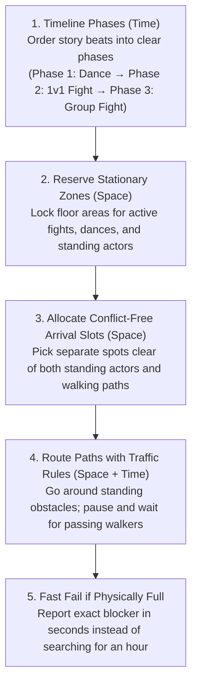

# Plan: Phase-Ordered Crowd Choreographer

## Goal
Make crowd shots **conflict-free and fast to compile** by combining two layers:
1. **Ordered Timeline Phases (Time):** Separate sequential story phases so later phases (like a crowd run-in) never start while an earlier phase (like a 1-on-1 fight) is still walking or fighting.
2. **Methodical Phase Choreographer (Space):** Inside each phase, reserve stationary areas first, pick arrival spots that never sit on walking corridors, route around standing characters/fights, and wait briefly for passing characters.

---

## Part 1: Eliminate Cross-Phase Time Conflicts

### Why cross-phase conflicts happen today
1. **Single-turn LLM JSON cannot see future `beat_id`s:** The LLM writes all calls in `task_queue/llm_response.json` in one shot, so it doesn't know internal IDs like `attack_25.finished` to pass into `after`.
2. **`group_fight` only delays the punches, not the run-in:** In [`FunctionCatalog.group_fight()`](file:///Users/vishaljose/PainterSpace/tools/shot_library/function_catalog.py#L993-L1014), the `group_fight` beat waits for all participants' previous actions (`wait_for`), but the `run_to` beats generated on [line 997](file:///Users/vishaljose/PainterSpace/tools/shot_library/function_catalog.py#L997) do **not**. So bystanders finish dancing at 8 s, run into the fight area 35 seconds early, and stand in the way while the first two fighters try to walk to their 1-on-1 fight.

### Changes
1. **Attach shared-phase barriers to run-ins (`function_catalog.py`):**
   - In [`FunctionCatalog.group_fight()`](file:///Users/vishaljose/PainterSpace/tools/shot_library/function_catalog.py#L993-L1014) (and any multi-actor staged action), compute `preceding` across **all participants** *before* creating approach/run-in `run_to` beats, and attach `wait_for` to every run-in beat.
   - Result: if `human_1` and `human_11` are in a 1-on-1 fight and also in `group_fight`, nobody starts running in for `group_fight` until `human_1` and `human_11` finish their 1-on-1 exchange.
2. **Support explicit timeline phases in LLM JSON (`llm_planner.py`, `docs/LLM_SHOT_PLANNER.md`):**
   - In [`LLMShotPlanner.plan_from_llm_json()`](file:///Users/vishaljose/PainterSpace/tools/shot_library/llm_planner.py#L488), accept either:
     - `"phases": [ {"calls": [...]}, {"calls": [...]} ]`, or
     - an optional `"phase": 1, 2, ...` field on items in `"calls"`.
   - Every call in phase $N+1$ automatically receives a `wait_for` barrier on the beats created in phase $N$ (unless overridden by an explicit `after` or Director's Brief lock).
   - Keep flat `"calls"` 100% backwards-compatible.

---

## Part 2: Eliminate Within-Phase Space & Traffic Conflicts

Once each phase has a clean time window, the compiler choreographs movement inside each phase without disconnected stages stepping on each other.

### 2.1 Continuous path & hold checks for arrival slots
**Files:** [destinations.py](file:///Users/vishaljose/PainterSpace/tools/shot_library/crowd/destinations.py), [movements.py](file:///Users/vishaljose/PainterSpace/tools/shot_library/crowd/movements.py)
- Replace the corner-sample `occupied()` check in [`_route_movements()`](file:///Users/vishaljose/PainterSpace/tools/shot_library/crowd/movements.py#L190-L206) with a continuous swept-path check (`blocked_intervals(spot, spot, arrive, leave, …)`).
- Check candidate arrival spots against:
  - all active `ActivityArea`s (ongoing fights, dances, stationary performances),
  - all locked/authored trajectories,
  - all already-committed paths across the full arrival-to-departure hold window.
- Result: the destination allocator never places a character's standing spot on top of someone else's walking corridor.

### 2.2 Unfreeze auto-generated interaction approaches
**Files:** [compiler.py](file:///Users/vishaljose/PainterSpace/tools/shot_library/compiler.py#L633-L654), [director_solver.py](file:///Users/vishaljose/PainterSpace/tools/shot_library/director_solver.py#L868-L916), [movements.py](file:///Users/vishaljose/PainterSpace/tools/shot_library/crowd/movements.py#L38-L41)
- Do not treat compiler-generated `auto_interaction_approach` paths as untouchable user-authored `brief_path`s.
- Include `planned_areas` (`activity_areas(...)`) inside `schedule_prompt_interactions` so 1-on-1 fighter approaches route around all stationary dancers and active zones from the start.
- Allow `route_movements` to re-route `auto_interaction_approach` beats if a crowd hold requires it.

### 2.3 Traffic rules: Wait for passers, go around standers
**Files:** [st_planner.py](file:///Users/vishaljose/PainterSpace/tools/shot_library/crowd/st_planner.py), [movements.py](file:///Users/vishaljose/PainterSpace/tools/shot_library/crowd/movements.py)
- **Passers (temporary blockage):** Keep departure delay and mid-route safe-interval waiting as the first choice when another walking character crosses an edge temporarily.
- **Standers (stationary actor or action zone that outlasts `max_delay_s`):** Treat any reservation that blocks a node across the whole allowed delay window as a static obstacle for that search, routing around it immediately instead of testing every `departure_step_s` wait step.
- **Fix backup-stop speed bug ([movements.py L254, L340](file:///Users/vishaljose/PainterSpace/tools/shot_library/crowd/movements.py#L254)):** Compute travel speed for fallback arrival stops from the movement clip's nominal locomotion speed (not `original_short_distance / duration`), so nearby alternative stops are reachable within the delay budget.

---

## Part 3: Stop Futile Searches in Seconds (Fail Fast & Clear)

**Files:** [st_planner.py](file:///Users/vishaljose/PainterSpace/tools/shot_library/crowd/st_planner.py), [joint.py](file:///Users/vishaljose/PainterSpace/tools/shot_library/crowd/joint.py), [movements.py](file:///Users/vishaljose/PainterSpace/tools/shot_library/crowd/movements.py), [config.py](file:///Users/vishaljose/PainterSpace/tools/shot_library/crowd/config.py)

1. **Blame only actual blockers:**
   - Instead of recording every actor touched anywhere during A* exploration, record only reservations that block the **start position**, **goal hold**, or the **closest-to-goal frontier node**.
2. **Never branch on non-reorderable blockers & prune identical failures:**
   - Only branch in [`priority_search()`](file:///Users/vishaljose/PainterSpace/tools/shot_library/crowd/joint.py#L49-L83) on adjustable movers whose trajectory actually changes when reordered.
   - Track a failure signature `(actor, beat_id, status, relevant_reservation_key)`; if a child ordering produces the exact same failure, prune it immediately.
   - Add a configurable wall-clock timeout (`max_joint_time_s: float = 30.0` in `CrowdSolverConfig`) and log progress per node/actor.

---

## Part 4: Speed Up Geometry & Reservation Checks

**Files:** [geometry.py](file:///Users/vishaljose/PainterSpace/tools/shot_library/crowd/geometry.py), [st_planner.py](file:///Users/vishaljose/PainterSpace/tools/shot_library/crowd/st_planner.py), [activities.py](file:///Users/vishaljose/PainterSpace/tools/shot_library/crowd/activities.py), [movements.py](file:///Users/vishaljose/PainterSpace/tools/shot_library/crowd/movements.py)

1. **Pre-filter scene solids & cache static edges across searches:**
   - Filter `solid_boxes` once per floor level/height band and bounding box instead of scanning all 173 boxes on every A* edge.
   - Share the static clearance cache across grid levels, fallback stops, and joint search nodes for the same `(level, solid_radius, buffer_m)`.
2. **Spatial & temporal bounding-box filter on `Reservation`:**
   - Store `(t_min, t_max, x_min, x_max, z_min, z_max, max_radius)` on each `Reservation` and skip disjoint reservations in `blocked_intervals()` before calling `intervals()`.
   - Merge consecutive stationary `ActivityArea`s for the same actor at the same position in [`activity_areas()`](file:///Users/vishaljose/PainterSpace/tools/shot_library/crowd/activities.py#L36-L97).

---

## Verification Plan
1. **Unit & regression tests (`tools/shot_library/test_all_phases.py`):**
   - Test that `group_fight` run-ins wait for earlier 1-on-1 fights involving any of the participants.
   - Test explicit `"phases"` / `"phase"` ordering in `plan_from_llm_json`.
   - Test that destination allocation rejects points crossed by a committed path during the hold window.
   - Test that passing characters trigger a brief wait while standing characters/zones trigger a detour around them.
   - Test that an impossible/blocked route fails in seconds with exact blocker attribution instead of running 128 joint nodes.
   - Run all 245+ existing tests.
2. **End-to-end benchmark on `scene_03/shot_001` (20-dancer club fight) and `scene_02` shots:**
   - Measure compile time and verify 0 collisions on a throwaway copy of `scene_03/shot_001`.
3. **Documentation:**
   - Update [README.md](file:///Users/vishaljose/PainterSpace/README.md) and [docs/LLM_SHOT_PLANNER.md](file:///Users/vishaljose/PainterSpace/docs/LLM_SHOT_PLANNER.md).

## Implementation corrections after review

Phase barriers now propagate to compiler-generated approaches and reaction partners, including when interaction routes are regenerated. Reciprocal calls with different barriers remain separate interactions.

Static geometry caches use per-solve numeric snapshots with exact height and edge keys. Raw mutable box inputs are re-read, so edits or replacements in an existing list cannot reuse stale clearance results.

The joint search uses a shared cooperative deadline (`max_joint_time_s`, currently 60 seconds by default), checked inside low-level routing, departure attempts, destination allocation, and collision checks. It returns `CROWD_ROUTE_TIMEOUT` on exhaustion, rather than accepting a late result. This is a coordination budget, not a timeout for the entire compilation pipeline or a hard process preemption guarantee.

Fail-fast handling is conservative: an occupied departure point is checked before spatial search and alternative goals, and reports its actual blockers. Equivalent route queries reuse cached results, with conservative spatial filtering of irrelevant reservations. Repeated failed-query signatures defer descendants behind unexplored queries. Blanket pruning on identical failures remains deliberately excluded: the same failure at two nodes does not establish that combinations of additional priority constraints cannot succeed. Transitive-order deduplication continues to prune equivalent priority states. General frontier blockers remain search evidence, not a proof of physical impossibility.
