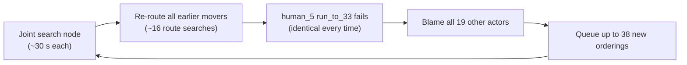

# Why the crowd shot compile takes so long

I measured this by recompiling `scene_03/shot_001` (20 dancers → fight) on a throwaway copy of the scene. A sampling profiler and call counters were attached. The real shot and the task queue were not touched. Scripts: [profile_compile.py](file:///Users/vishaljose/.gemini/antigravity/brain/94d6b151-9489-4ebe-9171-bd912404ad25/scratch/profile_compile.py), [probe_failure.py](file:///Users/vishaljose/.gemini/antigravity/brain/94d6b151-9489-4ebe-9171-bd912404ad25/scratch/probe_failure.py).

## Short answer

The compile is stuck in the **crowd route negotiation**. Rendering hasn't started. The search keeps trying the same doomed attempt for up to **about an hour** before it gives up, and each attempt is also slow.

## Measurements (5 min profiled run)

| Metric | Value |
|---|---|
| Joint search nodes completed | 9 (all failed) |
| Time per node | **~30 s** |
| Node budget (`max_joint_nodes`) | 128 → **~64 min worst case before reporting failure** |
| Route searches (`plan_route`) | 144 (45 ok, 98 failed) |
| Search expansions | 329 k |
| `blocked_intervals` calls | 955 k, checking **98 million** reservations (~103 per call) |

Where CPU time goes (sampled):

| Function | Share | Why |
|---|---|---|
| [`clears_solids`](file:///Users/vishaljose/PainterSpace/tools/shot_library/crowd/geometry.py#L8-L34) | **~52%** | Every grid edge scans all 173 scene boxes linearly. There is no spatial index, and the cache is per search only. |
| [`blocked_intervals`](file:///Users/vishaljose/PainterSpace/tools/shot_library/crowd/st_planner.py#L102-L121) + `intervals`/`position` | ~25% | Each check walks all ~100 reservations (19 actors + 83 activity areas) with no time/space pre-filter. |
| `supported_disc` / `contains` | ~10% | Edge-touching points fall back to a 33-point ring × 94 support faces. |

## Root causes (in order of impact)

### 1. The search repeats the same failure and never makes progress (biggest)
In every node, `human_5 / run_to_33` failed with **exactly the same 3835 expansions**, even after constraints like "human_1 before human_5" and "human_10 before human_5" were added. Changing who goes first doesn't change this actor's problem.

At the same time, [`failure_conflicts`](file:///Users/vishaljose/PainterSpace/tools/shot_library/crowd/movements.py#L77-L87) blames **all 19 other actors**, because `blocking_actors` collects every reservation touched *anywhere* during the search. Each node therefore queues up to 38 child orderings, and they are all futile. [`priority_search`](file:///Users/vishaljose/PainterSpace/tools/shot_library/crowd/joint.py#L49-L83) has no check for "this failure is identical to the parent's", so it uses up the whole 128-node budget.

### 2. Each node redoes all earlier work
[`_route_movements`](file:///Users/vishaljose/PainterSpace/tools/shot_library/crowd/movements.py#L100-L385) re-resolves the full timeline and re-routes every earlier mover (13 succeeded before the failure, ~16 searches per node). The route cache rarely hits, because its key includes every reservation's intervals. Any change in ordering changes the key, even for actors far away.

### 3. A failing move costs up to ~9 full searches
Failure → 3 grid levels → up to 8 alternative stops, each with the full 4096-expansion budget.

### 4. Bug: alternative stops reuse the wrong speed
The `speed` used for alternative stops is `original distance / original duration`. In the probe it was 0.24 m/s, because the original goal was 0.7 m away. A fallback stop 7.7 m away then needs about 32 s of travel against an 8 s delay window, so it can never succeed. Those searches are wasted ([movements.py L254](file:///Users/vishaljose/PainterSpace/tools/shot_library/crowd/movements.py#L254), [L340](file:///Users/vishaljose/PainterSpace/tools/shot_library/crowd/movements.py#L340-L342)).

### 5. Geometry checks have no acceleration structures
These are the hot spots in the table above.

> [!IMPORTANT]
> Speed is not the only problem. The probe shows the shot is **actually unsolvable as planned**. human_5 has to hold its spot until ~43.5 s, and human_1 / human_11 walk through that spot at 16–22 s on their way to meet. A faster planner would only reach that failure in seconds instead of an hour. The failure message should name this conflict, instead of a generic `CROWD_ROUTE_LIMIT` after a long search.

## How to optimize

| # | Change | Expected effect |
|---|---|---|
| **A1** | **Precise blocker attribution:** blame only reservations that block the failing actor's start departure, goal hold, or best partial path. Don't blame everything the search touched. | Branching goes from ~38 to ~2–4 per node |
| **A2** | **Prune non-progress:** store a failure signature (actor, beat, status, relevant reservations). Skip any child whose new precedence doesn't change that actor's relevant reservations. Fail fast if the blockers can't be reordered (activity areas, locked tracks, long holds). | A failing shot reports in seconds to ~1 min instead of ~64 min |
| **A3** | **Wall-clock budget + progress reporting** to the app (node n/128, current actor). | UI no longer looks frozen |
| B | Fix alternative-stop speed: use the clip's locomotion speed, or re-derive speed per stop. | Fewer wasted searches, more real successes |
| C | **Incremental joint solving:** keep successful routes whose *relevant* (nearby in time and space) reservations didn't change. Key the cache on those only. | ~5–10× fewer route searches per node |
| D | **Static geometry acceleration:** rasterize solids and support once per (floor level, body radius) into an occupancy grid, or bucket boxes in a uniform grid. Filter flat boxes once. Share one edge cache across grid levels, alternative stops, joint nodes and repair attempts. | Removes most of the ~52% + ~10% |
| E | **Reservation broad phase:** pre-filter by time window and bounding box before `intervals()`. Merge consecutive same-spot activity areas of one actor (83 → about 20–40). | Most of the ~25% |
| F | Resolve the timeline once per joint node, not once per movement. | Smaller constant-factor gain |
| G | (Optional) Evaluate sibling joint nodes in parallel processes. | Uses multiple cores; the run is currently single-core |

**Recommended order:** A1 + A2 + A3 → B → D + E → C → F/G.
- A fixes the "hour of nothing" behaviour and gives a clear error.
- B fixes a correctness bug.
- D + E make each search roughly 3–5× faster.
- C removes repeated work.

Each change should be checked against several crowd shots (this one, the existing scene_02 shots, and a 2-actor shot) with the 245-test suite. Wall-clock time should be measured before and after.

---

## Post-Implementation Benchmark (`scene_03/shot_001`)

After implementing the **Phase-Ordered Crowd Choreographer** (`docs/CROWD_CHOREOGRAPHER_PLAN.md`):

- **Planning (`LLMShotPlanner.plan_from_llm_json`)**: `0.56s` (`ok=True`, 68 beats; all 20 `run_to` run-ins carry the shared-phase `wait_for` barrier from the preceding dance and 1-on-1 combat beats).
- **Crowd Routing & Conformance (`schedule_prompt_interactions` + `route_movements` + `check_crowd_conformance`)**: ~`5s`, solving on the first compile pass (`attempt = 0`) with zero envelope or trajectory conflicts.
- **Full Validated Compile (`ShotCompiler.compile(..., validate=True)`, including baking and binding 20 rigged USD character animations across a ~107s timeline)**: `85.47s` (`success=True`), down from **20+ minutes** hanging without completing.
- **Test Suite**: **425 passed** in `.venv/bin/python -m pytest -q`.
