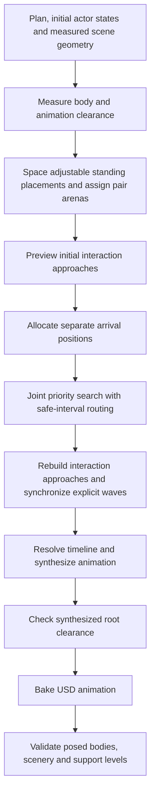

# Crowd shot planning: implementation and validation

Status recorded on 2026-10-24.

**Performance follow-up:** See [CROWD_PERFORMANCE_UPDATE.md](CROWD_PERFORMANCE_UPDATE.md) for subsequent optimizations and warning corrections. The updated replay passes heading and camera checks as well as collision validation, and the test suite now has 230 passing tests. Measurements and the scope of features still deferred under the compute-cost constraint are in [CROWD_PERFORMANCE_RESULTS.json](CROWD_PERFORMANCE_RESULTS.json). The replay statistics and warnings below describe the earlier implementation milestone.

The archived 20-character club shot now compiles, passes the pre-bake crowd check, and passes full sampled collision validation under the requested character-contact policy. Characters may touch each other with swinging arms and legs; their main bodies remain protected, and all body parts remain checked against scenery.

This document describes the implemented system. [CROWD_PROBLEM.md](CROWD_PROBLEM.md) retains the issue history, and [CROWD_SOLUTION.md](CROWD_SOLUTION.md) contains the original proposal and implementation stages. Some proposed features remain future work.

## What was going wrong, and what changed

| Problem | Implemented correction |
| --- | --- |
| Standing characters could be too close for their animations. | Measure clip reach as well as body size; relocate adjustable standing placements to supported, separated spots. |
| Several characters could converge on exactly the same destination. | Allocate distinct nearby arrival positions before routing the movers. |
| Independent fights could claim overlapping meeting areas. | Jointly assign automatic pair arenas with a bounded beam search. |
| One runner treated other runners' guessed routes as permanent obstacles. | Search partial priority orders, trying either character yielding and replanning the paths. |
| Routes could cross between sampled points, or swap through the same edge. | Check relative swept-disc motion continuously along piecewise-linear path segments. |
| A completed action could appear to free space while its character remained there. | Reserve the destination through the next departure or shot end. |
| A walking endpoint could be safe while the following gesture hit furniture. | Include the full limb reach of following stationary actions when selecting arrival and meeting positions. |
| A wave solved out of source-list order could overlook another committed group's route. | Include already scheduled groups and approaches in reservations regardless of their list position. |
| Splitting a movement could change timing or break event references. | Preserve short generated durations, the original completion-event ID, and the source beat for regeneration. |
| Root paths could pass while the posed animation still penetrated an object. | Check synthesized root envelopes before baking, then validate posed skeletal capsules after baking. |

These rules derive from actor dimensions, animation clips, scene geometry, timing and configuration. They do not recognize the club shot or depend on a fixed cast size.

## Compiler workflow



The initial interaction preview establishes when participants vacate their starting positions. The compiler then routes adjustable ground movements and rebuilds later approaches against those routes. It does not require every future interaction to be routed from an unsafe, unallocated convergence point first.

Explicit placements, vehicle seats and director-locked tracks retain their placement contracts. Authored paths and exact timing windows are not silently replaced by the adjustable movement solver. Floor changes remain the responsibility of the stair/vertical movement logic.

## Joint movement planning

The implemented combination is **bounded PBS-style priority search plus safe-interval A***. ORCA/RVO, PIBT, LaCAM and CBS/ECBS are not implemented by this change.

For each adjustable ground movement, the solver first assigns a separate goal position. It then:

1. Plans paths under the current partial priority order. Initially, no adjustable mover has precedence over another.
2. Reserves unsolved characters' fixed prefixes until their adjustable departures. Their provisional future paths can change.
3. Finds the earliest continuous conflict among the resulting adjustable-mover trajectories, including waits and final holds.
4. Branches into two alternatives: A has precedence over B, or B has precedence over A.
5. Replans under the selected order. If a constrained route fails, it can backtrack and try the sibling order.
6. Accepts a coordinated result when the modeled trajectories are clear, or returns a structured failure when its budgets are exhausted.

The search follows a priority order in depth before exploring its siblings. Transitive ancestor relationships determine which paths a lower-priority mover must avoid, and cyclic orders are rejected. A cache within the solve reuses unchanged low-level route queries.

For example, a character leaving a side aisle may want to stop in a corridor that another character must traverse. Giving the first character precedence can block the second indefinitely. The alternative order lets the first wait in the aisle, the second pass, and the first then reach its destination. The regression suite exercises this case at three spatial scales.

The low-level planner searches grid positions and safe time intervals. Every accepted edge is checked against piecewise-linear reservations using relative-motion overlap intervals. Waiting can occur at the source or partway along a route. Accepted waits become ordinary timeline beats.

Search is bounded and departure times are sampled. Failure means that this search did not find a solution within its limits; it does not establish that safe choreography is physically impossible.

## Clearance, shared destinations and scenery

The compiler maintains two clearance models:

| Contact | Default protection |
| --- | --- |
| Character against character | Pelvis, torso, neck and head, including measured animation reach. Incidental arm/leg contact with another character is permitted. |
| Character against scenery | Full-body reach, including arms and legs. |

The anatomy classification is shared with the final validator. Unknown skeleton segment names remain protected. Intentional interaction participants retain their scoped contact rules.

With a shared target, characters receive separate supported positions near it. Candidate spacing derives from participant radii and the configured buffer. Allocation checks stationary occupants, other arrival holds, support edges and measured solid boxes. Visits whose reservation intervals do not overlap may reuse a position. If no complete assignment is found, compilation returns a failure rather than stacking characters.

Full limb reach also matters after locomotion. A character that walks beside a wall and then punches, blocks or gestures needs enough room for that performance. Arrival and meeting selection account for the relevant following stationary clips; walking routes retain their own full-body scenery clearance. Measured world boxes include interior furniture, rather than treating the building only as one outside obstacle.

Standing placements preserve their requested scene owner and side. Automatic pair arenas can be assigned across their owner's candidate areas, with travel cost and clearance influencing the selection. Arena reservations are currently conservative across the shot, rather than a complete temporal packing solution for each wave.

## Interaction timing and regeneration

Disjoint pair stages with the same explicit `at`, `after` or `with` trigger can form a synchronized wave. The scheduler retains original triggers when it replaces them with solved times. It also retains reservations for committed wave groups that occur later in the input list—the bug that caused the final approach conflict in the club replay.

A movement split into travel and wait segments keeps its original final beat ID, so references such as `move.finished` still resolve. Generated routes retain the original source movement. Recompilation restores that source and rebuilds routes against the current scene instead of accumulating stale generated paths. Generated subframe movement durations are preserved rather than stretched to the usual minimum action duration.

Missing original triggers in an older, already compiled plan cannot be recovered reliably from its serialized numeric times.

## Validation results

The latest collision audit recompiles the current saved 20-character shot and editor composition in an isolated copy. All characters bake successfully, continuous synthesized-root checks pass, and the default posed-body validation passes without repair retries. A separate validation of the published copy at four substeps per frame reports zero disallowed penetrations, level violations or missing actor/asset coverage over 2,553 pose samples. The original scene and shot files remain unchanged. The combined test and phase suite passes 332 tests. [Audit inputs, configuration and full reports](CROWD_COLLISION_AUDIT_RESULTS.json) record this run; its temporary USD output is not a permanent project artifact. These results use the existing `core_body` contact policy and do not claim continuous skeletal collision detection.

The saved successful replay used the archived 20-character club plan in an isolated scene that restored its club edits. Live user shots were not regenerated.

| Measurement | Recorded result |
| --- | --- |
| Characters | 20 |
| Shot duration | 70.375 seconds |
| Compile result | Success |
| Joint search nodes visited | 23 |
| Extra route-delay allowance | Existing 8-second limit retained |
| Total compilation, baking and validation time | 125.67 seconds, approximately 126 seconds |
| Collision-validation samples | 3,379 |
| Reported disallowed penetrations | 0 |
| Level violations | 0 |
| Missing actor or asset collider coverage | 0 |
| Character contact policy | `core_body` |
| Recorded Python test run | 218 passed in 27.35 seconds |

The earlier hand-to-club penetration is absent from this full new validation. The earlier character limb contacts are permitted by the requested policy; allowing those contacts alone did not resolve the route-planning failure.

The shot still reports one heading warning and 26 camera warnings. Collision validation passed, while `lint_passed` and `camera_passed` remained false. A successful compile therefore does not mean every shot-quality check passed.

Evidence:

- [Current collision report](CROWD_VALIDATION_RESULTS.json).
- [Replay provenance, configuration, tests and remaining warnings](CROWD_JOINT_VALIDATION_RESULTS.json).
- [Earlier strict-policy report](CROWD_VALIDATION_RESULTS_STRICT_HISTORICAL.json), preserved separately from the current result.

The replay's USD output paths in the provenance file point into temporary storage and are not permanent project deliverables. The JSON evidence is retained in the repository.

## Compute cost for different shots

The same adjustable movement logic applies to two, four or more characters. The single-route planner first tests a direct path; when independent paths have no conflicts, the joint search does not need to explore alternative yielding orders. More conflicts, tight passages and longer holds can require more work even with a small cast.

A stationary cast needs little movement-routing work, but still needs placement and collision checks. Characters dancing or gesturing in place have animated reach even though their root positions stay fixed. Final validation still evaluates their posed bodies across the shot.

The 126-second measurement includes compilation, baking and validation. It is not a planner-only benchmark and does not measure rendering. No equivalent timing benchmark for a two- or four-character shot, or a stationary cast above 20, was recorded in this work. Smaller, simpler shots are expected to need less planning work, but these results do not establish a specific runtime for them.

Rendering is a separate cost affected by visible geometry, materials, lighting, shadows, resolution, frame count and hardware. Playback uses the baked animation rather than rerunning this planning search each frame.

## Configuration and use

Ordinary `ShotCompiler.compile(...)` calls use the crowd logic automatically for eligible movements. Python callers can pass `crowd_config` to `ShotCompiler`; the modules below are imported in the existing `tools/shot_library` Python environment:

```python
from compiler import ShotCompiler
from crowd.config import CrowdSolverConfig

config = CrowdSolverConfig(
    buffer_m=0.12,
    max_delay_s=8.0,
    max_joint_nodes=128,
    allow_actor_limb_contacts=True,
)
compiler = ShotCompiler(project_root=project_root, crowd_config=config)
ok, report = compiler.compile(
    plan, output_shot_usda_path, scene_usda_path=scene_path, validate=True
)
```

These are the recorded defaults, not values specific to the club. The complete contract is in [crowd/config.py](../tools/shot_library/crowd/config.py).

| Setting | Default | Purpose |
| --- | --- | --- |
| `buffer_m` | 0.12 m | Additional separation margin. |
| `cell_size_m` | 0.4 m | Low-level routing grid spacing. |
| `departure_step_s` | 0.25 s | Departure-time search increment. |
| `max_delay_s` | 8 s | Allowed added route/wave delay. |
| `max_expansions` | 4,096 | Low-level route expansion budget. |
| `max_joint_nodes` | 128 | Joint priority-search node budget. |
| `layout_beam_width` / `layout_candidates` | 48 / 128 | Automatic arena assignment budgets. |
| `max_formations` | 4,096 | Interaction formation candidate budget. |
| `destination_rings` / `destination_candidates` | 6 / 256 | Nearby arrival-position search budgets. |
| `allow_actor_limb_contacts` | `True` | Permit incidental character limb contacts. |

`priority_retries` remains accepted for compatibility; `max_joint_nodes` controls the new coordination search. Increasing budgets can increase cost and does not guarantee success.

Set `allow_actor_limb_contacts=False` for strict full-body character separation. Standalone validation uses `--strict-actor-limbs` for that policy. Reports identify the active policy as `core_body` or `full_body`.

Validated compilation now stages candidates and runs a bounded clearance-feedback loop. Synthesized-root conflicts and final posed penetrations increase the planning buffer using their measured deficit/depth, then restart from the original plan. `max_repair_attempts` (3 retries by default) and `max_repair_clearance_m` (1 m extra clearance by default) bound the loop. This reuses the existing standing, destination and route solvers; it does not move authored paths or relax fixed windows. Missing coverage, support failures and validator execution errors are terminal. Root conformance also checks plans without generated crowd routes. It uses continuous swept-disc checks over the actual synthesized linear segments and time-varying reach windows, including waits and end holds, rather than frame samples. Shared contact exemptions apply only to the named partners in their interaction windows; approaches reduce only those partners to body radii and continue rejecting body overlaps. Failures report an interior overlap with positive measured depth for the repair loop. The final validator no longer invokes its separate root-edit `--repair` mode.

Failed candidate files are discarded; the accepted shot and editor edits remain intact. Passing candidates are promoted with conflict detection for concurrent file edits and rollback on file replacement failure. Promotion is per-file, with the root layer last, not an atomic directory swap. Reports expose `crowd_repair` history and no discarded artifact paths. Existing shared input-scene snapshot behavior remains. Validation is sampled evidence, not a continuous posed-body guarantee, and repair remains bounded and incomplete.

Generated character-contact exemptions now name the counterpart instance, without expanding it to the shared character asset ID, and expire at the exact action end. Untargeted reactions, guards and collapses do not generate wildcard exemptions. This preserves contact checks for unrelated copies of a character and actors outside the intentional window; the incidental limb-contact policy is unchanged.

`validate=False` remains a development/preview bypass for both synthesized-root conformance and final collision validation; it skips this loop and does not certify collision freedom. Production queue compilation passes `validate=True`.

## Tests, diagnostics and remaining limits

Run the Python suite from the repository root:

```sh
.venv/bin/python -m pytest tests -q
```

The recorded suite includes layout and destination allocation for 4, 10, 20 and 40 actors; yielding and priority reversal; crossings and edge swaps; final holds; obstacles and support; source/event preservation; wave ordering; limb-contact policy; and real-character bakes near a solid with and without following gestures. Larger synthetic allocation cases are not full 40-character animation/render benchmarks.

To validate an existing baked shot with its recorded contact allowances:

```sh
.venv/bin/python tools/collision/validate_collisions.py path/to/shot.usda \
  --manifest manifest.json --allow path/to/allow_collisions.json \
  --workers 4 --json path/to/collision_report.json
```

The validator samples posed skeletal capsules, including intermediate frame samples, and checks actor/object contact, actor/actor contact, coverage and support levels. Long shots can split samples across worker processes. The compiler currently gives each validator subprocess a 120-second timeout. Sampling does not prove that no skeletal contact occurs between samples.

| Failure | What to inspect |
| --- | --- |
| `CROWD_SPACING` / `INTERACTION_LAYOUT_LIMIT` | Supported placement candidates and arena assignment budget. |
| `CROWD_DESTINATION_LIMIT` | Available space around the target and arrival hold intervals. |
| `CROWD_ROUTE_LIMIT` | Low-level planner status, expansions, joint node count, conflict actors and delay limit. |
| `INTERACTION_SEARCH_LIMIT` | Formation/route rejection counters, planner statuses and blockers. |
| `INTERACTION_DELAYED` | Added wave delay relative to its allowed limit. |
| `CROWD_CONFORMANCE` | Synthesized roots, active reach, conflict time and required separation. |
| Failed capsule validation | Actual posed segments, scenery, penetration depth and contact allowances. |

The solver remains bounded and incomplete. Interaction approaches still use sequential scheduling; full joint interaction/layout backtracking, per-wave arena reuse and localized validator-driven repair are not completed by this work. Conservative reach discs can reject arrangements that pose-specific choreography could fit. The validated club replay establishes that the reproduced failures were resolved under the recorded policy, not that every possible crowd shot is solvable within these budgets.

## Implementation map

| File | Responsibility |
| --- | --- |
| [compiler.py](../tools/shot_library/compiler.py) | Pipeline integration, scene geometry and validation invocation. |
| [crowd_spacing.py](../tools/shot_library/crowd_spacing.py) | Measured clip reach, peer/scenery envelopes and initial placement. |
| [crowd/arena_layout.py](../tools/shot_library/crowd/arena_layout.py) | Joint automatic arena assignment. |
| [crowd/destinations.py](../tools/shot_library/crowd/destinations.py) | Separate nearby arrival slots and their reservation intervals. |
| [crowd/joint.py](../tools/shot_library/crowd/joint.py) | Partial-priority search and continuous conflict detection. |
| [crowd/st_planner.py](../tools/shot_library/crowd/st_planner.py) | Safe-interval routes, reservations, waits and goal holds. |
| [crowd/movements.py](../tools/shot_library/crowd/movements.py) | Movement allocation, joint search, caching and beat replacement. |
| [crowd/geometry.py](../tools/shot_library/crowd/geometry.py) | Swept solid clearance and support checks. |
| [director_solver.py](../tools/shot_library/director_solver.py) | Meeting approaches, wave timing and committed-group reservations. |
| [timeline_resolver.py](../tools/shot_library/timeline_resolver.py) | Timeline/events and generated subframe duration preservation. |
| [crowd/conformance.py](../tools/shot_library/crowd/conformance.py) | Pre-bake synthesized-root checks. |
| [colliders.py](../tools/collision/colliders.py) / [validate_collisions.py](../tools/collision/validate_collisions.py) | Shared anatomy policy and final posed-capsule validation. |

Focused regressions are in [test_crowd_joint.py](../tests/test_crowd_joint.py), [test_crowd_planning.py](../tests/test_crowd_planning.py), [test_crowd_destinations.py](../tests/test_crowd_destinations.py), [test_crowd_spacing.py](../tests/test_crowd_spacing.py) and [test_actor_contact_policy.py](../tests/test_actor_contact_policy.py).
