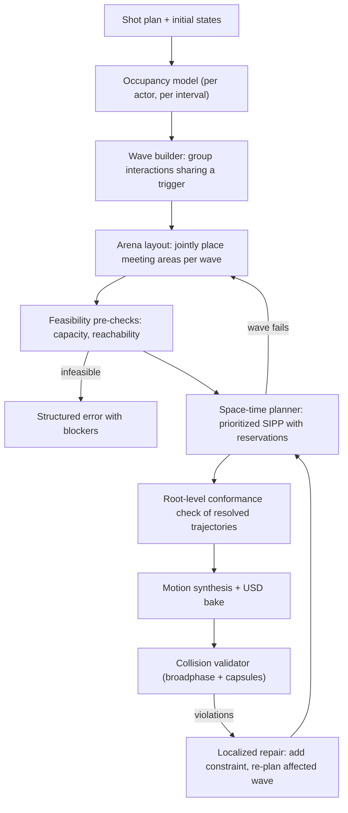

# Proposed solution: crowd placement, interaction routing, and collision validation

For the implemented system and successful club validation, see [CROWD_IMPLEMENTATION.md](CROWD_IMPLEMENTATION.md). See [CROWD_PERFORMANCE_UPDATE.md](CROWD_PERFORMANCE_UPDATE.md) for subsequent optimizations, resolved heading/camera warnings and the extensions still deferred under the compute-cost constraint. The proposal below records the earlier diagnosis; later sections track implementation progress. Its opening failure status is historical.

This document proposes a fix for the problem described in [`CROWD_PROBLEM.md`](CROWD_PROBLEM.md). The current 20-actor shot fails with `INTERACTION_SEARCH_LIMIT` (`prompt_pair_87`). The earlier version of that shot compiled but had 17 penetrations.

The diagnosis below comes from reading the current code (`crowd_spacing.py`, `director_solver.py`, `function_catalog.py`) and the archived plan for the failing shot (`scenes/scene_02/.deleted_shots/shot_004_*/shot_plan.json`). I did not recompile the shot for this proposal. Phase 0 starts by adding instrumentation to confirm each root cause.

---

## 1. Summary

The search budget is not the real problem. Raising it would only delay the same failure, because three parts of the pipeline disagree with each other:

1. **Placement and routing use different clearance models.** Crowd spacing packs actors by measured reach (`r_a + r_b + 0.12 m`). The interaction scheduler then requires every non-participant to be **1.5 m** from every route point and formation slot. That 1.5 m value is `STANDING_SPOT_SPACING_M`, which is the standing-spot *grid pitch*, not a body size. So a walking actor needs a gap of about 3 m between two standing actors. After spacing, the dance floor works like a wall.
2. **Groups are scheduled one at a time, greedily, with no backtracking.** Every committed formation stays in place as a permanent obstacle. Waiting is only tried until other actors' beats end, and a stationary blocker's beat never "ends", so later pairs either take long detours or fail.
3. **Meeting areas are chosen without knowing where people stand or walk.** Pair centers are kept 3.12 m apart from *each other*. They ignore occupied standing positions and travel corridors, and they stay on the side named in the reference.

The proposal replaces the per-group greedy search with one **crowd choreography stage**. It has one shared space-time occupancy model, a joint layout of meeting areas, and a space-time planner (prioritized Safe-Interval Path Planning) that knows when obstacles appear and disappear. It also adds feasibility checks, so the compiler can tell "impossible in this space" apart from "search gave up".

---

## 2. Root-cause analysis

### Evidence from the archived plan

Prompt: *"Two groups of 10 dance on two sides of the club; one guy from each group meets the other, argues, they fight; the groups run toward them and start fighting."* The prompt describes **one simultaneous brawl**. The last plan that compiled shows something else:

| Observation | Value in archived plan | What it means |
| --- | --- | --- |
| Meeting centers for the 9 follow-up pairs | `standing_left_30` … `standing_left_38` | All on the left side, so all 9 right-side actors must cross the room through the other fights |
| Approach durations | 8.6 s, 12.4 s, 18.7 s, 20.2 s | Long detours or waits around 1.5 m keep-out discs |
| Fight start times | 8.1 s, 20.4 s, 22.2 s, 23.6 s, 35.0 s, 44.7 s, 53.8 s | Fights became sequential: the scheduler pushed each pair later |
| Two pairs start at 8.14 s with 0.14 s approaches | `prompt_pair_95`, `prompt_pair_99` | These pairs were already standing near their center and started fighting before the trigger fight finished arguing |

### Root causes in code

| # | Cause | Location |
| --- | --- | --- |
| R1 | `STANDING_SPOT_SPACING_M` (1.5 m) is the clearance radius for every non-participant in `clear_formation`, the obstacle discs, and `_route_clear_of_actors`. It ignores the actual body radius and the reach used during placement. | `schedule_prompt_interactions`, lines ~520–647 |
| R2 | Obstacle discs are sampled once at `actor_start` and used as static geometry for the whole route. Actors that leave keep blocking. Actors that arrive later are only caught afterwards, as a pass/fail result. | `_collect_obstacles_at_time` call and disc list, ~629–636 |
| R3 | Groups are solved in plan order and committed immediately. Each new group calls `timeline_resolver.resolve()` on the whole plan again, so cost grows with groups × beats. Committed formations hold their final positions forever. | loop over `group_ids`, ~426–712 |
| R4 | `start_options` only contains end times of earlier beats. A stationary blocker has no future end time, so waiting cannot help. | ~558–561 |
| R5 | Pair centers are allocated before routing. They are separated only from other centers, not from occupied actors or from the routes participants need. The search also stays on the reference's left/right side. | `space_standing_actors`, ~123–168 |
| R6 | The budget (48 attempts, 12 per center) counts route attempts but not formations rejected by `clear_formation`. Running out returns `INTERACTION_SEARCH_LIMIT`, which says nothing about whether a solution exists. | ~582–628 |
| R7 | Placement considers only `dance` reach. Attack and defend reach, and the extra space a fight takes during its window, are not reserved. This explains the 17 penetrations in the earlier compiled shot. | `_actor_reach` |

---

## 3. Proposed design

### 3.1 Unified occupancy model (fixes R1, R7)

New module: `tools/shot_library/crowd/occupancy.py`. It is the only place clearance is defined, and placement, layout, planning, and the pre-bake check all use it.

- **`ActorEnvelope(actor_id, t0, t1, center_track, radius)`**: one entry per actor per beat.
  - Moving beats (`walk_to`, `run_to`, approaches): radius = manifest collision radius.
  - Stationary performance beats: radius = measured clip reach. Extend the existing USD reach sampler from `dance` to every clip-backed action (`attack` moves, `defend_or_block` styles, `react`, `argue`, …), with the same `(path, mtime)` cache.
  - Interaction beats: one **arena envelope** for the whole group (§3.3), not one per participant.
- **Required separation** between envelopes a and b: `r_a(t) + r_b(t) + buffer`. `buffer` is a documented config value (the current 0.12 m motion buffer). Participants of the same group are exempt from each other. Their spacing comes from the formation (`contact`/`combat`/`conversational`).
- `STANDING_SPOT_SPACING_M` stays a grid-sampling parameter only and is never used as a clearance.

All tunables go in one `CrowdSolverConfig` dataclass (buffer, grid resolution, time step, priorities, budgets, delay tolerance). Defaults are documented, and callers and tests can override them. Nothing is tuned for this one shot.

### 3.2 Wave builder (fixes R3 and the serialization)

Interactions that share a trigger form a **wave**: the same `after` event, the same explicit time, or a common ancestor beat in the shot plan. Example: "the groups see it and run". Every group in a wave is laid out and planned **together**. Waves are processed in time order. Committing a wave adds its reservations, which expire when the envelopes end, so a finished fight frees its area.

The timeline is resolved once per wave, not once per group. Later waves update the provisional trajectories incrementally.

### 3.3 Arena layout (fixes R5)

New module: `crowd/arena_layout.py`. For each group in a wave, it picks an **arena**: a disc with `center` and `radius = formation_radius + max participant action reach`.

- **Candidates:** the requested center (if any), the participants' midpoint projected onto supported area, the existing derived standing spots on **both** sides of the owner, and support-face centroids. Keeping the reference's side is a soft preference (a cost term), not a hard filter.
- **Hard constraints:** the arena is fully on measured support with the required static-solid clearance. Arenas whose time windows overlap must not overlap each other. An arena must not overlap stationary envelopes that are active during its window.
- **Cost:** total travel time of participants + λ₁ · distance from requested center + λ₂ · predicted route crossings (straight-line crossing count between participants' source→arena segments) + λ₃ · side-preference violation. The weights live in `CrowdSolverConfig`.
- **Solver:** an initial min-cost assignment of groups to candidates (Hungarian algorithm on the cost matrix with conflicting candidates removed), then a bounded local search (swap/move) to fix overlaps. The output is deterministic (stable tie-breaks). This is pure Python, with an optional `scipy` speed-up if it is already available.
- **Placement link:** when a pair actor's initial position is adjustable (a derived standing spot that is not director-locked), `space_standing_actors` uses the same layout cost. It prefers spots on the participant's side of the room that face their future arena, so approaches are short and do not cross each other.

### 3.4 Feasibility pre-checks (fixes R6)

Before searching:

1. **Capacity:** the sum of arena and stationary envelope areas active at the same time is compared with the free supported area on that level. If it is too much, return `CROWD_CAPACITY` with the numbers.
2. **Reachability:** flood fill on the planning grid, treating as blocked only envelopes that last until the end of the shot. If an arena is not in the same connected region as a participant, return `INTERACTION_UNREACHABLE` with the blocking actors and objects. Under the model, this proves no route exists. It is not just a sign that the budget ran out.

`INTERACTION_SEARCH_LIMIT` is kept only for real search truncation. It also reports the best partial result: which agents were routed, which failed, and the blockers found.

### 3.5 Space-time planner (fixes R2, R4)

New module: `crowd/st_planner.py`. It uses **prioritized planning over Safe-Interval Path Planning (SIPP)** with a shared reservation table.

- **Grid:** cells over measured support. The cell size comes from the smallest body radius in the shot (configurable fraction). Edges are kept only if the existing support and static-obstacle checks pass.
- **Safe intervals:** for each cell, these are the times when no reservation (inflated by the querying agent's own radius plus the other envelope's radius plus `buffer`) covers it. Stationary actors block cells only during their beat, so a dancer who leaves frees the floor. Moving agents reserve swept discs along their timed path.
- **Search:** A* over `(cell, safe interval)` states with continuous arrival times. Waiting happens naturally whenever the next safe interval opens later. This makes R4 go away: delays are no longer limited to other beats' end times.
- **Within a wave:** agents are ordered by priority (longest path first, then authored order). After each agent is planned, its timed path is reserved. If an agent fails, it gets a higher priority and the wave is planned again. This is a bounded loop in the style of Priority-Based Search, with the count set in `CrowdSolverConfig`. If the wave still fails, the arena layout runs again with the failed arena's candidates removed or penalized, then planning repeats.
- **Synchronization:** the group's meeting time is the latest participant arrival. Partners arriving earlier hold position in their slot, which is reserved from their arrival to the meeting time.
- **Delay policy:** a wave's total delay against the prompt's timing becomes a cost and is reported. If it is over `max_wave_delay_s`, the compiler returns `INTERACTION_DELAYED` with a suggestion, instead of silently stretching the shot to 54 s.
- **Path smoothing:** the grid path is shortened by string pulling, re-checked against the reservations, and passed on as `brief_path`.
- **Representing waits (integration constraint):** `resolve_path_for_actor` samples `brief_path` by arc length at a constant speed over the whole beat window, so a single `walk_to` cannot pause partway along its route. A wait at the start becomes a later `start_condition`. A wait partway along splits the route into consecutive `walk_to` beats with a `wait` beat between them. The other option is to extend `brief_path` with optional per-waypoint times, which would change `timeline_resolver` and `motion_synthesis` and needs a README update. Splitting into beats keeps the existing beat format and is the preferred first step.

This replaces the inner `center × angle × start_time × actor` loop. `_clear_route_around_discs` and `tools/collision/plan_path.py` stay for single-actor static queries.

### 3.6 Pre-bake conformance and validator cost

- **Root-level check before baking:** sample the resolved trajectories at the shot frame rate against the occupancy model. This takes milliseconds and catches planner or synthesis drift before the expensive bake.
- **Validator broadphase:** in `validate_collisions.py`, give each actor a bounding sphere per time sample (root plus clip reach) and put them in a uniform spatial hash. Run the capsule-vs-capsule checks only for pairs whose spheres overlap. The criteria and samples stay the same, and the parallel path stays as it is. With 20 actors spread over a floor, most pairs are far apart, so I expect a large cut from the current 66 s. This needs to be measured.

### 3.7 Localized repair loop (fixes residual penetrations)

The validator reports violations as `(actor_a, actor_b, first_s, last_s, worst_depth)`. The repair step:

1. Maps each violation to the wave and envelopes active during that interval.
2. Raises the separation for that pair and interval by the measured depth plus `buffer`. This is a per-shot override and does not change any global constant.
3. Re-plans only the affected wave, then re-bakes and re-validates.

It runs for at most `max_repair_iterations` (config). It is skipped when `user_edits.usda` exists, as today. If violations remain, they are reported along with the constraints that were tried.

---

## 4. Pipeline integration

| Stage | Today | Proposed |
| --- | --- | --- |
| Initial spacing | `space_standing_actors` (dance reach, greedy) | Same entry point, using the shared occupancy model and the arena-aware layout cost |
| Pair centers | Allocated in `space_standing_actors`, center-to-center only | `arena_layout.solve_wave()` per wave |
| Interaction scheduling | `schedule_prompt_interactions` greedy loop | Same function signature. Its body builds waves and calls `arena_layout` + `st_planner` |
| Errors | `CROWD_SPACING`, `INTERACTION_SEARCH_LIMIT`, `INTERACTION_APPROACH_OCCUPIED` | Adds `CROWD_CAPACITY`, `INTERACTION_UNREACHABLE`, `INTERACTION_DELAYED`. `SEARCH_LIMIT` is kept only for real truncation |
| Validation | Full capsule validation | Root-level pre-check, broadphase validation, bounded repair loop |

`ShotCompiler` keeps its order of operations. Only the inside of the spacing and scheduling steps changes. The beat output (`walk_to` with `brief_path`, `interaction_positions`, `start_condition`) is unchanged, so `timeline_resolver`, `motion_synthesis`, and the USD bake are not affected.

---

## 5. Phased rollout

| Phase | Scope | Exit criteria |
| --- | --- | --- |
| **0. Instrument + quick wins** | Log per-group rejection reasons (formation blocked vs route blocked vs budget). Replace the 1.5 m clearance with the per-actor body radius from the manifest + `buffer`. Allow center candidates on both sides. Exclude occupied envelopes when allocating centers. | Root causes R1/R5 confirmed by logs. Rerun the crowded shot and record the new result, whether it succeeds or fails |
| **1. Occupancy model** | `crowd/occupancy.py`, reach sampling for all clip actions, `CrowdSolverConfig` | Placement and scheduler share one separation function. Unit tests for envelopes of each action type |
| **2. SIPP planner** | `crowd/st_planner.py`, reservation table, prioritized replanning | Synthetic suites (§6) pass with zero root-level conflicts |
| **3. Waves + arena layout** | Wave builder, joint arena assignment, arena-aware placement | Two-group brawl finishes with all fights in one wave, inside `max_wave_delay_s` |
| **4. Diagnostics, validator, repair** | Capacity/reachability errors, broadphase, repair loop | Infeasible scenes return `CROWD_CAPACITY`/`INTERACTION_UNREACHABLE`, never `SEARCH_LIMIT`. Validator time measured before and after |

Update `README.md` and `CROWD_PROBLEM.md` at phases 2 and 3, because user-visible errors and behavior change.

---

## 6. Verification plan

Following the no-hardcoding rule, the target is a set of **generated** scenes, not the one club shot:

- **Scene generator** (test fixture): support polygons and solids with configurable size, plus actors on derived standing spots. Layouts: open floor; floor split by a bar counter with one or two gaps (bottleneck); floor with scattered tables; two levels joined by stairs.
- **Scenarios:** N ∈ {4, 10, 20, 40} actors.
  - Two groups converge into pairwise fights in one wave.
  - Staggered duels (several waves).
  - Dancers who stay put while others cross.
  - Pairs whose requested center is on the far side.
- **Infeasible cases:** the arena is larger than the floor, a gap is narrower than one body, or all routes are blocked by locked actors. These must return the specific structured error with blockers.
- **Properties checked:** zero root-level envelope overlaps; every route on support; every wave's delay ≤ `max_wave_delay_s` where feasible; deterministic output for a fixed seed; scheduling time limit per N (record a baseline first, then set limits).
- **End-to-end:** recompile the scene_02 brawl and confirm a full validator pass with zero penetrations. This is one data point, not the definition of success.

---

## 7. Risks and open questions

1. **Can the solver move fights to the other side of the room** when the reference names a side? This proposal treats the side as a soft preference. If directors expect sides to be binding, make it a config flag.
2. **Can idle actors yield?** A non-locked dancer could step aside so a crowd can get through. This would solve bottleneck scenes but adds generated beats. I suggest a later phase, behind a config flag.
3. **Delay versus relocation:** when both work, which should win? The cost weights decide. They need a director-facing default, ideally showing the chosen delay in the validation report.
4. **Envelope conservatism:** a reach-based disc is safe but generous for long-reach clips and may cause capacity errors in small rooms. A later refinement could use direction-aware envelopes (a fan in front of an attacker) without changing the planner interface.
5. **Dependencies:** everything above can be written in pure Python. `scipy.optimize.linear_sum_assignment` is optional for the layout step if the project already has it.

---

## 8. Implementation progress

### Stage 1 (done): measured, time-dependent clearance and rejection diagnostics

- [`crowd_spacing.py`](../tools/shot_library/crowd_spacing.py): `ActorEnvelopes` / `actor_envelopes()`. Each actor has a **body radius** (manifest character collision radius; asset bounds are only a fallback because they include the T-pose arm span) and a **per-beat clip reach** measured from USD for dance clips *and* attack moves. A mover keeps `body(mover) + radius_at(other, t) + buffer` from other actors, so a dancer blocks space only while dancing.
- [`director_solver.py`](../tools/shot_library/director_solver.py): `schedule_prompt_interactions(..., envelopes=None)` uses these envelopes in the formation check, obstacle discs and the time-sampled route check. Without envelopes it falls back to the old standing-grid spacing, so existing callers are unaffected. `_route_clear_of_actors` accepts a `(other, time)` callable. Placement and scheduling now use the same envelope model. The compiler passes the envelopes in.
- Failure details now carry `rejections` counts (`formation_off_support`, `formation_occupied_at_start`, `route_blocked`, `formation_occupied_at_arrival`, `center_budget_exhausted`).
- Tests in `tests/test_stage_pair.py`: a corridor that the grid pitch blocks but measured radii allow, a wide dancer making the pair wait, and time-dependent radius lookup. 52 focused tests pass.

**Result on the archived 20-actor club shot** (compiled from a scratch copy of the shot folder): the failure moved from `prompt_pair_87` to `prompt_pair_95`, so the scheduler gets further, but the shot still fails. The new counters for `prompt_pair_95` were `formation_occupied_at_start: 7555`, `route_blocked: 31`, `center_budget_exhausted: 4`. Almost all rejected candidates are meeting formations that sit on top of other actors, and these rejections do not count against the 48-attempt budget. That confirms the meeting-area choice (R5), not route search, is the dominant problem.

### Implemented follow-up: joint arenas, safe intervals, explicit waves and pre-bake checks

- `crowd/config.py` defines `CrowdSolverConfig`, accepted by `ShotCompiler`, standing placement, and interaction scheduling.
- `crowd/arena_layout.py` jointly assigns automatic pair areas across both sides of their owner. Arena radii include formation extent and measured reach. A deterministic beam search handles candidate-to-candidate disc conflicts, which a Hungarian assignment alone cannot encode. Standing placement and arena assignment commit atomically. Physical plans no longer run the symbolic grid-pitch center allocator first.
- `crowd/st_planner.py` searches `(cell, safe interval)` states. It checks piecewise-linear swept discs continuously, including waits, edge swaps, radius changes and goal holds. Departures are sampled at a configurable step; this is a bounded, incomplete SIPP variant, not a complete continuous-time solver. A reservation keeps its last position after its final key. Routes for the second approaching participant reserve the first participant's approach and destination.
- Mid-route waits are emitted as separate ordinary beats. The timeline preserves generated movement durations below 0.2 s, avoiding reservation drift from its normal minimum-action duration.
- `crowd/movements.py` also reserves adjustable semantic ground movements, not just generated pair approaches. The club replay exposed intersecting ordinary `run_to` beats before any pair approach; limiting planning to approaches would leave that failure intact. Ground moves use longest-path priority and bounded failed-route promotion, retain original `.finished` event IDs, preserve source beats for recompilation, and leave authored paths and fixed windows intact. The compiler first schedules interactions to establish when initial participants vacate their starts, plans ground movement against those trajectories, then rebuilds approaches.
- Destinations are checked through their next departure (or shot end). Only checking the stage's short duration allowed an already finished pair to be crossed later, even though its actors stayed in place. The goal-hold horizon does not increase the route's allowed arrival delay.
- Disjoint `turn_to_face` groups sharing an explicit timing trigger are processed before their dependent interactions and given a common meeting time. The compiler enforces the configured added-delay limit. It stores the original start condition before replacing it with a solved time, so recompilation preserves causal events. Missing trigger information in old compiled plans cannot be reconstructed from their solved numeric start times.
- Reach measurement now covers direct manifest clips, explicit clip selections, defense styles, reaction styles, and all possible dialogue gesture choices. Defense, reaction and dialogue clip selection is shared with synthesis instead of duplicating those mappings.
- `crowd/conformance.py` checks synthesized roots and active clip envelopes before baking on validated compiles. Intentional participants are exempt only during their shared action window. `CROWD_CONFORMANCE` reports the first overlap; this remains conservative evidence of an envelope conflict, not proof of posed-capsule penetration. `validate=False` preserves the existing validation bypass.
- Formation attempts now have their own limit; formation rejection cannot grow indefinitely outside the route-query budget. Route failure diagnostics include planner statuses.

### Corrections to the proposed guarantees

An action ending does not remove its actor: the body continues to occupy its final position until a later movement. Only its action-specific reach expires. Grid disconnection, beam-search exhaustion, sampled departure exhaustion and failed prioritized routes do not prove that continuous multi-agent routing is impossible. Similarly, area sums are only useful as a necessary capacity bound when the available support area is computed as a union and arena discs really are required to be disjoint; they are not a packing solver.

The validator already has whole-body capsule bounds and segment bounds before narrow-phase checks. This change retains that broadphase instead of adding an unmeasured alternative based on approximate root spheres.

### Remaining work

The implementation is a staged improvement, not completion of every phase above. Arenas for different pairs are conservatively reserved for the shot rather than solved per temporal wave. Interaction approaches still use sequential priorities without priority reordering or layout retries based on failed routes; ordinary ground movements now use bounded conflict-directed partial-priority search (see the latest follow-up below). Arena-aware initial placement, rigorous capacity/reachability diagnostics and localized validator-driven wave repair remain unimplemented. Full collision checks remain necessary. No claim of a collision-free 20-actor club shot follows from the synthetic tests; see `CROWD_PROBLEM.md` for the replay result.

### Shared destinations and clearance follow-up

`crowd/destinations.py` assigns a supported clearance slot near each ordinary ground movement's target, retaining the requested reference separately for regeneration. Candidate ring pitch derives from participant and blocker radii plus the buffer; search limits are configurable. Reservations last through arrival holds, and visits in disjoint intervals can reuse a slot. Failure returns `CROWD_DESTINATION_LIMIT` without a partial allocation. Authored paths and fixed windows are preserved.

`crowd/geometry.py` checks swept bodies against the measured world boxes, including solids inside a building, and checks full clearance discs against the union of support faces. The scene reader now exposes its measured boxes to the crowd planner. Low supporting faces remain walkable. This closes the previous gap where a building's overall obstacle disc was skipped because the actors were inside it.

Walking and running clip reach now contributes to travel envelopes and destination spacing. Interaction partners keep their explicit formation/body and scoped contact contracts; unrelated characters and objects keep full clearance. Candidate locations exactly on the required separation use a geometric epsilon consistently with the continuous route checker, avoiding false failures from floating-point roundoff.

Tests cover common targets with 4, 10, 20 and 40 actors, stationary target actors, solid obstacles, support limits, hold reuse, no-op arrivals, floor transitions, source/event preservation, deterministic regeneration and continuous route separation. All 182 tests pass. A real baked-character/shared-solid-target test also passes the full capsule validator. The stricter archived club replay stops at a route departure-horizon limit; its previous five penetrations have not been re-certified as fixed in a completed club bake.

### Permitted character limb contacts

The requested default now permits character-to-character arm and leg contacts. Core-body clip envelopes protect pelvis, torso, neck and head motion; separate full-body envelopes continue to protect against scenery. The classification is shared with the final validator, including its worker processes. It excludes limb-connected bones from actor/actor capsule checks only; actor/object samples and coverage checks remain intact. Unknown joint labels stay protected. Reports identify `actor_contact_policy` as `core_body` or `full_body`, and strict mode remains configurable. All 204 tests pass. Five selected samples from the previous bake demonstrate that its four actor limb contacts are permitted while its hand/scenery contact is still rejected; these samples do not constitute a complete new club validation.

### Joint coordination and full club validation

`crowd/joint.py` implements bounded, depth-first conflict-directed partial-priority search, following the PBS approach ([Ma et al., AAAI 2019](https://ojs.aaai.org/index.php/AAAI/article/view/4758)). Initially, adjustable movers reserve their fixed prefixes, and each path is solved without freezing other movers’ provisional futures. Continuous trajectory conflicts branch on either priority; constrained failures prune that branch while preserving its sibling. Ancestor closure rejects cycles. Unchanged low-level queries are cached within one solve. `max_joint_nodes` defaults to 128; `priority_retries` remains accepted for compatibility but no longer controls coordination. This is not an optimal or complete continuous CBS solver.

Arrival allocation and meeting formation now consider full limb reach of the stationary actions following locomotion. A safe walk endpoint is insufficient when the next gesture would enter scenery. Character-to-character limb contact remains permitted as requested.

Interaction waves exposed a separate reservation bug: groups can be solved out of source-list order, but prefix-only trajectories omitted an already solved later group. The scheduler now includes committed groups and their approaches regardless of list position. A six-actor crossing-wave regression checks continuous separation through final holds.

The archived 20-actor club plan now compiles successfully in the isolated replay scene. The successful movement search used 23 joint nodes. Synthesized-root conformance and full sampled capsule validation pass: **zero penetrations at 3,379 samples**, no level violations, no missing collider coverage. The shot lasts 70.375 seconds; the existing 8-second extra-route-delay limit remains. The Python suite passes **218 tests**, including a side-aisle problem requiring reversal of an unsuccessful ordering, scaled fixtures, gesture clearance from scenery, and two real-character full bakes. Separate camera and heading warnings remain. See `CROWD_JOINT_VALIDATION_RESULTS.json` for complete evidence and `CROWD_VALIDATION_RESULTS.json` for the current collision report. Historical five-penetration strict-mode evidence is preserved in `CROWD_VALIDATION_RESULTS_STRICT_HISTORICAL.json`.

This resolves the reproduced crowd routing and collision failures under the requested policy. Conservative shot-wide arenas, sequential interaction planning and bounded searches remain limitations for other scenes; sampled validation is not a mathematical guarantee between samples.
